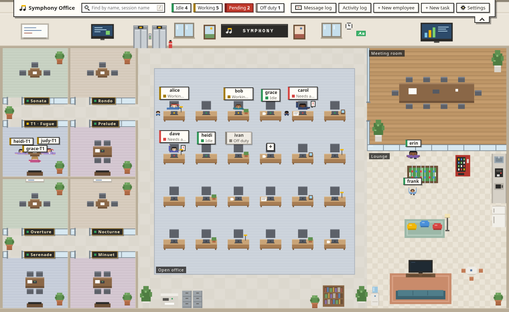
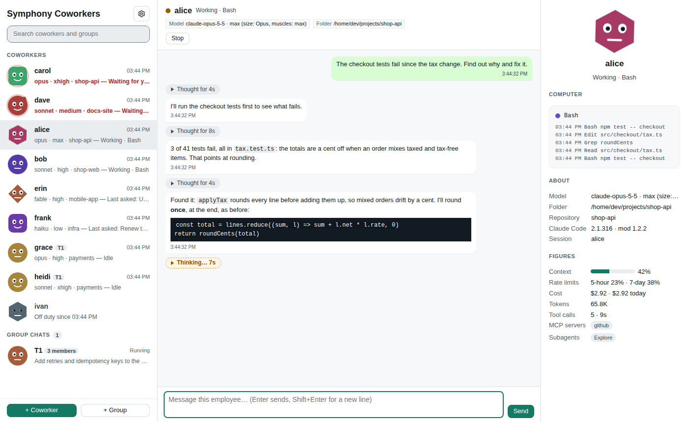
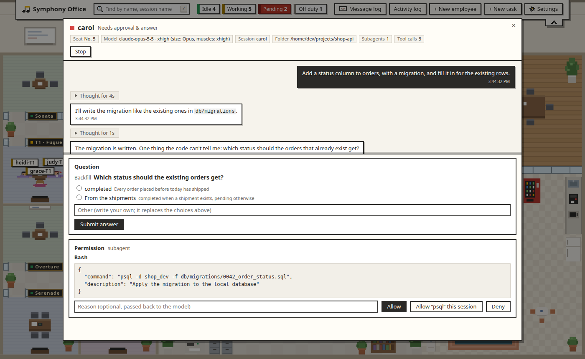

# symphony

[English](README.md) | [简体中文](README.zh-CN.md) | [繁體中文](README.zh-TW.md) | [日本語](README.ja.md) | [한국어](README.ko.md) | [Español](README.es.md) | [Français](README.fr.md) | **Deutsch** | [Português (Brasil)](README.pt-BR.md) | [Русский](README.ru.md)

symphony ist ein unabhängiges Projekt. Es ist nicht mit Anthropic verbunden und wird von Anthropic weder befürwortet noch gesponsert. Claude und Claude Code sind Marken von Anthropic, PBC.

Setz ein Team aus Claude-Code-Sitzungen in ein Pixel-Art-Büro: Du siehst auf einen Blick, wer gerade arbeitet und wer auf dich wartet, sprichst mit jedem in seinem eigenen Fenster und erledigst dort Berechtigungsanfragen und Fragen per AskUserQuestion mit einem Klick.



Die Seite gibt es in zwei Designs: das Pixelbüro oben und **Kollegen**, die Sitzungen als Kollegen in einer Chat-App, ihre Gesichter zeigen, was sie tun, das Gespräch in der Mitte, Profil und Rechner rechts. Wähle eines in den Einstellungen; die Bridge merkt es sich.



## Installation

Am schnellsten geht es so: Öffne Claude Code und füge ein

> Installiere mir https://github.com/feynmanzcys-bytes/symphony

Claude Code liest diese README und erledigt die Schritte aus dem nächsten Abschnitt; vor jeder Änderung, die über die Installation hinaus bleibt, fragt es dich. Wer von Hand installieren will, folgt denselben Schritten.

### Für KI-Agenten: die Installationsanleitung

Du liest das, weil ein Benutzer dich gebeten hat, symphony zu installieren. Führe die Schritte unten der Reihe nach in einer Shell aus und schließ mit dem Bericht aus Schritt 6 ab. Triff die Routineentscheidungen selbst (das Archiv, der Ordner im `PATH`), aber frag den Benutzer vor jeder Änderung, die über diese Installation hinaus bleibt: symphony bei jeder Anmeldung starten, eine rc-Datei der Shell bearbeiten oder den `PATH` des Benutzers ändern. Liste alle Entscheidungen im Bericht auf.

symphony besteht aus zwei Teilen und braucht beide:

1. **Das Programm `symphony`** (die Bridge): ein einzelnes Binary, ein lokaler Webserver unter `http://127.0.0.1:7788/`, der die Büroseite ausliefert und die Sitzungen ausführt. Es sollte im `PATH` des Benutzers liegen, unter dem Namen `symphony`, weil der Mod es mit `symphony -background` startet, wenn eine Sitzung keine laufende Bridge findet.
2. **Das Plugin `symphony-bridge`** (der Mod): ein Claude-Code-Plugin aus dem Marktplatz dieses Repositorys, auf Benutzerebene installiert. Es wird nur in Sitzungen aktiv, die mit `SYMPHONY_TOKEN` gestartet wurden, und tut in allen anderen nichts.

#### Schritt 1: den Rechner prüfen

```bash
uname -sm                 # Linux/macOS: bestimmt das Archiv unten (x86_64 → amd64; arm64/aarch64 → arm64)
claude --version          # braucht Claude Code 2.1.x (getestet mit 2.1.316)
git --version             # nur für gemeinsame Aufgaben; fehlt es, im Bericht vermerken, nicht abbrechen
symphony -version         # schon installiert? gibt "symphony v1.2.2 (darwin/arm64)" aus
curl -s -o /dev/null -w '%{http_code}\n' http://127.0.0.1:7788/api/state   # läuft eine Bridge? 401: symphony 1.x; 200: eine ältere; 000: keine
claude plugin list --json # Mod schon installiert? nach einem Eintrag mit "id": "symphony-bridge@symphony" suchen
brew --version            # Homebrew da (macOS, Linux)? dann kann Schritt 2 damit installieren
```

Unter Windows nimm PowerShell: `$env:PROCESSOR_ARCHITECTURE` ist `AMD64` oder `ARM64`, und `scoop --version` antwortet, wenn Scoop da ist.

Fehlt `claude`, hör auf und sag dem Benutzer, er soll zuerst Claude Code installieren. Sind Programm und Mod beide schon da, geh stattdessen zu „Aktualisieren“ unten. Ist nur eines von beiden da, führ die Schritte für das andere aus: Schritte 2 und 3 für das Programm (außer `symphony -version` gibt schon das neueste Release aus), Schritt 4 für den Mod, dann Schritt 5. Eine Bridge, die schon läuft, behält das Programm, mit dem sie gestartet wurde: Läuft eine, stoppst du sie vor Schritt 5.

#### Schritt 2: das Programm holen

**Mit Homebrew oder Scoop.** Dieses Repository ist auch ein Homebrew-Tap und ein Scoop-Bucket. Hat Schritt 1 Homebrew (macOS, Linux) oder Scoop (Windows) gefunden, kannst du statt des restlichen Schritts und Schritt 3 damit installieren: Es lädt das Archiv des neuesten Releases herunter, prüft es gegen die SHA-256-Prüfsumme in der Formula bzw. im Manifest (beim Erscheinen des Releases aus dessen `checksums.txt` geschrieben) und legt `symphony` in den `PATH`. Mach dann mit Schritt 4 weiter und schreib in den Bericht, womit du installiert hast.

```bash
brew tap feynmanzcys-bytes/symphony https://github.com/feynmanzcys-bytes/symphony
brew install symphony
symphony -version          # gibt Version und Plattform aus
```

```powershell
scoop bucket add symphony https://github.com/feynmanzcys-bytes/symphony
scoop install symphony
symphony -version
```

Sonst lad das Archiv für diesen Rechner und die `checksums.txt` des Releases in einen neuen, eigenen Ordner herunter und prüf das Archiv, bevor du irgendetwas installierst. Die Archive heißen `symphony_<os>_<arch>.tar.gz`, mit `<os>` `linux` oder `darwin` (macOS) und `<arch>` `amd64` oder `arm64`, und `symphony_windows_<arch>.zip`.

Unter Linux und macOS:

```bash
d=$(mktemp -d)   # ein neuer Ordner, den nur du lesen kannst
echo "$d"        # merk ihn dir: Schritt 3 installiert daraus
cd "$d"
curl -fsSLO https://github.com/feynmanzcys-bytes/symphony/releases/latest/download/symphony_<os>_<arch>.tar.gz
curl -fsSLO https://github.com/feynmanzcys-bytes/symphony/releases/latest/download/checksums.txt
if command -v sha256sum >/dev/null; then sha256sum -c --ignore-missing checksums.txt; else shasum -a 256 -c --ignore-missing checksums.txt; fi   # muss "symphony_<os>_<arch>.tar.gz: OK" ausgeben
tar xzf symphony_<os>_<arch>.tar.gz              # das Programm ist jetzt "$d/symphony"
```

Gibt die Prüfung nicht `OK` aus, hör auf: Installier das Programm nicht und sag es dem Benutzer. Mit `gh` statt curl lädst du nach `$d` herunter (gh legt den Ordner an, wenn es ihn noch nicht gibt) und führst dort dieselbe Prüfung und `tar` aus:

```bash
gh release download -R feynmanzcys-bytes/symphony -p 'symphony_<os>_<arch>.tar.gz' -p checksums.txt -D "$d"
```

Unter Windows, in PowerShell:

```powershell
$arch = if ($env:PROCESSOR_ARCHITECTURE -eq 'ARM64') { 'arm64' } else { 'amd64' }
$zip = "symphony_windows_$arch.zip"
$d = Join-Path $env:TEMP ("symphony-" + [guid]::NewGuid())   # ein neuer Ordner
New-Item -ItemType Directory -Path $d | Out-Null
$url = 'https://github.com/feynmanzcys-bytes/symphony/releases/latest/download'
Invoke-WebRequest -UseBasicParsing -Uri "$url/$zip" -OutFile (Join-Path $d $zip)
Invoke-WebRequest -UseBasicParsing -Uri "$url/checksums.txt" -OutFile (Join-Path $d 'checksums.txt')
$want = ((Select-String -SimpleMatch -Path (Join-Path $d 'checksums.txt') -Pattern $zip).Line -split '\s+')[0]
$got = (Get-FileHash -Algorithm SHA256 -LiteralPath (Join-Path $d $zip)).Hash
if ($got -ne $want) { throw "checksum mismatch: $zip" } else { 'checksum OK' }
```

Ist `gh` installiert und angemeldet (`gh auth status` klappt), prüf danach, wo das Archiv gebaut wurde: Jedes Archiv eines Releases trägt GitHubs Nachweis (Attestation), dass der Release-Workflow dieses Repositorys es gebaut hat. Außerhalb eines Terminals gibt `gh` nichts aus, wenn die Prüfung passt; richte dich also nach seinem Exit-Status:

```bash
gh attestation verify "$d/symphony_<os>_<arch>.tar.gz" --repo feynmanzcys-bytes/symphony && echo 'attestation OK'
```

```powershell
gh attestation verify (Join-Path $d $zip) --repo feynmanzcys-bytes/symphony
if ($LASTEXITCODE -eq 0) { 'attestation OK' }
```

Releases vor v1.2.0 haben keinen Nachweis (`no attestations found`); bei ihnen genügt die Prüfsumme. Bei jedem anderen Fehler hör auf, wie bei einer falschen Prüfsumme. Ohne `gh` oder ohne Anmeldung lass diese Prüfung aus und schreib das in den Bericht.

**Aus dem Quellcode** unter Linux oder macOS, wenn der Benutzer das lieber will (Go 1.27 oder neuer). Bau das Binary; `go run` reicht nicht, weil `-autostart` einen Build per `go run` ablehnt:

```bash
d=$(mktemp -d)
git clone https://github.com/feynmanzcys-bytes/symphony.git "$d/src"
cd "$d/src" && go build -o "$d/symphony" ./cmd/bridge   # das Programm ist jetzt "$d/symphony", wie aus einem Archiv
```

| System | x86-64 | ARM64 |
| --- | --- | --- |
| Linux | [`symphony_linux_amd64.tar.gz`](https://github.com/feynmanzcys-bytes/symphony/releases/latest/download/symphony_linux_amd64.tar.gz) | [`symphony_linux_arm64.tar.gz`](https://github.com/feynmanzcys-bytes/symphony/releases/latest/download/symphony_linux_arm64.tar.gz) |
| macOS | [`symphony_darwin_amd64.tar.gz`](https://github.com/feynmanzcys-bytes/symphony/releases/latest/download/symphony_darwin_amd64.tar.gz) (Intel) | [`symphony_darwin_arm64.tar.gz`](https://github.com/feynmanzcys-bytes/symphony/releases/latest/download/symphony_darwin_arm64.tar.gz) (Apple Silicon) |
| Windows | [`symphony_windows_amd64.zip`](https://github.com/feynmanzcys-bytes/symphony/releases/latest/download/symphony_windows_amd64.zip) | [`symphony_windows_arm64.zip`](https://github.com/feynmanzcys-bytes/symphony/releases/latest/download/symphony_windows_arm64.zip) |

Jedes Archiv enthält das Programm (`symphony`, unter Windows `symphony.exe`), `LICENSE` und `README.md`. Die `checksums.txt` im Release enthält die SHA-256-Prüfsumme jedes Archivs.

#### Schritt 3: in den PATH legen

Installier das Programm aus Schritt 2, `$d/symphony` (behält deine Shell keine Variablen zwischen Befehlen, schreib den Ordner aus, den Schritt 2 ausgegeben hat). Nimm einen Ordner, der schon im `PATH` des Benutzers liegt und ohne `sudo` beschreibbar ist: `~/.local/bin`, `/usr/local/bin` oder `/opt/homebrew/bin`, in dieser Reihenfolge.

```bash
install -m 755 "$d/symphony" ~/.local/bin/symphony
xattr -d com.apple.quarantine ~/.local/bin/symphony 2>/dev/null || true   # macOS: das Binary ist nicht signiert
symphony -version          # gibt "symphony v1.2.2 (linux/amd64)" aus: Version und Plattform
```

Liegt keiner dieser Ordner im `PATH`, frag den Benutzer, bevor du etwas änderst. Sagt er ja, leg `~/.local/bin` an, trag ihn in die rc-Datei der Shell ein (`~/.zshrc` oder `~/.bashrc`) und erwähn das im Bericht; sagt er nein, installier das Programm dort, wo er es sagt, und sag ihm, dass der Mod die Bridge nicht selbst starten kann, solange `symphony` nicht im `PATH` seiner Claude-Code-Sitzungen liegt (das Starten bei der Anmeldung in Schritt 5 funktioniert trotzdem).

Unter Windows entpackst du es in einen eigenen Ordner (`$d` und `$zip` stammen aus Schritt 2; in einer neuen Shell setz sie erneut):

```powershell
$dest = Join-Path $env:LOCALAPPDATA 'Programs\symphony'
Expand-Archive -LiteralPath (Join-Path $d $zip) -DestinationPath $dest -Force
& (Join-Path $dest 'symphony.exe') -version   # gibt "symphony v1.2.2 (windows/amd64)" aus
```

Diesen Ordner zum `Path` des Benutzers hinzuzufügen, ist eine bleibende Änderung: Frag den Benutzer vorher. Sagt er ja, führ die Zeile unten aus und öffne eine neue Shell; sagt er nein, nimm den vollständigen Pfad. Mit `Expand-Archive` entpackt trägt das Programm keine Download-Markierung, und SmartScreen lässt es laufen; eine mit „Alle extrahieren“ im Explorer entpackte Kopie kann beim Doppelklick blockiert werden: „Weitere Informationen“, dann „Trotzdem ausführen“.

```powershell
[Environment]::SetEnvironmentVariable('Path', [Environment]::GetEnvironmentVariable('Path', 'User') + ";$dest", 'User')
```

Findet deine eigene Shell `symphony` danach nicht (ihr `PATH` wurde gelesen, bevor du ihn geändert hast), nimm für die restlichen Schritte den absoluten Pfad.

#### Schritt 4: den Mod installieren

```bash
claude plugin install symphony-bridge --marketplace feynmanzcys-bytes/symphony
```

Das fügt das Repository als Plugin-Marktplatz `symphony` hinzu und installiert den Mod auf Benutzerebene, ohne Rückfragen. Stattdessen kann auch ein lokaler Klon des Repositorys der Marktplatz sein: `claude plugin install symphony-bridge --marketplace /absolute/path/to/symphony`. Die Sitzungen lesen den Mod dann aus diesem Ordner, und ein `git pull` dort aktualisiert ihn; leg einen solchen Klon also an einen bleibenden Ort, nicht in einen temporären Ordner.

Prüfen:

```bash
claude plugin list --json   # ein Eintrag hat "id": "symphony-bridge@symphony", "scope": "user", "enabled": true
```

- `"scope": "project"` oder `"local"`: Der Mod würde nur in einem Ordner geladen. Führ `claude plugin uninstall symphony-bridge@symphony` aus und installiere dann erneut mit `--scope user`.
- `"enabled": false`: `claude plugin enable symphony-bridge@symphony`.

#### Schritt 5: die Bridge starten

Hat Schritt 1 eine laufende Bridge gefunden, stopp sie zuerst wie unter „Aktualisieren“ unten: Sie führt das alte Programm aus, und das neue würde sie dort nur vorfinden und ihr den Vortritt lassen. Wird sie gestoppt, enden die Sitzungen, die sie gestartet hat; sag es also vorher dem Benutzer.

Frag den Benutzer, ob symphony bei jeder Anmeldung starten soll.

Wenn ja:

```bash
symphony -autostart on -open=false
```

Das startet die Bridge jetzt und bei jeder Anmeldung (ein systemd-Benutzerdienst unter Linux, ein launchd-Agent unter macOS, der Run-Schlüssel der Registry unter Windows) und gibt nach Datum und Uhrzeit aus:

```
symphony now starts when you log in (<where>); it's running at http://127.0.0.1:7788/?key=<key>
```

Wenn nein:

```bash
symphony -background -open=false
```

Das startet die Bridge losgelöst vom Terminal (nach einem Neustart des Rechners startet sie nicht wieder) und gibt auf der Standardfehlerausgabe nach Datum und Uhrzeit aus:

```
the symphony bridge runs in the background at http://127.0.0.1:7788/?key=<key>; its log: <data folder>/bridge.log
```

Läuft die Bridge dieser Version schon, gibt es stattdessen (auf dieselbe Weise) `a symphony bridge is already running at http://127.0.0.1:7788/?key=<key>` aus; das ist in Ordnung, starte keine zweite. `<key>` ist der Seitenschlüssel, der einen Browser im Büro anmeldet: Füg ihn nirgendwo anders ein. Antwortet das Programm mit `127.0.0.1:7788 is taken: another program, or a symphony bridge with another data folder, answers there`, sag dem Benutzer, was dort antwortet (auch eine ältere symphony-Bridge zählt dazu: Stopp sie wie unter „Aktualisieren“), und nimm nicht ohne Rückfrage eine andere Adresse.

Prüf die ganze Kette mit einer Anfrage, die den Seitenschlüssel aus dem Datenordner vorzeigt (über die Standardeingabe, damit der Schlüssel nicht auf einer Befehlszeile steht, die andere Benutzer sehen könnten):

```bash
printf 'X-Symphony-Key: %s\n' "$(cat "${SYMPHONY_DATA:-${XDG_CONFIG_HOME:-$HOME/.config}/symphony}/key")" | curl -s -H @- http://127.0.0.1:7788/api/launch/options      # Linux
printf 'X-Symphony-Key: %s\n' "$(cat "${SYMPHONY_DATA:-$HOME/Library/Application Support/symphony}/key")" | curl -s -H @- http://127.0.0.1:7788/api/launch/options   # macOS
```

```powershell
$data = if ($env:SYMPHONY_DATA) { $env:SYMPHONY_DATA } else { Join-Path $env:APPDATA 'symphony' }
(Invoke-WebRequest -UseBasicParsing -Headers @{ 'X-Symphony-Key' = (Get-Content (Join-Path $data 'key')) } -Uri http://127.0.0.1:7788/api/launch/options).Content
```

Der Datenordner ist `~/.config/symphony` unter Linux (`$XDG_CONFIG_HOME/symphony`, wenn das gesetzt ist), `~/Library/Application Support/symphony` unter macOS und `%AppData%\symphony` unter Windows, oder `SYMPHONY_DATA`, wenn das gesetzt ist.

Die Antwort enthält `"enabled":true` und `"mod":{"ok":true,"id":"symphony-bridge@symphony","version":"1.1.1"}`: Die Bridge läuft, sie hat `claude` gefunden, und der Mod ist dort installiert, wo die Sitzungen ihn laden. Bei `"enabled":false` sagt `mod.code`, was nicht stimmt, und `mod.fix` den Befehl, der es behebt: `mod_not_installed` oder `mod_project_scope` (zurück zu Schritt 4), `mod_disabled` (aktivieren), `mod_check_failed` (`claude plugin list --json` ist fehlgeschlagen, Claude Code ist also wohl zu alt). `"mod":null` heißt, dass die Bridge `claude` in ihrem `PATH` gar nicht gefunden hat (ihr Log sagt das): Leg es dorthin oder starte die Bridge mit `-claude /path/to/claude`. Eine Antwort mit `"code":"page_key"` heißt, dass die Anfrage keinen oder den falschen Schlüssel vorgezeigt hat: Prüf, ob `cat` die Schlüsseldatei gefunden hat (zum Datenordner siehe oben); wenn ja, wurde die laufende Bridge mit einem anderen Datenordner gestartet.

Das Log der Bridge ist `bridge.log` im Datenordner; bei der Anmeldung gestartet, loggt sie unter Linux nach `journalctl --user -u symphony` und unter macOS nach `~/Library/Logs/symphony.log`.

#### Schritt 6: dem Benutzer berichten

Öffne das Büro, indem du `symphony` ausführst: Läuft die Bridge, öffnet es das Büro im Standardbrowser, schon angemeldet, und beendet sich. Es gibt auch die Adresse mit `?key=` aus, die jeden Browser auf diesem Rechner anmeldet.

Sag dem Benutzer:

- Das Büro öffnet sich mit `symphony` (oder einem Doppelklick darauf); `http://127.0.0.1:7788/` allein reicht in einem Browser, der schon angemeldet ist. Ein Klick auf das „+“ an einem leeren Platz stellt den ersten Mitarbeiter ein: Ordner wählen, und dort startet eine Claude-Code-Sitzung, innerhalb der Bridge; ihr Fenster auf der Seite ist ihr Chat.
- Neue Mitarbeiter folgen den Claude-Code-Einstellungen des Benutzers (Modell, Denkaufwand, Berechtigungsmodus), sofern er im Dialog keine anderen wählt. `bypassPermissions` führt jeden Befehl und jede Änderung ohne Rückfrage aus, und was eine Sitzung liest, kann sie dann Befehle im Namen des Benutzers ausführen lassen; der Dialog warnt, wenn es gewählt ist.
- Jede Sitzung verbraucht das Claude-Abo oder API-Guthaben des Benutzers, wie jede Claude-Code-Sitzung; eine Aufgabe lässt 2 bis 5 Sitzungen zugleich laufen.
- Im Büro erscheinen nur Sitzungen, die über die Seite gestartet wurden (oder von Hand mit `SYMPHONY_TOKEN`, siehe „Sitzungen starten“ unten). Seine anderen Claude-Code-Sitzungen, auch die, die gerade installiert, werden nicht angezeigt.
- Was wo installiert wurde: der Pfad des Programms, der Mod auf Benutzerebene, die Bridge bei der Anmeldung oder im Hintergrund gestartet, jede Änderung am `PATH` oder an einer rc-Datei, die Entscheidungen, die du getroffen hast, und dass `git` fehlt, falls es fehlt.
- Wie man alles rückgängig macht: „Deinstallieren“ unten.

Regeln: Die Bridge lauscht nur auf diesem Rechner (sie lehnt jede Adresse ab, die nicht auf diesem Rechner liegt; behalt den Standardwert `127.0.0.1:7788`, außer der Benutzer wählt einen anderen Port), führ sie nicht mit `sudo` aus und starte keine zweite Bridge unter derselben Adresse oder mit demselben Datenordner (symphony lehnt das ab und nennt die laufende).

#### Aktualisieren

Lad das neue Release wie in Schritt 2 herunter. Die laufende Bridge behält das alte Programm, bis sie neu startet (und unter Windows lässt sich ein laufendes Programm nicht ersetzen); stopp sie also mit `symphony -stop`, ersetz das Programm wie in Schritt 3 und starte sie so wieder, wie sie vorher lief: `symphony -autostart on -open=false`, wenn sie bei der Anmeldung startet (das startet sie auch gleich), sonst `symphony -background -open=false`. Läuft die Bridge mit einem anderen `-addr` oder `-data` als den Standardwerten, gib jedem dieser Befehle dieselben mit: `-stop` stoppt nur die Bridge dieses Datenordners (unter `-addr` oder dort, wo die Bridge dieses Ordners läuft) und gibt `nothing to stop` aus, wenn keine antwortet. Wird die Bridge gestoppt, enden die Sitzungen, die sie gestartet hat; sag es also vorher dem Benutzer. (`-stop` kam mit v1.1.0; um eine Bridge v1.0.0 zu stoppen, beende ihren Prozess: `pkill -x symphony` unter Linux und macOS, `Stop-Process -Name symphony` unter Windows.)

Mit Homebrew oder Scoop installiert, ersetzt `brew update && brew upgrade symphony` (bzw. `scoop update; scoop update symphony`) den Download und Schritt 3, zwischen demselben `-stop` und dem neuen Start. Startet symphony bei der Anmeldung, nennt der Eintrag dafür Homebrews Verknüpfung zum Programm (`bin/symphony`), die das Upgrade auf die neue Version umstellt; `-autostart on` startet es dort also nur jetzt wieder.

Der Mod zieht mit `claude plugin update symphony-bridge@symphony` nach (mit einem Klon als Marktplatz stattdessen `git pull` dort).

Programm und Mod haben dieselbe Versionsnummer; [CHANGELOG.md](CHANGELOG.md) listet auf, was sich in jedem Release geändert hat.

#### Deinstallieren

```bash
symphony -stop                                    # stoppt die Bridge und ihre Sitzungen, egal wie sie gestartet wurde (gib ihre -addr und -data mit, wenn es nicht die Standardwerte sind)
symphony -autostart off                           # startet die Bridge nicht mehr bei der Anmeldung (sagt es, wenn das gar nicht eingerichtet war)
claude plugin uninstall symphony-bridge@symphony  # der Mod
claude plugin marketplace remove symphony         # der Marktplatz-Eintrag
rm ~/.local/bin/symphony                          # das Programm, wo auch immer Schritt 3 es abgelegt hat
```

Hat Schritt 3 `~/.local/bin` in eine rc-Datei der Shell eingetragen, entfern diese Zeile auch. Unter Windows, in PowerShell:

```powershell
symphony -stop                                               # stoppt die Bridge und ihre Sitzungen (gib ihre -addr und -data mit, wenn es nicht die Standardwerte sind)
symphony -autostart off                                      # startet die Bridge nicht mehr bei der Anmeldung
claude plugin uninstall symphony-bridge@symphony
claude plugin marketplace remove symphony
$dest = Join-Path $env:LOCALAPPDATA 'Programs\symphony'
Remove-Item -Recurse -Force $dest                            # das Programm
$p = ([Environment]::GetEnvironmentVariable('Path', 'User') -split ';' | Where-Object { $_ -and $_ -ne $dest }) -join ';'
[Environment]::SetEnvironmentVariable('Path', $p, 'User')    # der Path-Eintrag, den Schritt 3 hinzugefügt hat
```

Mit Homebrew installiert, führ statt der `rm`-Zeile `brew uninstall symphony` und `brew untap feynmanzcys-bytes/symphony` aus; mit Scoop statt der letzten vier PowerShell-Zeilen `scoop uninstall symphony` und `scoop bucket rm symphony`.

Der Datenordner (die Konten mit ihren Tokens, der Seitenschlüssel, der Nachrichtenverlauf, das Verbrauchsprotokoll, die Aufgaben und Dateien wie `lock`, `bridge.addr` oder ein beiseitegelegtes `*.corrupt-<time>`) bleibt; lösch ihn, um alles zu entfernen. Damit wird auch der Seitenschlüssel gelöscht: Der nächste Start legt einen neuen an, und jeder Browser muss sich neu anmelden. Unter Linux mit einem Snap- oder Flatpak-Browser liegt `open.html` im eigenen Ordner dieses Browsers (`~/snap/<snap>/common` oder `~/.var/app/<app id>`); lösch sie auch.

## Was es kann

- **Jede Sitzung als Chat**: Klick auf einen Mitarbeiter, und sein Fenster öffnet sich in der Mitte der Seite: oben, wer er ist, darunter die Sitzung als Chat: die Eingaben, das Nachdenken des Modells (eingeklappt, „Denkt nach…“ in Orange, solange es dauert), seine Antworten, während sie eintreffen, die Werkzeugaufrufe und Nachrichten anderer Sitzungen in Lila. Schreib unten, und es erreicht die Sitzung als deine Eingabe; der Stopp-Knopf unterbricht sie. Was das Modell schreibt, erscheint als Markdown (Überschriften, Listen, Tabellen, Code, Links). Zwischen zwei Teilen einer Antwort falten sich sein Nachdenken und seine Werkzeugaufrufe zu einer Zeile, „Denkt nach… 2 Min. 38 s“, solange es arbeitet, und „2 Min. 38 s nachgedacht“, wenn es fertig ist; ein Klick klappt die Schritte auf.
- **Freigaben im Browser**: Berechtigungsanfragen (Befehle ausführen, Dateien bearbeiten) und Fragen per AskUserQuestion steigen als Karten über das Eingabefeld im Fenster dieses Mitarbeiters (im Design „Kollegen“ stehen sie im Gespräch an der Stelle, an der sie aufkamen, und du kannst weiter tippen), und der rote Zähler in der Leiste oben bringt dich hin. „Für diese Sitzung erlauben“ auf der Karte einer Berechtigungsanfrage lässt dieselbe Art von Aufruf bis zum Ende der Sitzung ohne Nachfrage durch: jede Änderung, einen Befehl danach, wie er anfängt (`npm test`), oder ein Werkzeug. Auch das Formular eines MCP-Servers erscheint als Karte; du beantwortest es im Terminal der Sitzung, das die Karte direkt im Fenster öffnet. Läuft die Bridge nicht, kennt sie das Konto nicht oder ist ihr nicht zu trauen, fällt die Sitzung wie gewohnt aufs Terminal zurück und bleibt nie hängen.
- **Ein Pixel-Art-Büro**: Jede Sitzung ist ein Mitarbeiter mit festem Platz. Grün ist frei, Gelb bei der Arbeit, Rot wartet auf deine Freigabe oder Antwort, Grau hat Feierabend. Wer nichts zu tun hat, bleibt erst am Platz und hängt am Handy oder zockt, dann zieht er los: Fernsehen auf dem Lounge-Sofa, Kicker, Fangen, ein Plausch am runden Tisch, Kaffee, ein Blick aus dem Fenster; nach einer Weile folgt ein Nickerchen, oft versteckt im Meetingraum. Die Größe der Figur richtet sich nach dem Modell, ihre Muskeln nach dem Denkaufwand. Das Büro ist ein Stockwerk im Gebäude einer großen Firma und füllt das Fenster: das Großraumbüro in der Mitte, links kleine Besprechungsräume für 3 bis 5 Personen mit Türschild, rechts der Meetingraum und die Lounge, und Aufzüge zum Kommen und Gehen. In den Einstellungen stellst du auch die Pixelgröße ein, in vier Stufen: dasselbe Büro, mit jeder Stufe in feineren Pixeln und mit mehr Details gezeichnet.
- **Jeden finden und zurückrufen**: Klick auf einen freien Mitarbeiter, und er geht an seinen Platz zurück (und bleibt dort bis zu seiner nächsten Aufgabe); das Suchfeld in der Leiste oben findet Mitarbeiter nach Name, Sitzungsname oder Ordner (mit `/` springst du hinein), und ein Klick auf einen Zähler daneben (frei, arbeitet, offen, Feierabend) hebt alle in diesem Zustand hervor. Mit dem Griff unter der Leiste schiebst du sie nach oben weg und wieder herunter.
- **Nachrichten zwischen Sitzungen**: Wenn sich Sitzungen gegenseitig Nachrichten schicken (SendMessage), fliegt ein Briefumschlag durchs Büro, und der Nachrichtenverlauf hält sie fest.
- **Sitzungen über die Seite starten, ohne dass sich etwas öffnet**: Klick auf das „+“ an einem leeren Platz, um einen neuen Mitarbeiter einzustellen, und wähl den Ordner. Modell, Denkaufwand und Berechtigungsmodus folgen deinen Claude-Code-Einstellungen („Standard“), sofern du keine anderen wählst; wählst du `bypassPermissions`, zeigt eine rote Warnung, was das erlaubt. Setz den Haken bei „Ihr sagen, wer sonst im Büro ist“, und der Systemprompt der Sitzung nennt einmal pro Unterhaltung die anderen, die online sind, damit sie sie mit SendMessage erreichen kann. Klick bei einem Mitarbeiter, der Feierabend hat, auf „An die Arbeit“, und er kehrt an denselben Platz zurück, mit den Einstellungen, mit denen er zuletzt gearbeitet hat. Die Sitzung läuft auf einem eigenen Terminal innerhalb der Bridge: kein Fenster öffnet sich, nichts nimmt dir den Fokus; „Terminal öffnen“ im Fenster des Mitarbeiters zeigt dieses Terminal, wenn du es willst, und es zu schließen ändert nichts.
- **Teams in den Besprechungsräumen**: Klick auf einen freien kleinen Besprechungsraum, schreib eine Aufgabe auf und wähl 2 bis 5 Mitglieder: Mitarbeiter, die jeweils eine zweite Sitzung nur für die Aufgabe bekommen, oder Berater, die nur für dieses eine Mal dazukommen. Standardmäßig leitet das erste Mitglied und verteilt die Teile per SendMessage; jedes Mitglied arbeitet in seinem eigenen Git-Worktree auf seinem eigenen Branch, sodass niemand jemandem in die Dateien pfuscht. Bis die Aufgabe endet, sitzen die Mitglieder im Besprechungsraum.
- **Einstellungen und ein Problem melden**: Der Knopf Einstellungen (ein Zahnrad in Kollegen) sammelt, was du ab und zu änderst: die Sprache, das Design, hell oder dunkel, die Pixelgröße, Bewegung anhalten, die Schritte aufgeklappt. Was schiefgeht (ein Start oder eine Aufgabe, die fehlschlug, ein API-Fehler einer Sitzung, ein Fehler in der Seite), landet von selbst im Fehlerprotokoll; willst du ein Problem melden, klick dort auf „Ich möchte ein Problem melden“ und schick uns die Datei, die du bekommst, per E-Mail oder als Anhang an ein Issue auf GitHub. Die Datei enthält die Fehler, die Versionen und die letzten Protokollzeilen der Bridge, aber keinen Schlüssel, kein Token und keine Unterhaltung.
- **10 Sprachen**: English, 简体中文, 繁體中文, 日本語, 한국어, Español, Français, Deutsch, Português (Brasil) und Русский. Die Seite richtet sich nach der Sprache deines Browsers und hat in den Einstellungen eine Sprachauswahl; die Meldungen der Bridge folgen `-lang`, sonst deiner Systemsprache (`LANG` und Ähnliches), sonst Englisch; die des Mods folgen `SYMPHONY_LANG` (bei einer über die Seite gestarteten Sitzung die Sprache der Seite), sonst deiner Systemsprache, sonst Englisch.
- **Nur lokal**: Die Bridge ist ein einzelnes Go-Programm (nur Standardbibliothek; die End-to-End-Tests nutzen zusätzlich chromedp), das nur auf diesem Rechner lauscht, die Seiten sind reines JavaScript, und nichts hängt von einem Drittanbieterdienst ab.



## Voraussetzungen

- Claude Code 2.1.316 (mit dieser Version getestet). Der Mod nutzt die Function Hooks von Claude Code, die noch eine Early-Access-API sind; führe also nach einem Update von Claude Code die End-to-End-Tests aus.
- Die Bridge gibt es als fertiges Programm für Linux, macOS und Windows; Go 1.27 oder neuer brauchst du nur, um sie aus dem Quellcode zu bauen.
- `git`, nur für gemeinsame Aufgaben: Jedes Mitglied einer Aufgabe arbeitet in einem Git-Worktree.
- Sonst nichts: Über die Seite gestartete Sitzungen laufen auf jeder Plattform innerhalb der Bridge.

## Die Bridge betreiben

`symphony` startet die Bridge und öffnet das Büro in deinem Browser, schon angemeldet (`-open=false` schaltet das ab). Der Browser bekommt den Seitenschlüssel der Bridge als Cookie über `open.html`, eine Datei im Datenordner, die nur du lesen kannst, sodass der Schlüssel nie auf einer Befehlszeile auftaucht; unter Linux landet diese Datei stattdessen im eigenen Ordner des Browsers, wenn dein Browser ein Snap oder Flatpak ist, weil solche Browser den Datenordner nicht lesen können. Öffnest du <http://127.0.0.1:7788/> in einem Browser, der nicht angemeldet ist, zeigt eine Seite, wie du hineinkommst: `symphony` noch einmal ausführen oder die Adresse mit `?key=` öffnen, die die Bridge in ihr Log geschrieben hat. <http://127.0.0.1:7788/approve> ist eine einfachere Seite nur für Freigaben. Startest du `symphony` erneut, während es läuft, öffnet sich nur das Büro. Unter Windows läuft `symphony.exe` per Doppelklick in einem eigenen Fenster, und wenn du das Fenster schließt, stoppt die Bridge.

| Flag | Standard | Wozu |
| --- | --- | --- |
| `-addr` | `127.0.0.1:7788` | Adresse, auf der die Bridge lauscht. Ihr Host muss `127.0.0.1`, `localhost` oder `::1` sein (wie in `[::1]:7788`); jeden anderen lehnt die Bridge ab |
| `-data` | `$SYMPHONY_DATA`, sonst `symphony` in deinem Konfigurationsordner | Der Datenordner: die Konten mit ihren Tokens (`accounts.json`), der Seitenschlüssel (`key`) und `open.html`, der Nachrichtenverlauf (`messages.json`), das Verbrauchsprotokoll (`ledger.json`), die Aufgaben (`tasks.json`), das Fehlerprotokoll (`errors.json`), das Log von `-background` (`bridge.log`), `lock` und `bridge.addr` (welche Bridge ihn benutzt, und wo) sowie ein beschädigter Nachrichtenverlauf oder ein beschädigtes Verbrauchsprotokoll, beiseitegelegt als `*.corrupt-<time>` |
| `-claude` | `claude` | Die ausführbare Datei von claude |
| `-lang` | deine Systemsprache, sonst `en` | Sprache der Bridge-Meldungen (`SYMPHONY_LANG`, `LC_ALL`, `LC_MESSAGES` oder `LANG` legen den Standard fest) |
| `-mod` | leer | Für die Entwicklung: gibt Sitzungen per `--plugin-dir` den Mod aus diesem Ordner mit, statt der installierten Kopie |
| `-web` | leer | Für die Entwicklung: liefert die Seiten aus diesem Ordner aus, sodass Änderungen nach dem Neuladen sichtbar sind |
| `-open` | `true` | Öffnet das Büro im Browser, sobald die Bridge läuft; läuft unter `-addr` schon die Bridge dieses Datenordners, wird nur ihr Büro geöffnet |
| `-autostart` | — | `on`: Startet die Bridge bei jeder Anmeldung, mit den übrigen angegebenen Optionen, und startet sie gleich; `off`: macht das rückgängig |
| `-background` | — | Startet die Bridge im Hintergrund, losgelöst vom Terminal und mit Log in `bridge.log` im Datenordner, und kehrt zurück, sobald sie antwortet |
| `-stop` | — | Stoppt die Bridge dieses Datenordners (unter `-addr`, sonst dort, wo sie läuft), egal wie sie gestartet wurde (ihre Sitzungen enden), und kehrt zurück, sobald sie weg ist; den Schlüssel zeigt es nur einer Bridge vor, die beweist, dass sie ihn hat |
| `-version` | — | Gibt die Version aus und beendet sich |

Antwortet unter `-addr` etwas anderes (ein anderes Programm, eine Bridge mit einem anderen Datenordner oder eine ältere symphony-Bridge), sagt symphony das und hört auf; den Seitenschlüssel zeigt es nur einer Bridge vor, die beweist, dass sie ihn hat. Ein Datenordner gehört immer nur einer Bridge: Startet symphony mit einem Datenordner, dessen Bridge schon unter einer anderen Adresse läuft, sagt es, wo sie läuft, öffnet ihr Büro und hört auf (gib einer zweiten Bridge ihren eigenen `-data`).

**Beim Anmelden starten**: `symphony -autostart on` lässt die Bridge bei jeder Anmeldung starten, mit den gleich mitgegebenen Optionen (etwa `-addr`), und startet sie sofort; `symphony -autostart off` macht das rückgängig. Unter Linux ist das ein systemd-Benutzerdienst (`journalctl --user -u symphony` zeigt sein Log), unter macOS ein launchd-Agent (Log in `~/Library/Logs/symphony.log`), unter Windows ein Wert unter dem Run-Schlüssel der Registry (die Bridge läuft in einem Konsolenfenster; schließt du es, ist sie bis zur nächsten Anmeldung aus). `symphony -stop` stoppt eine Bridge, egal wie sie gestartet wurde, bis sie wieder gestartet wird (eine bei der Anmeldung gestartete also bei der nächsten Anmeldung). Dafür braucht es das Programm symphony selbst, nicht `go run`. Die bei der Anmeldung gestartete Bridge bekommt von deiner Shell nichts außer `PATH`; deshalb speichert `-autostart on` auch die Variablen, die ihre Sitzungen brauchen könnten, so wie deine Shell sie beim Aufruf hat: `CLAUDE_CONFIG_DIR`, den Proxy (`HTTP_PROXY`, `HTTPS_PROXY`, `NO_PROXY`, `ALL_PROXY`, jeweils groß oder klein geschrieben), `NODE_EXTRA_CA_CERTS`, `SSL_CERT_FILE` und `SSL_CERT_DIR`, sonst nichts (keine API-Schlüssel), in `autostart-env.json` im Datenordner, die nur du lesen kannst; änderst du sie, führ den Befehl erneut aus. Eine Bridge, die schon beim Start scheitert (ihr Datenordner von einer anderen Bridge belegt, eine beschädigte `accounts.json`, etwas anderes unter ihrer Adresse), wird ein paarmal neu gestartet und dann in Ruhe gelassen: unter Linux 5 Versuche in einer Minute (`systemctl --user status symphony` sagt, warum), unter macOS ein Versuch pro Minute (das Log sagt, warum); behebe die Ursache und führ `symphony -autostart on` erneut aus, oder melde dich einfach neu an.

**Aus dem Quellcode**, mit Go 1.27 oder neuer: `git clone https://github.com/feynmanzcys-bytes/symphony.git && cd symphony && go run ./cmd/bridge`.

## Sitzungen starten

**Über die Seite**: Klick auf das „+“ an einem leeren Platz, gib einen Namen ein und wähle Ordner und Optionen. Die Bridge führt `claude` auf einem eigenen Terminal innerhalb der Bridge aus: Es öffnet sich kein Fenster. Das Fenster des Mitarbeiters zeigt die Sitzung als Chat, und sein Knopf „Terminal öffnen“ öffnet ein Terminalfenster, das mit der Sitzung verbunden ist (`symphony attach <id>` tut dasselbe aus jedem Terminal, mit `-addr` und `-data`, wenn die Bridge nicht die Standardwerte nutzt; lässt sich kein Terminalfenster öffnen, zeigt die Seite den genauen Befehl. `Ctrl-]` oder das Schließen des Fensters trennt die Verbindung, und die Sitzung läuft weiter). Die Sitzungen sind Kindprozesse der Bridge: Wird die Bridge beendet, enden sie. Endet eine Sitzung (über die Seite gestoppt, mit der Bridge oder von selbst), endet mit ihr, was sie im Hintergrund laufen ließ (etwa ein Befehl, den ein Werkzeug mit `&` in den Hintergrund geschickt hat): Unter Windows beendet das Job-Objekt der Sitzung alles; unter Linux und macOS findet die Bridge diese Prozesse anhand der Start-ID in ihrer Umgebung, die sie unter macOS bei Apples eigenen Programmen nicht lesen kann (`/bin/sleep`, `bash`, `zsh`, `perl`: Das System verbirgt deren Umgebung vor `ps -E`); ein zurückgelassener `node`- oder Homebrew-Server endet also, ein schlichtes `sleep` oder Shell-Skript nicht.

**Aus einem Terminal**: Leg ein Konto an, um ein Token zu bekommen, wobei du den Seitenschlüssel vorzeigst, und starte dann `claude` mit dem Token:

```bash
printf 'X-Symphony-Key: %s\n' "$(cat ~/.config/symphony/key)" | curl -H @- -X POST 127.0.0.1:7788/api/accounts -d '{"name":"frontend-alice"}'   # die Antwort enthält das Token
SYMPHONY_TOKEN=<token> claude --name frontend-alice --permission-mode manual
```

Die Schlüsseldatei ist `~/.config/symphony/key` unter Linux, `~/Library/Application Support/symphony/key` unter macOS und `%AppData%\symphony\key` unter Windows, oder `key` in dem Ordner, den `-data` / `SYMPHONY_DATA` angibt.

Empfohlen ist der Berechtigungsmodus `manual`: Im Modus `auto` wird bei den meisten Aktionen niemand gefragt, also kommen kaum Freigaben auf der Seite an. Läuft die Bridge nicht unter der Standardadresse, setz zusätzlich `SYMPHONY_BRIDGE`: `http://127.0.0.1:<port>`, `http://localhost:<port>` oder `http://[::1]:<port>` auf diesem Rechner, oder eine `https://`-Adresse; bei allem anderen nimmt der Mod nie Kontakt zur Bridge auf. `SYMPHONY_LANG` legt die Sprache der Mod-Meldungen fest (sonst deine Systemsprache, sonst Englisch).

Bevor die Sitzung ihr Token irgendwohin schickt, prüft der Mod, ob die Bridge unter dieser Adresse das Token kennt, ohne es zu senden (`POST /api/hello`). Kann die Bridge die Sitzung nicht übernehmen, zeigt die Sitzung eine dieser Meldungen, ihre Freigaben bleiben im Terminal, und sie bleibt nie hängen:

| Meldung | Was sie bedeutet |
| --- | --- |
| `Bridge (...) nicht erreichbar` / `can't reach the bridge` | Unter der Adresse der Bridge antwortet nichts, und die Bridge zu starten hat nicht geholfen (oder die Adresse liegt nicht auf diesem Rechner). |
| `Bridge (...) konnte nicht gestartet werden: <reason>` / `couldn't start the bridge ...: <reason>` | Nichts hat geantwortet, und `symphony -background` ist aus dem angezeigten Grund gescheitert (etwa weil die Bridge dieses Datenordners unter einer anderen Adresse läuft: setz `SYMPHONY_BRIDGE` auf diese Adresse). |
| `Die Bridge kennt dieses SYMPHONY_TOKEN nicht` / `the bridge doesn't know this SYMPHONY_TOKEN` | Die Bridge hat kein Konto mit diesem Token: Es wurde gelöscht, oder die Bridge nutzt einen anderen Datenordner. |
| `ist keine Bridge von symphony, der diese Sitzung vertrauen kann` / `isn't a symphony bridge this session can trust` | Unter der Adresse antwortet etwas, kann aber nicht beweisen, dass es das Token kennt: ein anderes Programm oder ein symphony, das älter ist als der Mod (aktualisier es). Das Token wird nicht gesendet. |
| `SYMPHONY_BRIDGE (...) muss auf diesem Rechner liegen oder https verwenden` / `SYMPHONY_BRIDGE ... must be on this machine or use https` | Die Adresse gehört nicht zu denen, die der Mod annimmt; die Bridge wird nie kontaktiert. |
| `Dieses Konto hat bereits eine Sitzung online` / `this account already has a session online` | Ein Konto dient immer nur einer Sitzung zugleich; leg für diese Sitzung ein weiteres Konto an. |
| `wartet auf deine Antwort auf der Webseite des Büros` / `waiting for your answer in the office page` | Eine Berechtigungsanfrage oder Frage wartet auf der Seite des Büros, nicht im Terminal; beantworte sie dort oder drück Esc, um sie abzubrechen. Erscheint einmal pro Sitzung. |

Antwortet unter der Adresse der Bridge auf diesem Rechner nichts, startet die Sitzung die Bridge selbst mit `symphony -background -open=false -addr <that address>` (wenn `symphony` in deinem PATH liegt) und sagt das (`Bridge (...) im Hintergrund gestartet` / `started the bridge ... in the background`); die Bridge läuft nach dem Ende der Sitzung weiter. Setz `SYMPHONY_DATA`, wenn deine Konten nicht im Standard-Datenordner liegen. Läuft die Bridge dieses Datenordners schon unter einer anderen Adresse, sagt die Sitzung das und fällt aufs Terminal zurück: setz `SYMPHONY_BRIDGE` auf diese Adresse.

## Gemeinsame Aufgaben

In einem kleinen Besprechungsraum arbeitet ein Team aus 2 bis 5 Sitzungen gemeinsam an einer Aufgabe. Aufgaben brauchen `git`.

**Eine Aufgabe starten**: Klick auf einen freien kleinen Besprechungsraum und beschreib, was zu tun ist. Hak die Mitglieder in der gewünschten Reihenfolge an (2 bis zu den Plätzen im Raum), wähl für jedes Mitglied Modell und Denkaufwand und für das ganze Team den Berechtigungsmodus (standardmäßig die eigenen Einstellungen von Claude Code; ein Mitarbeiter, der schon gearbeitet hat, startet mit seinem letzten Modell und Denkaufwand; wählst du `bypassPermissions`, erscheint die Warnung), dann klick auf „Aufgabe starten“. Es gibt zwei Arten von Mitgliedern:

- **Mitarbeiter**: Jeder bekommt eine zweite Sitzung nur für die Aufgabe, die im Ordner des Mitarbeiters arbeitet; seine eigene Sitzung am Platz bleibt, wie sie ist. Ein Mitarbeiter ist immer nur in einer Aufgabe, und wer noch nie gearbeitet hat, hat noch keinen Ordner: Klick vorher einmal auf „An die Arbeit“.
- **Berater**: Teilnehmer nur für diese eine Aufgabe, angelegt mit den üblichen Feldern (Name, Ordner, Modell, Denkaufwand). Sie haben keinen Platz, kommen mit dem Aufzug und sind wieder weg, sobald die Aufgabe endet.

**Die Leitung**: Standardmäßig leitet das erste Mitglied: Es teilt die Aufgabe auf, verteilt die Teile per SendMessage, prüft die Arbeit, führt die Branches der anderen in seinen eigenen zusammen und sagt dir, was erledigt wurde. Nimm den Haken bei der Leitung weg, dann bekommt jeder die ganze Aufgabe, und die Mitglieder teilen sie unter sich auf. So oder so gibt die Bridge jedem Mitglied seine erste Eingabe: wer im Team ist (die Mitglieder erreichen einander per SendMessage über ihren Namen), den Branch jedes Einzelnen und die Regeln.

**Git**: Jedes Mitglied arbeitet in seinem eigenen Git-Worktree auf seinem eigenen Branch `symphony/<task id>/<member>` (etwa `symphony/T1/bob`; ein zweites Mitglied mit demselben Namen bekommt `-2`) seines Ordners, sodass niemand jemandem in die Dateien pfuscht und dein eigener Checkout unverändert bleibt. Die Worktrees liegen im Ordner unter `.symphony/worktrees/`, vor Git versteckt durch `.git/info/exclude` (deine `.gitignore` bleibt unberührt). Wenn die Aufgabe endet, wird alles, was ein Mitglied noch nicht committet hat, auf seinen Branch committet, die Dateien, die Git in seinem Worktree ignoriert (Build-Ausgaben, `.env`, `node_modules` und Ähnliches), werden im Ordner nach `.symphony/kept/<member>-<task id>/` verschoben, und die Worktrees werden entfernt. symphony löscht `.symphony/kept/` nie; lösch es, wenn du das, was darin liegt, nicht mehr brauchst.

- In deinen eigenen Repositorys wird nichts zusammengeführt: Die Branches bleiben, damit du sie zusammenführst; gibt es eine Leitung, sammelt deren Branch die Arbeit aller.
- Ein Ordner, der kein Git-Repository ist, wird für die Aufgabe zu einem und bleibt es: `git init`, dann ein Commit mit allem, was darin liegt, außer Dateien, die oft Geheimnisse enthalten oder sperrig sind (`.env`, `.env.*`, `*.pem`, `*.key`, `*.p12`, `*.pfx`, `id_rsa*`, `id_ecdsa*`, `id_ed25519*`, `.npmrc`, `.netrc`, `.pypirc`, `node_modules/`, `.DS_Store`), die in `.git/info/exclude` eingetragen werden. Diese Dateien bleiben im Ordner, sind aber nicht in den Worktrees der Mitglieder; ein Mitglied, das sie braucht, installiert oder erstellt sich also eigene. Wenn die Aufgabe endet, werden die Branches der Mitglieder in den Branch des Ordners zusammengeführt, sodass der Ordner das Ergebnis enthält; das `.git` und die Branches bleiben erhalten. Scheitert der Start der Aufgabe, ist der Ordner wieder ein gewöhnlicher Ordner.
- Schlägt ein Merge fehl, wird er rückgängig gemacht und die Basis bleibt, wie sie war; die Branches bleiben mit der Arbeit darauf erhalten, und das Aufgabenfenster zeigt, welcher Branch einen Konflikt hat. Was beim Beenden einer Aufgabe sonst fehlschlägt, bleibt, wie es ist, und das Aufgabenfenster zeigt, was fehlgeschlagen ist.

**Im Büro**: Die Mitglieder sitzen die ganze Aufgabe über am Tisch des Raums, und am Platz eines Mitarbeiters steht so lange ein leerer Stuhl. Das Türschild des Raums zeigt die ID der Aufgabe; sein Licht, grün, solange der Raum frei ist, wird gelb, während die Aufgabe läuft, und rot, während ein Mitglied auf deine Freigabe oder Antwort wartet. Ein Klick auf den Raum öffnet das Aufgabenfenster: die Aufgabe, die Mitglieder mit ihren Ordnern und Branches, den Team-Chat und „Aufgabe beenden“. Auch ein Klick auf die Figur eines Mitglieds im Raum öffnet das Aufgabenfenster; ein Klick auf ein Mitglied darin öffnet sein Chatfenster direkt daneben, genau wie das Fenster eines Mitarbeiters, immer nur für ein Mitglied (ein Klick auf ein anderes Mitglied wechselt). Der rote Zähler in der Leiste oben und das Suchfeld öffnen ein Mitglied einer Aufgabe genauso.

**Der Team-Chat**: Das Aufgabenfenster listet die Nachrichten, die sich die Mitglieder gegenseitig schicken, jede mit der Pixelfigur und dem Namen des Absenders, und der Text beginnt mit `@` und dem Empfänger. Darunter ist ein Feld, in dem du selbst ans Team schreibst: `@bob-T1 …` geht nur an dieses Mitglied (mehrere `@names` gehen an alle davon; tippst du `@`, öffnet sich eine Liste der Mitglieder, aus der du mit den Pfeiltasten, Enter oder einem Klick wählst), und eine Nachricht ohne `@` geht an alle in der Aufgabe. Enter sendet, Umschalt+Enter beginnt eine neue Zeile.

Eine Aufgabe endet, wenn du sie im Aufgabenfenster beendest oder wenn ihre letzte Sitzung endet: Die Bridge stoppt die Sitzungen der Mitglieder, kümmert sich wie oben beschrieben um die Git-Seite und löscht die Berater. Eine Aufgabe, die noch läuft, wenn die Bridge stoppt, wird beim nächsten Start der Bridge auf dieselbe Weise beendet.

## Konten und Plätze

- Eine Identität in symphony besteht aus einem Namen, einem Token und einem festen Platz. Ein Konto kann immer nur von einer Sitzung zugleich genutzt werden, dazu von einer in der Aufgabe, an der es teilnimmt; jede weitere Sitzung wird abgewiesen, und ihre Freigaben bleiben im Terminal.
- Claude-Logins werden hier nicht verwaltet: Alle Sitzungen können sich ein Claude-Login teilen.
- Die Daten liegen in `~/.config/symphony` (Linux), `~/Library/Application Support/symphony` (macOS) oder `%AppData%\symphony` (Windows), oder dort, wo `-data` / `SYMPHONY_DATA` es angibt. `accounts.json` enthält die Tokens und `key` den Seitenschlüssel; beide sind nur für den Besitzer lesbar (0600); unter Windows schützen sie die Zugriffsrechte des Benutzerordners.

## Kosten und Berechtigungen

- Jede Sitzung, die symphony startet, ist eine Claude-Code-Sitzung und verbraucht dein Claude-Abo oder API-Guthaben wie jede andere. Opus mit maximalem Denkaufwand verbraucht es schnell, und eine Aufgabe lässt 2 bis 5 Sitzungen zugleich laufen.
- `bypassPermissions` führt jeden Befehl und jede Änderung ohne Rückfrage aus. Inhalte, die eine Sitzung liest (eine Datei, eine Webseite, die Ausgabe eines Tools), können sie dann Befehle in deinem Namen ausführen lassen. Der Start- und der Aufgabendialog zeigen eine rote Warnung, wenn du es wählst; standardmäßig folgen sie deinen Claude-Code-Einstellungen.
- Bei Sitzungen, die über die Seite gestartet werden, beantwortet die Bridge die Frage „trust this folder“ von Claude Code für dich; starte Sitzungen also nur in Ordnern, denen du vertraust.
- „Für diese Sitzung erlauben“ gilt bis zum Ende der Sitzung und lässt nur durch, wonach Claude Code gefragt hätte, im Rahmen deiner Berechtigungseinstellungen: nie einen Befehl, der mit einem anderen verkettet ist (`;`, `&&`, `|`, eine Umleitung), und nie an einer Deny-Regel oder den Einstellungen deiner Organisation vorbei. Eine Befehlsregel deckt jeden Befehl ab, der genauso anfängt (`npm test` deckt auch `npm test -- --watch` ab).

## Sicherheit

Die Seite kann Sitzungen starten, also Befehle auf diesem Rechner ausführen; deshalb achtet die Bridge darauf, wer sie erreicht:

- **Der Seitenschlüssel**: Das Büro und seine API brauchen den Seitenschlüssel, ein Cookie, das dein Browser über den Link bekommt, den `symphony` öffnet. Der Schlüssel ist die Datei `key` im Datenordner, die nur du lesen kannst; Programme zeigen ihn im Header `X-Symphony-Key` vor.
- **Nur dieser Rechner**: Die Bridge lauscht nur auf diesem Rechner und nimmt nur Verbindungen von ihm an. Sie lehnt Anfragen ab, die an einen anderen Host gerichtet sind (DNS-Rebinding), ebenso schreibende Anfragen, die andere Websites über deinen Browser schicken, und ihre API beantwortet keine Anfrage, die laut deinem Browser von einer anderen Website oder einem anderen Port kommt, nicht einmal einen Link. Andere Websites können ihre Seiten nicht einbetten. Die Seiten laden nur die eigenen Dateien der Bridge (eine Content Security Policy).
- **Der Mod prüft die Bridge**, bevor er sein Token sendet, und das Programm `symphony`, bevor es den Seitenschlüssel vorzeigt, sodass etwas anderes, das unter der Adresse der Bridge lauscht, keins von beiden bekommt.
- **Wovor es nicht schützt**: Programme, die unter deinem eigenen Benutzer laufen, können den Seitenschlüssel und die Tokens im Datenordner lesen, wie jede deiner Dateien. Und Browser schicken die Cookies einer Website an jeden ihrer Ports: Ein Server, den ein anderer Benutzer dieses Rechners auf `127.0.0.1` betreibt, bekommt das Cookie mit dem Seitenschlüssel, wenn dein Browser ihn öffnet oder wenn er den Port der Bridge übernimmt, während die Bridge gestoppt ist und das Büro noch in einem Tab offen ist. Auf einem Rechner, den du mit anderen teilst, schließ das Büro, bevor du die Bridge stoppst, und könnte der Schlüssel durchgesickert sein, lösch die Datei `key` im Datenordner (der nächste Start legt einen neuen an).
- Die Programme sind nicht signiert. macOS lehnt eine mit dem Browser heruntergeladene Kopie womöglich ab, weil es den Entwickler nicht überprüfen kann: Klick unter Systemeinstellungen → Datenschutz & Sicherheit auf „Dennoch öffnen“ oder führe einmal `xattr -d com.apple.quarantine symphony` aus. Unter Windows kann SmartScreen eine mit „Alle extrahieren“ im Explorer entpackte Kopie beim Doppelklick blockieren: Klick auf „Weitere Informationen“ und dann auf „Trotzdem ausführen“ (`Expand-Archive`, das die Installation nutzt, hinterlässt keine Download-Markierung). Die `checksums.txt` im Release enthält die SHA-256-Prüfsumme jedes Archivs, und jedes Archiv trägt GitHubs Nachweis (Attestation), wo es gebaut wurde; Schritt 2 der Installation prüft beides.

Wie du eine Sicherheitslücke meldest, steht in [SECURITY.md](SECURITY.md).

## Plattformen

| System | Über die Seite gestartete Sitzungen | „Terminal öffnen“ | Getestet |
| --- | --- | --- | --- |
| Linux | Ein Pseudoterminal innerhalb der Bridge | Ein grafisches Terminal (x-terminal-emulator, gnome-terminal, konsole, xterm) mit `symphony attach` | Vollständige End-to-End-Tests |
| macOS | Ein Pseudoterminal innerhalb der Bridge | Terminal.app mit `symphony attach` | Vollständige End-to-End-Tests |
| Windows | Eine Pseudokonsole (ConPTY) innerhalb der Bridge | Ein neues Konsolenfenster mit `symphony attach` | Unit-Tests und die End-to-End-Tests ohne tmux; echte Sitzungen unter Windows 11 geprüft |

Die Bridge bestätigt „trust this folder“ auf jeder Plattform für dich.

## Entwicklung

```bash
go test -race ./...                         # Unit-Tests für Bridge und Übersetzungen
claude plugin test mods/symphony-bridge     # Unit-Tests für den Mod
claude plugin validate .                    # Marktplatz prüfen
claude plugin validate mods/symphony-bridge  # Mod prüfen
SYMPHONY_E2E=1 go test -tags e2e -v -count=1 -timeout 20m ./e2e/   # End-to-End: startet echte Sitzungen und verbraucht Tokens
```

- Mitmachen: [CONTRIBUTING.md](CONTRIBUTING.md) beschreibt die Einrichtung, die Prüfungen vor einem Pull Request und die Regeln; [CLAUDE.md](CLAUDE.md) ist die ausführliche Karte des Codes.
- Am Mod arbeiten: `go run ./cmd/bridge -mod mods/symphony-bridge`, dann bekommen über die Seite gestartete Sitzungen deine Kopie des Mods per `--plugin-dir`; Sitzungen, die du von Hand startest, gibst du `--plugin-dir mods/symphony-bridge` selbst mit.
- An den Seiten arbeiten: `go run ./cmd/bridge -web web`, dann zeigt ein Neuladen deine Änderungen.
- Das Büro ohne echte Sitzungen ansehen: Starte eine zweite Bridge mit einem eigenen Datenordner und füll sie mit ausgedachter Aktivität: `D=$(mktemp -d)`, `go run ./cmd/bridge -addr 127.0.0.1:7799 -data "$D"`, dann in einem anderen Terminal (mit demselben `D`) `go run ./cmd/demo -base http://127.0.0.1:7799 -data "$D"` (die Demo liest den Seitenschlüssel der Bridge aus diesem Datenordner).
- Die Screenshots in dieser README: `SYMPHONY_E2E=1 SYMPHONY_E2E_DOCS=1 go test -tags e2e -run TestDocsScreens ./e2e/` nimmt sie mit ausgedachter Aktivität neu auf (ohne Tokens).
- Übersetzungen: Jede Sprache ist eine Datei, `web/locales/<lang>.json` für die Seiten und `internal/i18n/locales/<lang>.json` für die Bridge, mit denselben Schlüsseln wie `en.json`; die paar Meldungen des Mods stehen in `mods/symphony-bridge/hooks/messages.ts`. Die Unit-Tests prüfen, dass jede Sprache alle Schlüssel und dieselben `{placeholders}` hat, und der End-to-End-Test `TestI18n` öffnet die Seiten in jeder Sprache.
- Die End-to-End-Tests brauchen claude, tmux (für die Sitzungen, die die Tests selbst steuern) und Chromium oder Chrome, laufen also unter Linux und macOS. `TestOffice` und `TestModStartsBridge` starten echte Sitzungen und verbrauchen Tokens; die anderen nicht. Standardmäßig nutzen sie den Mod aus diesem Repository; mit `SYMPHONY_E2E_MOD=installed` nehmen sie den installierten Mod. Screenshots landen in `e2e/artifacts/`.
- Releases: Erhöh die Version in `mods/symphony-bridge/.claude-plugin/plugin.json`, füg in `CHANGELOG.md` einen Abschnitt `## vX.Y.Z (date)` hinzu, bring dev nach main, versieh dann diesen Commit auf main mit einem Tag und pushe den Tag (`git tag -a v1.0.0 -m v1.0.0 && git push origin v1.0.0`); GitHub Actions prüft, dass der Tag die Version aus `plugin.json` ist und dass der Abschnitt existiert, baut das Programm für alle Plattformen, weist per Attestation nach, wo die Archive gebaut wurden, und veröffentlicht ein Release, dessen Release Notes mit diesem Abschnitt beginnen (`.github/workflows/release.yml`; ein Suffix wie `-rc.1` macht daraus ein Pre-Release); bei einem Release, das kein Pre-Release ist, committet der Workflow anschließend die Homebrew-Formula und das Scoop-Manifest auf main (und auf dev, wenn das ein Fast-Forward ist), pulle danach also beide. `.github/release.sh v1.0.0 dist` baut dieselben Archive lokal, unter Linux Byte für Byte gleich.

| Ordner | Was drin ist |
| --- | --- |
| `mods/symphony-bridge/` | Der Claude-Code-Mod (TypeScript) |
| `.claude-plugin/marketplace.json` | Der Plugin-Marktplatz, den `claude plugin install` liest |
| `cmd/bridge/`, `internal/bridge/` | Die Bridge |
| `internal/i18n/` | Spracherkennung und die Übersetzungen der Bridge |
| `web/` | Büro- und Freigabeseite samt Übersetzungen, in die Bridge eingebaut |
| `cmd/demo/` | Ausgedachte Aktivität fürs Büro |
| `e2e/` | End-to-End-Tests |
| `docs/` | Das Protokoll zwischen der Bridge und den Seiten, und die Screenshots |

## Lizenz

[MIT](LICENSE)

symphony ist ein unabhängiges Projekt. Es ist nicht mit Anthropic verbunden und wird von Anthropic weder befürwortet noch gesponsert. Claude und Claude Code sind Marken von Anthropic, PBC.
