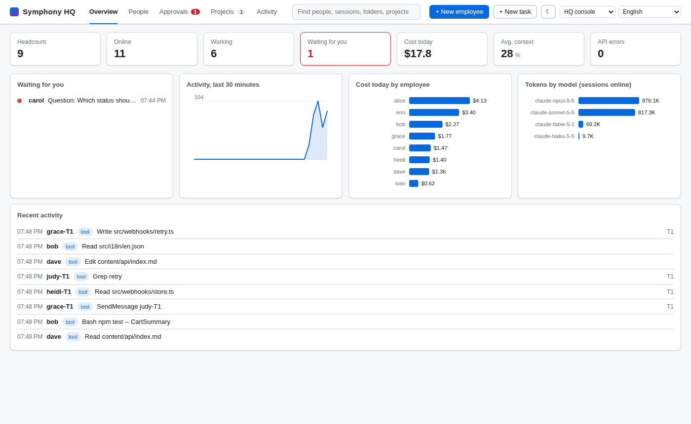
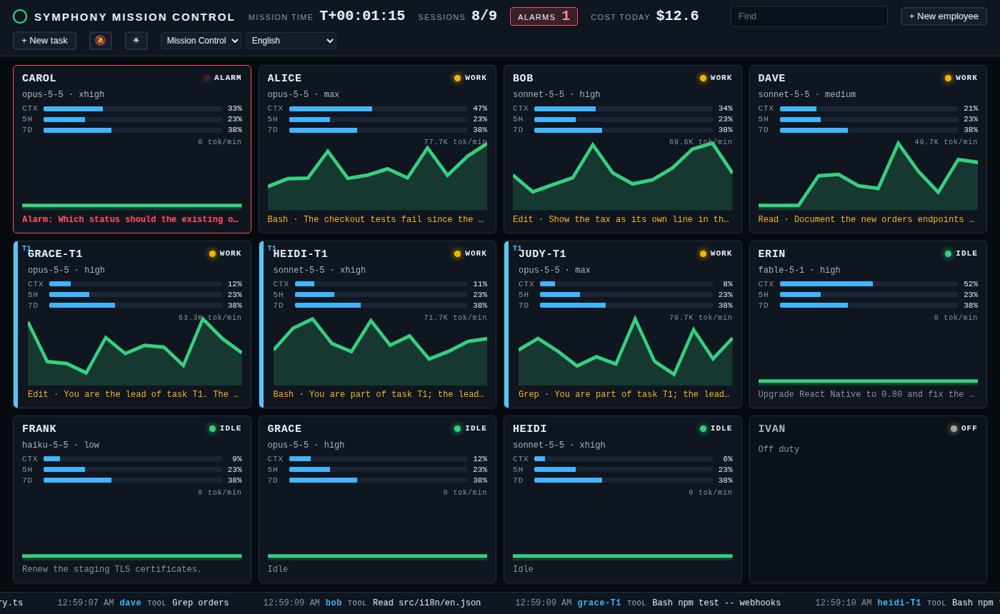

# symphony

[English](README.md) | [简体中文](README.zh-CN.md) | [繁體中文](README.zh-TW.md) | [日本語](README.ja.md) | [한국어](README.ko.md) | [Español](README.es.md) | **Français** | [Deutsch](README.de.md) | [Português (Brasil)](README.pt-BR.md) | [Русский](README.ru.md)

symphony est un projet indépendant. Il n’est ni affilié à Anthropic, ni approuvé ou sponsorisé par Anthropic. Claude et Claude Code sont des marques d’Anthropic, PBC.

Réunissez une équipe de sessions Claude Code dans un bureau en pixel art : voyez d’un coup d’œil qui travaille et qui vous attend, parlez à chacun dans sa propre fenêtre, et traitez-y en un clic les demandes d’autorisation et les questions AskUserQuestion.


La page existe en plusieurs thèmes : le bureau en pixels ci-dessus ; la **console HQ**, une console de gestion avec une bande d’indicateurs, l’effectif, une file d’approbations, un tableau des projets et une chronologie de l’activité ; **Collègues**, les sessions comme des collègues dans une messagerie, leur visage disant ce qu’ils font, la discussion au milieu, le profil et l’ordinateur à droite ; et le **Contrôle de mission**, le mur d’une salle de contrôle pour un second écran : un panneau de télémétrie par session, les demandes en alarmes, l’activité en bandeau. Choisissez-en un dans la barre du haut ; le bridge s’en souvient.






## Installation

Le plus rapide : ouvrez Claude Code et collez

> Installe-moi https://github.com/feynmanzcys-bytes/symphony

Claude Code lit ce README et fait les étapes de la section suivante ; il vous demande votre accord avant tout changement qui dure au-delà de l’installation. Pour installer à la main, suivez les mêmes étapes.

### Pour les agents IA : la procédure d’installation

Vous lisez ceci parce qu’un utilisateur vous a demandé d’installer symphony. Faites les étapes ci-dessous dans l’ordre, dans un shell, et terminez par le compte rendu de l’étape 6. Faites vous-même les choix courants (l’archive, le dossier dans le `PATH`), mais demandez à l’utilisateur avant tout changement qui persiste au-delà de cette installation : démarrer symphony à chaque ouverture de session, modifier un fichier rc du shell, ou changer le `PATH` de l’utilisateur. Listez tous les choix dans le compte rendu.

symphony a deux parties et a besoin des deux :

1. **Le programme `symphony`** (le bridge) : un seul binaire, un serveur web local à l’adresse `http://127.0.0.1:7788/` qui sert la page du bureau et fait tourner les sessions. Il devrait être dans le `PATH` de l’utilisateur, sous le nom `symphony`, car le mod le démarre avec `symphony -background` quand une session ne trouve aucun bridge en marche.
2. **Le plugin `symphony-bridge`** (le mod) : un plugin Claude Code issu de la marketplace de ce dépôt, installé avec la portée utilisateur. Il n’agit que dans les sessions lancées avec `SYMPHONY_TOKEN` et ne fait rien dans les autres.

#### Étape 1 : vérifier la machine

```bash
uname -sm                 # Linux/macOS : choisit l’archive ci-dessous (x86_64 → amd64 ; arm64/aarch64 → arm64)
claude --version          # il faut Claude Code 2.1.x (testé avec 2.1.316)
git --version             # seulement pour les tâches en équipe ; s’il manque, le noter dans le compte rendu sans s’arrêter
symphony -version         # déjà installé ? affiche "symphony v1.1.0 (darwin/arm64)"
curl -s -o /dev/null -w '%{http_code}\n' http://127.0.0.1:7788/api/state   # un bridge tourne ? 401 : symphony 1.x ; 200 : un plus ancien ; 000 : aucun
claude plugin list --json # le mod est déjà installé ? cherchez une entrée avec "id": "symphony-bridge@symphony"
```

Sous Windows, utilisez PowerShell : `$env:PROCESSOR_ARCHITECTURE` vaut `AMD64` ou `ARM64`.

Si `claude` manque, arrêtez-vous et dites à l’utilisateur d’installer d’abord Claude Code. Si le programme et le mod sont déjà tous les deux en place, passez plutôt à « Mise à jour » ci-dessous. Si un seul des deux l’est, faites les étapes de l’autre : les étapes 2 et 3 pour le programme (sauf si `symphony -version` affiche déjà la dernière version), l’étape 4 pour le mod, puis l’étape 5. Un bridge qui tourne déjà garde le programme avec lequel il a démarré : s’il y en a un, vous l’arrêterez avant l’étape 5.

#### Étape 2 : récupérer le programme

Téléchargez l’archive de cette machine et le `checksums.txt` de la version dans un nouveau dossier rien qu’à eux, et vérifiez l’archive avant d’installer quoi que ce soit. Les archives sont `symphony_<os>_<arch>.tar.gz`, où `<os>` vaut `linux` ou `darwin` (macOS) et `<arch>` vaut `amd64` ou `arm64`, et `symphony_windows_<arch>.zip`.

Sous Linux et macOS :

```bash
d=$(mktemp -d)   # un nouveau dossier que vous seul pouvez lire
echo "$d"        # notez-le : l’étape 3 installe depuis ce dossier
cd "$d"
curl -fsSLO https://github.com/feynmanzcys-bytes/symphony/releases/latest/download/symphony_<os>_<arch>.tar.gz
curl -fsSLO https://github.com/feynmanzcys-bytes/symphony/releases/latest/download/checksums.txt
if command -v sha256sum >/dev/null; then sha256sum -c --ignore-missing checksums.txt; else shasum -a 256 -c --ignore-missing checksums.txt; fi   # doit afficher "symphony_<os>_<arch>.tar.gz: OK"
tar xzf symphony_<os>_<arch>.tar.gz              # le programme est maintenant "$d/symphony"
```

Si la vérification n’affiche pas `OK`, arrêtez-vous : n’installez pas le programme, et prévenez l’utilisateur. Avec `gh` au lieu de curl, téléchargez dans `$d` (gh crée le dossier s’il n’existe pas encore), puis lancez la même vérification et `tar` dans ce dossier :

```bash
gh release download -R feynmanzcys-bytes/symphony -p 'symphony_<os>_<arch>.tar.gz' -p checksums.txt -D "$d"
```

Sous Windows, dans PowerShell :

```powershell
$arch = if ($env:PROCESSOR_ARCHITECTURE -eq 'ARM64') { 'arm64' } else { 'amd64' }
$zip = "symphony_windows_$arch.zip"
$d = Join-Path $env:TEMP ("symphony-" + [guid]::NewGuid())   # un nouveau dossier
New-Item -ItemType Directory -Path $d | Out-Null
$url = 'https://github.com/feynmanzcys-bytes/symphony/releases/latest/download'
Invoke-WebRequest -UseBasicParsing -Uri "$url/$zip" -OutFile (Join-Path $d $zip)
Invoke-WebRequest -UseBasicParsing -Uri "$url/checksums.txt" -OutFile (Join-Path $d 'checksums.txt')
$want = ((Select-String -SimpleMatch -Path (Join-Path $d 'checksums.txt') -Pattern $zip).Line -split '\s+')[0]
$got = (Get-FileHash -Algorithm SHA256 -LiteralPath (Join-Path $d $zip)).Hash
if ($got -ne $want) { throw "checksum mismatch: $zip" } else { 'checksum OK' }
```

**Depuis les sources** sous Linux ou macOS, si l’utilisateur le préfère (Go 1.27 ou plus récent). Compilez le binaire ; `go run` ne convient pas, car `-autostart` refuse un build `go run` :

```bash
d=$(mktemp -d)
git clone https://github.com/feynmanzcys-bytes/symphony.git "$d/src"
cd "$d/src" && go build -o "$d/symphony" ./cmd/bridge   # le programme est maintenant "$d/symphony", comme depuis une archive
```

| Système | x86-64 | ARM64 |
| --- | --- | --- |
| Linux | [`symphony_linux_amd64.tar.gz`](https://github.com/feynmanzcys-bytes/symphony/releases/latest/download/symphony_linux_amd64.tar.gz) | [`symphony_linux_arm64.tar.gz`](https://github.com/feynmanzcys-bytes/symphony/releases/latest/download/symphony_linux_arm64.tar.gz) |
| macOS | [`symphony_darwin_amd64.tar.gz`](https://github.com/feynmanzcys-bytes/symphony/releases/latest/download/symphony_darwin_amd64.tar.gz) (Intel) | [`symphony_darwin_arm64.tar.gz`](https://github.com/feynmanzcys-bytes/symphony/releases/latest/download/symphony_darwin_arm64.tar.gz) (Apple silicon) |
| Windows | [`symphony_windows_amd64.zip`](https://github.com/feynmanzcys-bytes/symphony/releases/latest/download/symphony_windows_amd64.zip) | [`symphony_windows_arm64.zip`](https://github.com/feynmanzcys-bytes/symphony/releases/latest/download/symphony_windows_arm64.zip) |

Chaque archive contient le programme (`symphony`, ou `symphony.exe` sous Windows), `LICENSE` et `README.md`. Le fichier `checksums.txt` de la version donne le SHA-256 de chaque archive.

#### Étape 3 : le mettre dans le PATH

Installez le programme de l’étape 2, `$d/symphony` (si votre shell ne garde pas les variables d’une commande à l’autre, écrivez en toutes lettres le dossier que l’étape 2 a affiché). Prenez un dossier déjà présent dans le `PATH` de l’utilisateur et accessible en écriture sans `sudo` : `~/.local/bin`, `/usr/local/bin` ou `/opt/homebrew/bin`, dans cet ordre.

```bash
install -m 755 "$d/symphony" ~/.local/bin/symphony
xattr -d com.apple.quarantine ~/.local/bin/symphony 2>/dev/null || true   # macOS : le binaire n’est pas signé
symphony -version          # affiche "symphony v1.1.0 (linux/amd64)" : la version et la plateforme
```

Si aucun de ces dossiers n’est dans le `PATH`, demandez à l’utilisateur avant de changer quoi que ce soit. S’il accepte, créez `~/.local/bin`, ajoutez-le au fichier rc du shell (`~/.zshrc` ou `~/.bashrc`) et signalez-le dans le compte rendu ; s’il refuse, installez le programme là où il l’indique et prévenez-le que le mod ne peut pas démarrer le bridge tout seul tant que `symphony` n’est pas dans le `PATH` de ses sessions Claude Code (le démarrage à l’ouverture de session, à l’étape 5, fonctionne quand même).

Sous Windows, décompressez-le dans un dossier rien qu’à lui (`$d` et `$zip` viennent de l’étape 2 ; dans un nouveau shell, redéfinissez-les) :

```powershell
$dest = Join-Path $env:LOCALAPPDATA 'Programs\symphony'
Expand-Archive -LiteralPath (Join-Path $d $zip) -DestinationPath $dest -Force
& (Join-Path $dest 'symphony.exe') -version   # affiche "symphony v1.1.0 (windows/amd64)"
```

Ajouter ce dossier au `Path` de l’utilisateur est un changement durable : demandez d’abord à l’utilisateur. S’il accepte, lancez la ligne ci-dessous et ouvrez un nouveau shell ; s’il refuse, utilisez le chemin complet. SmartScreen peut afficher un avertissement au premier lancement : « Informations complémentaires », puis « Exécuter quand même ».

```powershell
[Environment]::SetEnvironmentVariable('Path', [Environment]::GetEnvironmentVariable('Path', 'User') + ";$dest", 'User')
```

Si votre propre shell ne trouve pas `symphony` après cela (son `PATH` a été lu avant votre modification), utilisez le chemin absolu pour la suite des étapes.

#### Étape 4 : installer le mod

```bash
claude plugin install symphony-bridge --marketplace feynmanzcys-bytes/symphony
```

Cette commande ajoute le dépôt comme marketplace de plugins `symphony` et installe le mod avec la portée utilisateur, sans rien demander. Un clone local du dépôt peut servir de marketplace à la place : `claude plugin install symphony-bridge --marketplace /absolute/path/to/symphony`. Les sessions lisent alors le mod dans ce dossier, et un `git pull` dans ce dossier le met à jour : gardez donc un tel clone dans un endroit durable, pas dans un dossier temporaire.

Vérifiez :

```bash
claude plugin list --json   # une entrée contient "id": "symphony-bridge@symphony", "scope": "user", "enabled": true
```

- `"scope": "project"` ou `"local"` : le mod ne se chargerait que dans un seul dossier. Lancez `claude plugin uninstall symphony-bridge@symphony`, puis réinstallez avec `--scope user`.
- `"enabled": false` : `claude plugin enable symphony-bridge@symphony`.

#### Étape 5 : démarrer le bridge

Si l’étape 1 a trouvé un bridge en marche, arrêtez-le d’abord, comme dans « Mise à jour » ci-dessous : il fait tourner l’ancien programme, et le nouveau ne ferait que le trouver là et s’effacer. L’arrêter termine les sessions qu’il a démarrées : prévenez donc l’utilisateur avant.

Demandez à l’utilisateur si symphony doit démarrer à chaque ouverture de session.

S’il répond oui :

```bash
symphony -autostart on -open=false
```

Cette commande démarre le bridge maintenant et à chaque ouverture de session (un service utilisateur systemd sous Linux, un agent launchd sous macOS, la clé Run du registre sous Windows), et affiche, après la date et l’heure :

```
symphony now starts when you log in (<where>); it's running at http://127.0.0.1:7788/?key=<key>
```

S’il répond non :

```bash
symphony -background -open=false
```

Cette commande démarre le bridge détaché du terminal (il ne redémarre pas après un redémarrage de la machine), et affiche, sur la sortie d’erreur standard, après la date et l’heure :

```
the symphony bridge runs in the background at http://127.0.0.1:7788/?key=<key>; its log: <data folder>/bridge.log
```

Quand un bridge de cette version tourne déjà, le programme affiche plutôt (de la même façon) `a symphony bridge is already running at http://127.0.0.1:7788/?key=<key>` ; c’est normal, n’en démarrez pas un autre. `<key>` est la clé des pages, qui connecte un navigateur au bureau : ne la collez nulle part ailleurs. Si le programme répond `127.0.0.1:7788 is taken: another program, or a symphony bridge with another data folder, answers there`, dites à l’utilisateur ce qui répond à cette adresse (un bridge symphony plus ancien compte aussi : arrêtez-le comme dans « Mise à jour ») et n’en choisissez pas une autre sans lui demander.

Vérifiez toute la chaîne avec une seule requête, qui présente la clé des pages lue dans le dossier de données (par l’entrée standard, pour que la clé n’apparaisse pas sur une ligne de commande que d’autres utilisateurs pourraient voir) :

```bash
printf 'X-Symphony-Key: %s\n' "$(cat "${SYMPHONY_DATA:-${XDG_CONFIG_HOME:-$HOME/.config}/symphony}/key")" | curl -s -H @- http://127.0.0.1:7788/api/launch/options      # Linux
printf 'X-Symphony-Key: %s\n' "$(cat "${SYMPHONY_DATA:-$HOME/Library/Application Support/symphony}/key")" | curl -s -H @- http://127.0.0.1:7788/api/launch/options   # macOS
```

```powershell
$data = if ($env:SYMPHONY_DATA) { $env:SYMPHONY_DATA } else { Join-Path $env:APPDATA 'symphony' }
(Invoke-WebRequest -UseBasicParsing -Headers @{ 'X-Symphony-Key' = (Get-Content (Join-Path $data 'key')) } -Uri http://127.0.0.1:7788/api/launch/options).Content
```

Le dossier de données est `~/.config/symphony` sous Linux (`$XDG_CONFIG_HOME/symphony` si cette variable est définie), `~/Library/Application Support/symphony` sous macOS et `%AppData%\symphony` sous Windows, ou `SYMPHONY_DATA` si cette variable est définie.

La réponse contient `"enabled":true` et `"mod":{"ok":true,"id":"symphony-bridge@symphony","version":"1.1.0"}` : le bridge tourne, il a trouvé `claude`, et le mod est installé là où les sessions le chargeront. Avec `"enabled":false`, `mod.code` dit ce qui ne va pas et `mod.fix` donne la commande qui le corrige : `mod_not_installed` ou `mod_project_scope` (retour à l’étape 4), `mod_disabled` (activez-le), `mod_check_failed` (`claude plugin list --json` a échoué, donc Claude Code est probablement trop ancien). `"mod":null` veut dire que le bridge n’a pas du tout trouvé `claude` dans son `PATH` (son journal le signale) : ajoutez-le au PATH, ou démarrez le bridge avec `-claude /path/to/claude`. Une réponse avec `"code":"page_key"` veut dire que la requête n’a présenté aucune clé ou la mauvaise : vérifiez que `cat` a trouvé le fichier de clé (le dossier de données, ci-dessus) ; si c’est le cas, le bridge en marche a été démarré avec un autre dossier de données.

Le journal du bridge est `bridge.log` dans le dossier de données ; démarré à l’ouverture de session, il journalise dans `journalctl --user -u symphony` sous Linux et dans `~/Library/Logs/symphony.log` sous macOS.

#### Étape 6 : rendre compte à l’utilisateur

Ouvrez le bureau en lançant `symphony` : quand le bridge tourne, le programme ouvre le bureau dans le navigateur par défaut, déjà connecté, puis se termine. Il affiche aussi l’adresse avec `?key=`, qui connecte n’importe quel navigateur de cette machine.

Dites à l’utilisateur :

- Pour ouvrir le bureau, lancez `symphony` (ou double-cliquez dessus) ; `http://127.0.0.1:7788/` seul fonctionne dans un navigateur déjà connecté. Cliquez sur le « + » d’un poste libre pour embaucher le premier employé : choisissez un dossier, et une session Claude Code y démarre, à l’intérieur du bridge ; sa fenêtre dans la page est sa discussion.
- Les nouveaux employés suivent les réglages Claude Code de l’utilisateur (modèle, effort de réflexion, mode d’autorisation), sauf s’il en choisit d’autres dans la boîte de dialogue. `bypassPermissions` exécute chaque commande et chaque modification sans demander, et ce qu’une session lit peut alors lui faire exécuter des commandes au nom de l’utilisateur ; la boîte de dialogue prévient quand on le choisit.
- Chaque session consomme le forfait Claude ou le crédit API de l’utilisateur, comme toute session Claude Code ; une tâche fait tourner de 2 à 5 sessions à la fois.
- Seules les sessions démarrées depuis la page (ou à la main avec `SYMPHONY_TOKEN`, voir « Démarrer des sessions » plus bas) apparaissent dans le bureau. Les autres sessions Claude Code de l’utilisateur, y compris celle qui fait cette installation, n’y figurent pas.
- Ce qui a été installé et où : le chemin du programme, le mod avec la portée utilisateur, le bridge démarré à l’ouverture de session ou en arrière-plan, toute modification du `PATH` ou d’un fichier rc, les choix que vous avez faits, et l’absence de `git` le cas échéant.
- Comment tout défaire : « Désinstallation » ci-dessous.

Règles : le bridge n’écoute que sur cette machine (il refuse toute adresse hors de cette machine ; gardez l’adresse par défaut `127.0.0.1:7788`, sauf si l’utilisateur choisit un autre port), ne le lancez pas avec `sudo`, et ne démarrez pas un second bridge à la même adresse ni sur le même dossier de données (symphony le refuse et indique celui qui tourne).

#### Mise à jour

Téléchargez la nouvelle version comme à l’étape 2. Le bridge en cours d’exécution garde l’ancien programme jusqu’à son redémarrage (et sous Windows, un programme en cours d’exécution ne peut pas être remplacé) : arrêtez-le avec `symphony -stop`, remplacez le programme comme à l’étape 3, puis redémarrez-le comme il tournait avant : `symphony -autostart on -open=false` s’il démarre à l’ouverture de session (cela le démarre aussi tout de suite), sinon `symphony -background -open=false`. Si le bridge tourne avec un `-addr` ou un `-data` autres que les valeurs par défaut, donnez les mêmes à chacune de ces commandes : `-stop` n’arrête que le bridge de ce dossier de données (sur `-addr`, ou là où tourne le bridge de ce dossier), et affiche `nothing to stop` quand aucun ne répond. Arrêter le bridge termine les sessions qu’il a démarrées : prévenez donc l’utilisateur avant. (`-stop` est arrivé avec la v1.1.0 ; pour arrêter un bridge v1.0.0, terminez son processus : `pkill -x symphony` sous Linux et macOS, `Stop-Process -Name symphony` sous Windows.)

Le mod suit avec `claude plugin update symphony-bridge@symphony` (avec un clone comme marketplace, faites plutôt `git pull` dans ce clone).

Le programme et le mod partagent le même numéro de version ; [CHANGELOG.md](CHANGELOG.md) liste ce qui a changé dans chaque version.

#### Désinstallation

```bash
symphony -stop                                    # arrête le bridge et ses sessions, quelle que soit la façon dont il a été démarré (ajoutez ses -addr et -data s’ils diffèrent des valeurs par défaut)
symphony -autostart off                           # ne le démarre plus à l’ouverture de session (le signale si ce n’était pas le cas)
claude plugin uninstall symphony-bridge@symphony  # le mod
claude plugin marketplace remove symphony         # l’entrée de la marketplace
rm ~/.local/bin/symphony                          # le programme, là où l’étape 3 l’a mis
```

Si l’étape 3 a ajouté `~/.local/bin` à un fichier rc du shell, supprimez aussi cette ligne. Sous Windows, dans PowerShell :

```powershell
symphony -stop                                               # arrête le bridge et ses sessions (ajoutez ses -addr et -data s’ils diffèrent des valeurs par défaut)
symphony -autostart off                                      # ne le démarre plus à l’ouverture de session
claude plugin uninstall symphony-bridge@symphony
claude plugin marketplace remove symphony
$dest = Join-Path $env:LOCALAPPDATA 'Programs\symphony'
Remove-Item -Recurse -Force $dest                            # le programme
$p = ([Environment]::GetEnvironmentVariable('Path', 'User') -split ';' | Where-Object { $_ -and $_ -ne $dest }) -join ';'
[Environment]::SetEnvironmentVariable('Path', $p, 'User')    # l’entrée du Path que l’étape 3 a ajoutée
```

Le dossier de données (les comptes avec leurs tokens, la clé des pages, le journal des messages, le registre de consommation, les tâches, et des fichiers comme `lock`, `bridge.addr` ou un `*.corrupt-<time>` mis de côté) reste en place ; supprimez-le pour tout effacer. Le supprimer efface aussi la clé des pages : le prochain démarrage en crée une nouvelle, et chaque navigateur doit se reconnecter. Sous Linux avec un navigateur snap ou flatpak, `open.html` se trouve dans le dossier propre à ce navigateur (`~/snap/<snap>/common` ou `~/.var/app/<app id>`) ; supprimez-le aussi.

## Fonctionnalités

- **Chaque session comme une discussion** : cliquez sur un employé et sa fenêtre s’ouvre au milieu de la page : en haut qui il est, en dessous la session sous forme de discussion : les instructions, la réflexion du modèle (repliée, « Réflexion… » en orange tant qu’elle dure), ses réponses au fil de l’eau, les appels d’outils, et les messages des autres sessions en violet. Écrivez en bas et le texte arrive à la session comme votre instruction ; le bouton Arrêter l’interrompt.
- **Approbations dans le navigateur** : les demandes d’autorisation (exécuter des commandes, modifier des fichiers) et les questions AskUserQuestion remontent sous forme de cartes par-dessus la zone de saisie de la fenêtre de cet employé, et le compteur rouge de la barre du haut vous y amène. Si le bridge ne tourne pas, ne connaît pas le compte ou n’est pas digne de confiance, la session revient au terminal comme d’habitude et ne reste jamais bloquée.
- **Un bureau en pixel art** : chaque session est un employé à un poste fixe. Vert : disponible ; jaune : occupé ; rouge : attend votre autorisation ou votre réponse ; gris : hors service. Les employés désœuvrés traînent d’abord à leur poste avec leur téléphone ou leurs jeux, puis partent se promener : télé sur le canapé de l’espace détente, baby-foot, partie de chat, discussion à la table ronde, café, coup d’œil par la fenêtre ; au bout d’un moment, ils font la sieste, souvent cachés dans la salle de réunion. La taille du personnage dépend du modèle, et ses muscles de l’effort de réflexion. Le bureau est un étage de l’immeuble d’une grande entreprise et remplit la fenêtre : l’open space au centre, de petites salles de réunion de 3 à 5 places avec leur plaque à gauche, la salle de réunion et l’espace détente à droite, et des ascenseurs pour arriver et repartir. La barre du haut règle aussi la taille des pixels, en quatre crans : le même bureau, dessiné avec des pixels plus fins et plus de détails à chaque cran.
- **Retrouver quelqu’un et le rappeler** : cliquez sur un employé disponible et il retourne à son poste (il y reste jusqu’à son prochain tour) ; le champ de recherche de la barre du haut trouve les employés par nom, par nom de session ou par dossier (touche `/` pour y aller), et un clic sur un compteur à côté (disponible, occupé, en attente, hors service) fait ressortir tous les employés dans cet état. L’onglet sous la barre la range vers le haut et la fait redescendre.
- **Messages entre sessions** : quand des sessions s’envoient des messages (SendMessage), une enveloppe traverse le bureau, et le journal des messages les conserve.
- **Démarrer des sessions depuis la page, sans qu’aucune fenêtre ne s’ouvre** : cliquez sur le « + » d’un poste libre pour embaucher un nouvel employé, puis choisissez le dossier. Le modèle, l’effort de réflexion et le mode d’autorisation suivent vos réglages Claude Code (« Par défaut »), sauf si vous en choisissez d’autres ; choisir `bypassPermissions` affiche un avertissement rouge sur ce qu’il permet. Cliquez sur « Au travail ! » dans la fenêtre d’un employé hors service pour le faire revenir au même poste, avec les choix de sa dernière session de travail. La session tourne sur un terminal à elle, à l’intérieur du bridge : rien ne s’ouvre et rien ne vous prend le focus ; « Ouvrir le terminal » dans la fenêtre de l’employé montre ce terminal quand vous le voulez, et le fermer ne change rien.
- **Des équipes dans les salles de réunion** : cliquez sur une petite salle de réunion libre, écrivez une tâche et choisissez de 2 à 5 membres : des employés, qui reçoivent chacun une deuxième session rien que pour la tâche, ou des conseillers ponctuels. Par défaut, le premier membre dirige et distribue les parts avec SendMessage ; chaque membre travaille dans son propre worktree git, sur sa propre branche, si bien que personne ne marche sur les fichiers des autres. Les membres restent assis dans la salle jusqu’à la fin de la tâche.
- **10 langues** : English, 简体中文, 繁體中文, 日本語, 한국어, Español, Français, Deutsch, Português (Brasil) et Русский. La page suit la langue de votre navigateur et propose un sélecteur de langue dans la barre du haut ; les messages du bridge suivent `-lang`, sinon la langue de votre système (`LANG` et consorts), sinon l’anglais ; ceux du mod suivent `SYMPHONY_LANG` (la langue de la page, pour une session démarrée depuis la page), sinon la langue de votre système, sinon l’anglais.
- **Tout en local** : le bridge est un seul programme Go (bibliothèque standard uniquement ; les tests de bout en bout utilisent aussi chromedp) qui n’écoute que sur cette machine, les pages sont en JavaScript pur, et rien ne dépend d’un service tiers.


## Prérequis

- Claude Code 2.1.316 (testé avec cette version). Le mod utilise les function hooks de Claude Code, une API encore en accès anticipé : après chaque mise à jour de Claude Code, relancez les tests de bout en bout.
- Le bridge existe en programme prêt à l’emploi pour Linux, macOS et Windows ; Go 1.27 ou plus récent n’est nécessaire que pour le compiler depuis les sources.
- `git`, pour les tâches en équipe seulement : chaque membre d’une tâche travaille dans un worktree git.
- Rien d’autre : les sessions démarrées depuis la page tournent dans le bridge, sur toutes les plateformes.

## Lancer le bridge

`symphony` démarre le bridge et ouvre le bureau dans votre navigateur, déjà connecté (`-open=false` le désactive). Le navigateur reçoit la clé des pages du bridge sous forme de cookie via `open.html`, un fichier du dossier de données que vous seul pouvez lire, si bien que la clé n’apparaît jamais sur une ligne de commande ; sous Linux, quand votre navigateur est un snap ou un flatpak, ce fichier va plutôt dans le dossier propre au navigateur, car ces navigateurs ne peuvent pas lire le dossier de données. Ouvrir <http://127.0.0.1:7788/> dans un navigateur qui n’est pas connecté affiche une page qui explique comment entrer : relancer `symphony`, ou ouvrir l’adresse avec `?key=` que le bridge a écrite dans son journal. <http://127.0.0.1:7788/approve> est une page plus simple, réservée aux approbations. Relancer `symphony` alors qu’il tourne déjà ouvre simplement le bureau. Sous Windows, lancé d’un double-clic, `symphony.exe` tourne dans sa propre fenêtre, et fermer cette fenêtre arrête le bridge.

| Option | Par défaut | Rôle |
| --- | --- | --- |
| `-addr` | `127.0.0.1:7788` | Adresse d’écoute. Son hôte doit être `127.0.0.1`, `localhost` ou `::1` (comme dans `[::1]:7788`) ; le bridge refuse tout autre hôte |
| `-data` | `$SYMPHONY_DATA`, sinon `symphony` dans votre dossier de configuration | Le dossier de données : les comptes avec leurs tokens (`accounts.json`), la clé des pages (`key`) et `open.html`, le journal des messages (`messages.json`), le registre de consommation (`ledger.json`), les tâches (`tasks.json`), le journal de `-background` (`bridge.log`), `lock` et `bridge.addr` (quel bridge l’utilise, et où), et un journal des messages ou un registre de consommation endommagé, mis de côté sous le nom `*.corrupt-<time>` |
| `-claude` | `claude` | L’exécutable claude |
| `-lang` | la langue de votre système, sinon `en` | Langue des messages du bridge (`SYMPHONY_LANG`, `LC_ALL`, `LC_MESSAGES` ou `LANG` fixent la valeur par défaut) |
| `-mod` | vide | Pour le développement : donne aux sessions le mod de ce dossier avec `--plugin-dir`, à la place de la copie installée |
| `-web` | vide | Pour le développement : sert les pages depuis ce dossier, pour voir les modifications après un rechargement |
| `-open` | `true` | Ouvre le bureau dans le navigateur une fois le bridge démarré ; si le bridge de ce dossier de données tourne déjà sur `-addr`, ouvre simplement son bureau |
| `-autostart` | — | `on` : démarre le bridge à chaque ouverture de session, avec les autres options données, et le démarre tout de suite ; `off` : annule cela |
| `-background` | — | Démarre le bridge en arrière-plan, détaché du terminal et journalisant dans `bridge.log` du dossier de données, puis rend la main dès qu’il répond |
| `-stop` | — | Arrête le bridge de ce dossier de données (sur `-addr`, sinon là où il tourne), quelle que soit la façon dont il a été démarré (ses sessions prennent fin), puis rend la main une fois qu’il est arrêté ; il ne montre la clé qu’à un bridge qui prouve qu’il la connaît |
| `-version` | — | Affiche la version et quitte |

Quand autre chose répond sur `-addr` (un autre programme, un bridge avec un autre dossier de données, ou un bridge symphony plus ancien), symphony le signale et s’arrête ; il ne montre la clé des pages qu’à un bridge qui prouve qu’il la connaît. Un dossier de données n’appartient qu’à un seul bridge à la fois : lancé avec un dossier de données dont le bridge tourne déjà à une autre adresse, symphony indique où il tourne, ouvre son bureau et s’arrête (donnez à un second bridge son propre `-data`).

**Le lancer à l’ouverture de session** : `symphony -autostart on` fait démarrer le bridge à chaque ouverture de session, avec les options données en même temps (par exemple `-addr`), et le démarre tout de suite ; `symphony -autostart off` annule cela. Sous Linux, c’est un service utilisateur systemd (`journalctl --user -u symphony` affiche son journal), sous macOS un agent launchd (journal dans `~/Library/Logs/symphony.log`), sous Windows une valeur sous la clé Run du registre (le bridge tourne dans une fenêtre de console ; la fermer l’arrête jusqu’à la prochaine ouverture de session). `symphony -stop` arrête un bridge, quelle que soit la façon dont il a été démarré, jusqu’à ce qu’il soit redémarré (à la prochaine ouverture de session, pour un bridge démarré à l’ouverture de session). Il faut le programme symphony lui-même, pas `go run`.

**Depuis les sources**, avec Go 1.27 ou plus récent : `git clone https://github.com/feynmanzcys-bytes/symphony.git && cd symphony && go run ./cmd/bridge`.

## Démarrer des sessions

**Depuis la page** : cliquez sur le « + » d’un poste libre, saisissez un nom, puis choisissez le dossier et les options. Le bridge lance `claude` sur un terminal à lui, à l’intérieur du bridge : aucune fenêtre ne s’ouvre. La fenêtre de l’employé montre la session sous forme de discussion, et son bouton « Ouvrir le terminal » ouvre une fenêtre de terminal reliée à la session (`symphony attach <id>` fait de même depuis n’importe quel terminal, avec `-addr` et `-data` quand le bridge n’utilise pas les valeurs par défaut ; quand aucune fenêtre de terminal ne peut s’ouvrir, la page affiche la commande exacte. `Ctrl-]` ou la fermeture de la fenêtre détache, et la session continue). Les sessions sont des processus enfants du bridge : arrêter le bridge les termine.

**Depuis un terminal** : créez un compte pour obtenir un token, en présentant la clé des pages, puis lancez `claude` avec ce token :

```bash
printf 'X-Symphony-Key: %s\n' "$(cat ~/.config/symphony/key)" | curl -H @- -X POST 127.0.0.1:7788/api/accounts -d '{"name":"frontend-alice"}'   # la réponse contient le token
SYMPHONY_TOKEN=<token> claude --name frontend-alice --permission-mode manual
```

Le fichier de clé est `~/.config/symphony/key` sous Linux, `~/Library/Application Support/symphony/key` sous macOS et `%AppData%\symphony\key` sous Windows, ou `key` dans le dossier qu’indique `-data` / `SYMPHONY_DATA`.

Le mode d’autorisation `manual` est recommandé : en mode `auto`, la plupart des actions ne demandent rien à personne, donc peu d’approbations arrivent jusqu’à la page. Si le bridge n’est pas à l’adresse par défaut, définissez aussi `SYMPHONY_BRIDGE` : `http://127.0.0.1:<port>`, `http://localhost:<port>` ou `http://[::1]:<port>` sur cette machine, ou une adresse `https://` ; avec toute autre valeur, le mod ne contacte jamais le bridge. `SYMPHONY_LANG` choisit la langue des messages du mod (sinon la langue de votre système, sinon l’anglais).

Avant que la session n’envoie son token où que ce soit, le mod vérifie que le bridge à cette adresse connaît le token, sans l’envoyer (`POST /api/hello`). Quand le bridge ne peut pas prendre la session, celle-ci affiche l’un de ces messages, ses approbations restent dans le terminal, et elle ne reste jamais bloquée :

| Message | Ce que cela veut dire |
| --- | --- |
| `impossible de joindre le bridge (...)` / `can't reach the bridge` | Rien ne répond à l’adresse du bridge, et démarrer le bridge n’y a rien changé (ou l’adresse n’est pas sur cette machine). |
| `impossible de démarrer le bridge (...) : <reason>` / `couldn't start the bridge ...: <reason>` | Rien n’a répondu, et `symphony -background` a échoué pour la raison affichée (par exemple, le bridge de ce dossier de données tourne à une autre adresse : mettez celle-ci dans `SYMPHONY_BRIDGE`). |
| `le bridge ne reconnaît pas ce SYMPHONY_TOKEN` / `the bridge doesn't know this SYMPHONY_TOKEN` | Le bridge n’a aucun compte avec ce token : il a été supprimé, ou le bridge utilise un autre dossier de données. |
| `n’est pas un bridge symphony auquel cette session peut se fier` / `isn't a symphony bridge this session can trust` | Quelque chose répond à l’adresse mais ne peut pas prouver qu’il connaît le token : un autre programme, ou un symphony plus ancien que le mod (mettez-le à jour). Le token n’est pas envoyé. |
| `SYMPHONY_BRIDGE (...) doit être sur cette machine ou utiliser https` / `SYMPHONY_BRIDGE ... must be on this machine or use https` | L’adresse n’est pas de celles que le mod accepte ; le bridge n’est jamais contacté. |
| `ce compte a déjà une session en ligne` / `this account already has a session online` | Un compte ne sert qu’une session à la fois ; créez un autre compte pour cette session. |
| `en attente de votre réponse dans la page du bureau` / `waiting for your answer in the office page` | Une demande d’autorisation ou une question attend dans la page du bureau, pas dans le terminal ; répondez-y là-bas, ou appuyez sur Échap pour l’annuler. Affiché une fois par session. |

Quand rien ne répond à l’adresse du bridge sur cette machine, la session démarre elle-même le bridge avec `symphony -background -open=false -addr <that address>` (si `symphony` est dans votre PATH) et le signale (`bridge (...) démarré en arrière-plan` / `started the bridge ... in the background`) ; le bridge continue de tourner après la fin de la session. Définissez `SYMPHONY_DATA` si vos comptes ne sont pas dans le dossier de données par défaut. Si le bridge de ce dossier de données tourne déjà à une autre adresse, la session le signale et revient au terminal : mettez cette adresse dans `SYMPHONY_BRIDGE`.

## Tâches en équipe

Une petite salle de réunion, c’est l’endroit où une équipe de 2 à 5 sessions travaille ensemble sur une même tâche. Les tâches demandent `git`.

**Lancer une tâche** : cliquez sur une petite salle de réunion libre et décrivez ce qu’il faut faire. Cochez les membres dans l’ordre voulu (de 2 jusqu’au nombre de places de la salle), choisissez le modèle et l’effort de réflexion de chacun ainsi que le mode d’autorisation de l’équipe (par défaut, les réglages de Claude Code ; un employé qui a déjà travaillé démarre avec son dernier modèle et son dernier effort ; choisir `bypassPermissions` affiche l’avertissement), puis cliquez sur « Lancer la tâche ». Un membre peut être :

- **Un employé** : il reçoit une deuxième session rien que pour la tâche, qui travaille dans le dossier de l’employé ; sa session habituelle, à son poste, reste telle quelle. Un employé n’est que dans une tâche à la fois, et celui qui n’a jamais travaillé n’a pas encore de dossier : cliquez d’abord une fois sur « Au travail ! ».
- **Un conseiller** : un participant ponctuel créé pour la tâche avec les champs habituels (nom, dossier, modèle, effort de réflexion). Il n’a pas de poste, arrive par l’ascenseur et disparaît à la fin de la tâche.

**Le chef** : par défaut, le premier membre dirige : il découpe la tâche, distribue les parts avec SendMessage, relit le travail, fusionne les branches des autres dans la sienne et vous dit ce qui a été fait. Décochez la case du chef et chacun reçoit toute la tâche, que les membres se répartissent entre eux. Dans les deux cas, le bridge donne à chaque membre sa première instruction : qui fait partie de l’équipe (les membres se joignent par leur nom avec SendMessage), la branche de chacun et les règles.

**Côté git** : chaque membre travaille dans son propre worktree git, sur sa propre branche `symphony/<task id>/<member>` de son dossier (par exemple `symphony/T1/bob` ; un second membre du même nom reçoit `-2`), si bien que personne ne marche sur les fichiers des autres et que votre propre copie de travail reste telle quelle. Les worktrees sont dans `.symphony/worktrees/` à l’intérieur du dossier, cachés à git par `.git/info/exclude` (votre `.gitignore` n’est pas touché). À la fin de la tâche, ce qu’un membre n’a pas encore commité est commité sur sa branche, les fichiers que git ignore dans son worktree (sorties de compilation, `.env`, `node_modules` et autres) sont déplacés dans `.symphony/kept/<member>-<task id>/` à l’intérieur du dossier, et les worktrees sont supprimés. symphony ne supprime jamais `.symphony/kept/` ; supprimez-le quand vous n’avez plus besoin de ce qu’il contient.

- Dans vos propres dépôts, rien n’est fusionné : les branches restent, à vous de les fusionner ; s’il y a un chef, sa branche rassemble le travail de tous.
- Un dossier qui n’est pas un dépôt git en devient un pour la tâche et le reste : `git init`, puis un commit de tout ce qu’il contient, sauf les fichiers qui contiennent souvent des secrets ou qui sont volumineux (`.env`, `.env.*`, `*.pem`, `*.key`, `*.p12`, `*.pfx`, `id_rsa*`, `id_ecdsa*`, `id_ed25519*`, `.npmrc`, `.netrc`, `.pypirc`, `node_modules/`, `.DS_Store`), listés dans `.git/info/exclude`. Ces fichiers restent dans le dossier mais ne sont pas dans les worktrees des membres : un membre qui en a besoin installe ou crée les siens. À la fin de la tâche, les branches des membres sont fusionnées dans la branche du dossier, si bien que le dossier contient le résultat ; le `.git` et les branches sont conservés. Si la tâche ne parvient pas à démarrer, le dossier redevient un dossier ordinaire.
- Une fusion qui échoue est annulée et la base reste telle qu’elle était ; les branches restent, avec le travail qu’elles portent, et la fenêtre de la tâche indique quelle branche est en conflit. Tout autre échec pendant la fin d’une tâche reste en l’état, et la fenêtre de la tâche indique ce qui a échoué.

**Dans le bureau** : les membres restent assis à la table de la salle pendant toute la tâche, et pendant ce temps le poste d’un employé montre une chaise vide. La plaque de la salle affiche l’identifiant de la tâche ; son voyant, vert tant que la salle est libre, passe au jaune pendant la tâche et au rouge quand un membre attend votre autorisation ou votre réponse. Cliquez sur la salle pour ouvrir la fenêtre de la tâche : la tâche, les membres avec leurs dossiers et leurs branches, la discussion de l’équipe et « Terminer la tâche ». Un clic sur le personnage d’un membre dans la salle ouvre aussi la fenêtre de la tâche ; un clic sur un membre dans cette fenêtre ouvre sa fenêtre de discussion juste à côté, la même que celle d’un employé, un membre à la fois (cliquez sur un autre membre pour changer). Le compteur rouge de la barre du haut et le champ de recherche ouvrent un membre d’une tâche de la même façon.

**La discussion de l’équipe** : la fenêtre de la tâche liste les messages que les membres s’envoient, chacun avec le personnage en pixels et le nom de son expéditeur, et le texte commence par `@` et son destinataire. En dessous, une zone de saisie vous permet d’écrire vous-même à l’équipe : `@bob-T1 …` ne va qu’à ce membre (plusieurs `@names` vont à chacun d’eux ; taper `@` ouvre la liste des membres, où l’on choisit avec les flèches, Entrée ou un clic), et un message sans `@` va à tous ceux de la tâche. Entrée envoie, Maj+Entrée saute une ligne.

Une tâche se termine quand vous la terminez depuis la fenêtre de la tâche ou quand sa dernière session prend fin : le bridge arrête les sessions des membres, s’occupe de la partie git comme décrit plus haut et supprime les conseillers. Une tâche encore en cours quand le bridge s’arrête est terminée de la même façon au prochain démarrage du bridge.

## Comptes et postes

- Dans symphony, une identité, c’est un nom, un token et un poste fixe. Un compte ne peut servir qu’à une session à la fois, plus une dans la tâche dont il fait partie ; toute autre session est refusée et ses approbations restent dans le terminal.
- La connexion à Claude n’est pas gérée ici : toutes les sessions peuvent partager le même identifiant Claude.
- Les données sont stockées dans `~/.config/symphony` (Linux), `~/Library/Application Support/symphony` (macOS) ou `%AppData%\symphony` (Windows), ou à l’endroit indiqué par `-data` / `SYMPHONY_DATA`. `accounts.json` contient les tokens et `key` la clé des pages ; tous deux ne sont lisibles que par leur propriétaire (0600) ; sous Windows, ce sont les droits d’accès du dossier utilisateur qui les protègent.

## Coût et autorisations

- Chaque session que symphony démarre est une session Claude Code et consomme votre forfait Claude ou votre crédit API comme n’importe quelle autre. Opus à l’effort maximal l’épuise vite, et une tâche fait tourner de 2 à 5 sessions à la fois.
- `bypassPermissions` exécute chaque commande et chaque modification sans demander. Un contenu que lit une session (un fichier, une page web, la sortie d’un outil) peut alors lui faire exécuter des commandes en votre nom. Les boîtes de dialogue de lancement et de tâche affichent un avertissement rouge quand vous le choisissez ; par défaut, elles suivent vos réglages Claude Code.
- Pour les sessions démarrées depuis la page, le bridge répond à votre place à la question « faire confiance à ce dossier » de Claude Code : ne démarrez donc des sessions que dans des dossiers auxquels vous faites confiance.

## Sécurité

La page peut démarrer des sessions, c’est-à-dire exécuter des commandes sur cette machine ; le bridge contrôle donc qui peut l’atteindre :

- **La clé des pages** : le bureau et son API demandent la clé des pages, un cookie que votre navigateur reçoit via le lien qu’ouvre `symphony`. La clé est le fichier `key` du dossier de données, lisible par vous seul ; les programmes la présentent dans l’en-tête `X-Symphony-Key`.
- **Cette machine seulement** : le bridge n’écoute que sur cette machine et n’accepte que les connexions qui en viennent. Il refuse les requêtes adressées à tout autre hôte (DNS rebinding) et les écritures que d’autres sites web envoient via votre navigateur, et son API ne répond à aucune requête dont votre navigateur indique qu’elle vient d’un autre site ou d’un autre port, pas même à un lien. Les autres sites ne peuvent pas afficher ses pages dans un cadre. Les pages ne chargent que les fichiers du bridge lui-même (une Content Security Policy).
- **Le mod vérifie le bridge** avant d’envoyer son token, et le programme `symphony` avant de montrer la clé des pages, si bien qu’autre chose qui écouterait à l’adresse du bridge n’obtient ni l’un ni l’autre.
- **Ce contre quoi il ne protège pas** : les programmes qui tournent sous votre propre utilisateur peuvent lire la clé des pages et les tokens du dossier de données, comme n’importe lequel de vos fichiers. Et les navigateurs envoient les cookies d’un site à tous ses ports : un serveur qu’un autre utilisateur de cette machine fait tourner sur `127.0.0.1` reçoit le cookie de la clé des pages quand votre navigateur l’ouvre, ou quand il prend le port du bridge pendant que le bridge est arrêté et que le bureau est encore ouvert dans un onglet. Sur une machine partagée, fermez le bureau avant d’arrêter le bridge, et si la clé a pu fuiter, supprimez le fichier `key` du dossier de données (le prochain démarrage en crée une nouvelle).
- Les programmes ne sont pas signés. macOS peut refuser une copie téléchargée avec un navigateur, faute de pouvoir vérifier le développeur : cliquez sur « Ouvrir quand même » dans Réglages Système → Confidentialité et sécurité, ou lancez une fois `xattr -d com.apple.quarantine symphony`. Sous Windows, SmartScreen peut aussi vous avertir : cliquez sur « Informations complémentaires », puis sur « Exécuter quand même ». Le fichier `checksums.txt` de la version donne le SHA-256 de chaque archive ; l’étape 2 de l’installation le vérifie.

Pour signaler une vulnérabilité, voir [SECURITY.md](SECURITY.md).

## Plateformes

| Système | Sessions démarrées depuis la page | « Ouvrir le terminal » | Tests |
| --- | --- | --- | --- |
| Linux | Un pseudo-terminal dans le bridge | Un terminal graphique (x-terminal-emulator, gnome-terminal, konsole, xterm) qui lance `symphony attach` | Tests de bout en bout complets |
| macOS | Un pseudo-terminal dans le bridge | Terminal.app lançant `symphony attach` | Tests de bout en bout complets |
| Windows | Une pseudo-console (ConPTY) dans le bridge | Une nouvelle fenêtre de console qui lance `symphony attach` | Compilation croisée et tests unitaires uniquement |

Le bridge répond « faire confiance à ce dossier » à votre place, sur toutes les plateformes.

## Développement

```bash
go test -race ./...                         # tests unitaires du bridge et des traductions
claude plugin test mods/symphony-bridge     # tests unitaires du mod
claude plugin validate .                    # vérifie la marketplace
claude plugin validate mods/symphony-bridge  # vérifie le mod
SYMPHONY_E2E=1 go test -tags e2e -v -count=1 -timeout 20m ./e2e/   # bout en bout : démarre de vraies sessions et consomme des tokens
```

- Contribuer : [CONTRIBUTING.md](CONTRIBUTING.md) décrit la mise en place, les vérifications à lancer avant une pull request et les règles ; [CLAUDE.md](CLAUDE.md) est la carte détaillée du code.
- Travailler sur le mod : `go run ./cmd/bridge -mod mods/symphony-bridge`, et les sessions démarrées depuis la page reçoivent votre copie du mod via `--plugin-dir` ; pour les sessions que vous lancez à la main, ajoutez vous-même `--plugin-dir mods/symphony-bridge`.
- Travailler sur les pages : `go run ./cmd/bridge -web web`, et un rechargement affiche vos modifications.
- Voir le bureau sans vraies sessions : démarrez un second bridge avec son propre dossier de données et remplissez-le d’activité fictive : `D=$(mktemp -d)`, `go run ./cmd/bridge -addr 127.0.0.1:7799 -data "$D"`, puis dans un autre terminal (avec le même `D`) `go run ./cmd/demo -base http://127.0.0.1:7799 -data "$D"` (la démo lit la clé des pages du bridge dans ce dossier de données).
- Les captures d’écran de ce README : `SYMPHONY_E2E=1 SYMPHONY_E2E_DOCS=1 go test -tags e2e -run TestDocsScreens ./e2e/` les refait avec de l’activité fictive (sans consommer de tokens).
- Traductions : chaque langue tient dans un fichier, `web/locales/<lang>.json` pour les pages et `internal/i18n/locales/<lang>.json` pour le bridge, avec les mêmes clés que `en.json` ; les quelques messages du mod se trouvent dans `mods/symphony-bridge/hooks/messages.ts`. Les tests unitaires vérifient que chaque langue a toutes les clés et les mêmes `{placeholders}`, et le test de bout en bout `TestI18n` ouvre les pages dans chaque langue.
- Les tests de bout en bout ont besoin de claude, tmux (pour les sessions que les tests pilotent eux-mêmes) et Chromium ou Chrome : ils tournent donc sous Linux et macOS. `TestOffice` et `TestModStartsBridge` démarrent de vraies sessions et consomment des tokens ; les autres non. Par défaut, ils utilisent le mod de ce dépôt ; définissez `SYMPHONY_E2E_MOD=installed` pour utiliser le mod installé. Les captures d’écran sont enregistrées dans `e2e/artifacts/`.
- Versions : augmentez la version dans `mods/symphony-bridge/.claude-plugin/plugin.json`, ajoutez une section `## vX.Y.Z (date)` à `CHANGELOG.md`, amenez dev sur main, puis étiquetez ce commit sur main et poussez l’étiquette (`git tag -a v1.0.0 -m v1.0.0 && git push origin v1.0.0`) ; GitHub Actions vérifie que l’étiquette est la version de `plugin.json` et que la section existe, compile le programme pour toutes les plateformes et publie une version dont les notes commencent par cette section (`.github/workflows/release.yml` ; un suffixe comme `-rc.1` en fait une préversion). `.github/release.sh v1.0.0 dist` produit les mêmes archives en local.

| Dossier | Contenu |
| --- | --- |
| `mods/symphony-bridge/` | Le mod Claude Code (TypeScript) |
| `.claude-plugin/marketplace.json` | La marketplace de plugins que lit `claude plugin install` |
| `cmd/bridge/`, `internal/bridge/` | Le bridge |
| `internal/i18n/` | La détection de la langue et les traductions du bridge |
| `web/` | Les pages du bureau et des approbations, avec leurs traductions, intégrées au bridge |
| `cmd/demo/` | De l’activité fictive pour le bureau |
| `e2e/` | Les tests de bout en bout |
| `docs/` | Le protocole entre le bridge et les pages, et les captures d’écran |

## Licence

[MIT](LICENSE)

symphony est un projet indépendant. Il n’est ni affilié à Anthropic, ni approuvé ou sponsorisé par Anthropic. Claude et Claude Code sont des marques d’Anthropic, PBC.
