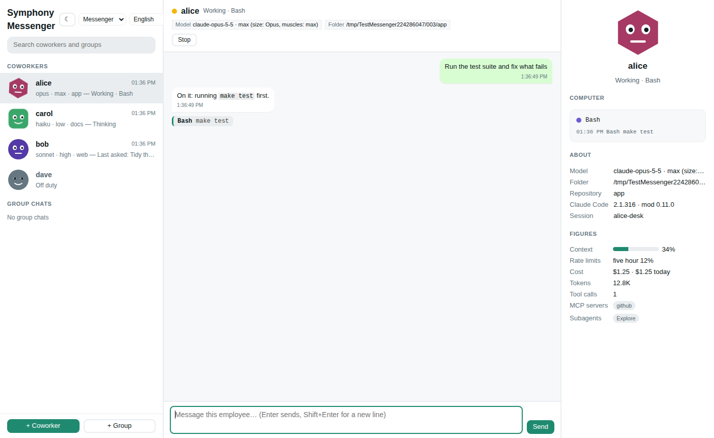

# symphony

[English](README.md) | [简体中文](README.zh-CN.md) | [繁體中文](README.zh-TW.md) | **日本語** | [한국어](README.ko.md) | [Español](README.es.md) | [Français](README.fr.md) | [Deutsch](README.de.md) | [Português (Brasil)](README.pt-BR.md) | [Русский](README.ru.md)

Claude Code のセッションをチームにまとめて、ピクセルアートのオフィスで働かせましょう。誰が作業中で誰があなたを待っているのかがひと目でわかり、社員ごとのウィンドウで会話でき、権限の承認や AskUserQuestion の質問にもそこからワンクリックで対応できます。


ページにはテーマがあります。上のピクセルオフィス、**HQ コンソール**（KPI の帯、名簿、承認キュー、プロジェクトボード、アクティビティのタイムラインを備えた管理コンソール）、**メッセンジャー**（セッションがメッセージアプリの同僚になり、顔が状態を示し、中央に会話、右にプロフィールとコンピュータ）、そして**ミッションコントロール**（サブ画面向けの管制室の壁：セッションごとにテレメトリパネル、要求はアラーム、アクティビティはティッカー）です。上のバーで選ぶと、bridge が覚えます。





## インストール

いちばん手軽な方法：Claude Code を開いて、次のように貼り付けます。

> https://github.com/feynmanzcys-bytes/symphony をインストールして

Claude Code がこの README を読み、次の節の手順をすべて実行します。手動でインストールする場合も、同じ手順に従ってください。

### AI エージェント向け：インストール手順書

あなたがこれを読んでいるのは、ユーザーに symphony のインストールを頼まれたからです。以下の手順をシェルで順番に実行し、最後にステップ 6 の報告をしてください。手順に指示がない限り、ユーザーには何も質問しないでください。よくある選択は自分で決めて、報告に書き出してください。

symphony は 2 つの部分からなり、両方が必要です。

1. **`symphony` プログラム**（bridge）：単一のバイナリで、`http://127.0.0.1:7788/` で動くローカルの Web サーバーです。オフィスのページを配信し、セッションを動かします。`symphony` という名前でユーザーの `PATH` 上に置く必要があります。動いている bridge がセッションから見つからないとき、mod が `symphony -background` で起動するからです。
2. **`symphony-bridge` プラグイン**（mod）：このリポジトリのマーケットプレイスにある Claude Code のプラグインで、ユーザースコープにインストールします。`SYMPHONY_TOKEN` を付けて起動したセッションでだけ動作し、それ以外のセッションでは何もしません。

#### ステップ 1：マシンを確認する

```bash
uname -sm                 # Linux/macOS：下のアーカイブを選ぶ（x86_64 → amd64、arm64/aarch64 → arm64）
claude --version          # Claude Code 2.1.x が必要（2.1.316 で動作確認済み）
git --version             # チームでのタスクにだけ必要。なければ報告に書き、止まらない
symphony -version         # インストール済み？ "symphony v0.12.0 (darwin/arm64)" と表示される
curl -s http://127.0.0.1:7788/api/state | head -c 40   # bridge が既に動いている？ {"type":"snapshot",... と表示される
claude plugin list --json # mod がインストール済み？ "id":"symphony-bridge@symphony" を探す
```

Windows では PowerShell を使います。`$env:PROCESSOR_ARCHITECTURE` は `AMD64` か `ARM64` で、curl の代わりに `Invoke-WebRequest http://127.0.0.1:7788/api/state` を使います。

`claude` がなければ、そこで止めて、先に Claude Code をインストールするようユーザーに伝えてください。プログラムと mod が両方そろっているなら、代わりに下の「更新」へ進んでください。

#### ステップ 2：プログラムを入手する

うまくいく最初の方法を使ってください。

- **A. `gh` で**（このリポジトリが非公開のあいだも使えます。`gh auth status` でログイン済みであることが条件です）：
  ```bash
  gh release download -R feynmanzcys-bytes/symphony --pattern 'symphony_<os>_<arch>.tar.gz' -D /tmp/symphony-dl
  ```
- **B. `curl` で**（リポジトリが公開されてからのみ。404 になったら A か C を使ってください）：
  ```bash
  curl -fL -o /tmp/symphony-dl/symphony_<os>_<arch>.tar.gz https://github.com/feynmanzcys-bytes/symphony/releases/latest/download/symphony_<os>_<arch>.tar.gz
  ```
- **C. ソースから**（Go 1.27 以降。クローンはステップ 4 でも使います）：
  ```bash
  git clone https://github.com/feynmanzcys-bytes/symphony.git /tmp/symphony-src
  cd /tmp/symphony-src && go build -o symphony ./cmd/bridge
  ```
  バイナリをビルドしてください。`-autostart` は `go run` のビルドを受け付けないので、`go run` ではだめです。

| システム | x86-64 | ARM64 |
| --- | --- | --- |
| Linux | [`symphony_linux_amd64.tar.gz`](https://github.com/feynmanzcys-bytes/symphony/releases/latest/download/symphony_linux_amd64.tar.gz) | [`symphony_linux_arm64.tar.gz`](https://github.com/feynmanzcys-bytes/symphony/releases/latest/download/symphony_linux_arm64.tar.gz) |
| macOS | [`symphony_darwin_amd64.tar.gz`](https://github.com/feynmanzcys-bytes/symphony/releases/latest/download/symphony_darwin_amd64.tar.gz)（Intel） | [`symphony_darwin_arm64.tar.gz`](https://github.com/feynmanzcys-bytes/symphony/releases/latest/download/symphony_darwin_arm64.tar.gz)（Apple シリコン） |
| Windows | [`symphony_windows_amd64.zip`](https://github.com/feynmanzcys-bytes/symphony/releases/latest/download/symphony_windows_amd64.zip) | [`symphony_windows_arm64.zip`](https://github.com/feynmanzcys-bytes/symphony/releases/latest/download/symphony_windows_arm64.zip) |

各アーカイブには、プログラム（`symphony`、Windows では `symphony.exe`）、`LICENSE`、`README.md` が入っています。リリースの `checksums.txt` には各アーカイブの SHA-256 が載っています（`sha256sum -c --ignore-missing checksums.txt`、macOS では `shasum -a 256 -c`）。

#### ステップ 3：PATH に置く

ユーザーの `PATH` に既に含まれていて、`sudo` なしで書き込めるフォルダを選んでください。候補は `~/.local/bin`、`/usr/local/bin`、`/opt/homebrew/bin` で、この順に探します。どれもなければ `~/.local/bin` を作ってシェルの rc ファイル（`~/.zshrc` か `~/.bashrc`）に追加し、そのことを報告に書いてください。

```bash
tar xzf /tmp/symphony-dl/symphony_<os>_<arch>.tar.gz -C /tmp/symphony-dl
install -m 755 /tmp/symphony-dl/symphony ~/.local/bin/symphony
xattr -d com.apple.quarantine ~/.local/bin/symphony 2>/dev/null || true   # macOS：バイナリに署名がないため
symphony -version          # "symphony v0.12.0 (linux/amd64)" と表示される：バージョンとプラットフォーム
```

Windows では、`Expand-Archive symphony_windows_<arch>.zip -DestinationPath "$env:LOCALAPPDATA\Programs\symphony"` を実行し、そのフォルダをユーザーの `Path` に追加して（`[Environment]::SetEnvironmentVariable('Path', "$([Environment]::GetEnvironmentVariable('Path','User'));$env:LOCALAPPDATA\Programs\symphony", 'User')`）、新しいシェルを開きます。初回の実行で SmartScreen が警告することがあります。「詳細情報」、次に「実行」を選んでください。

このあと自分のシェルで `symphony` が見つからない場合は（そのシェルの `PATH` は変更前に読み込まれています）、残りの手順では絶対パスを使ってください。

#### ステップ 4：mod をインストールする

```bash
claude plugin install symphony-bridge --marketplace feynmanzcys-bytes/symphony
```

これでリポジトリがプラグインマーケットプレイス `symphony` として追加され、mod が確認なしでユーザースコープにインストールされます。リポジトリは git でクローンされるので、リポジトリが非公開のあいだは GitHub への git アクセスが必要です。それが原因で失敗したら、代わりにクローンをマーケットプレイスとして使ってください（ステップ 2 C のもの、なければ新しくクローンします）：`claude plugin install symphony-bridge --marketplace /absolute/path/to/symphony`。クローンをマーケットプレイスにすると、セッションはそのフォルダから mod を読み込み、そこで `git pull` すれば mod も更新されます。

確認：

```bash
claude plugin list --json   # "id":"symphony-bridge@symphony", "scope":"user", "enabled":true のエントリーが 1 つある
```

- `"scope":"project"` か `"local"`：mod が 1 つのフォルダでしか読み込まれません。`claude plugin uninstall symphony-bridge@symphony` を実行してから、`--scope user` を付けてインストールし直してください。
- `"enabled":false`：`claude plugin enable symphony-bridge@symphony`。

#### ステップ 5：bridge を起動する

```bash
symphony -autostart on -open=false
```

これで bridge が今すぐ起動し、以後ログインのたびに起動するようになります（Linux では systemd のユーザーサービス、macOS では launchd エージェント、Windows ではレジストリの Run キー）。次のように表示されます。

```
symphony now starts when you log in (<where>); it's running at http://127.0.0.1:7788/
```

ログイン時の起動は要らないとユーザーが言っていた場合は、代わりに `symphony -background -open=false` を実行してください。bridge をターミナルから切り離して起動し、`the symphony bridge runs in the background at http://127.0.0.1:7788/; its log: <data folder>/bridge.log` と表示します。bridge が既に動いていれば、どちらのコマンドも `a symphony bridge is already running at http://127.0.0.1:7788/` と答えます。それで問題ないので、もう 1 つ起動しないでください。

リクエスト 1 つで全体のつながりを確認します。

```bash
curl -s http://127.0.0.1:7788/api/launch/options
```

応答に `"enabled":true` と `"mod":{"ok":true,"id":"symphony-bridge@symphony","version":"0.12.0"}` が含まれていれば、bridge が動いていて、`claude` を見つけ、mod がセッションの読み込む場所にインストールされています。`"enabled":false` なら、`mod.code` が何が問題かを、`mod.fix` がそれを直すコマンドを示します。`mod_not_installed` か `mod_project_scope`（ステップ 4 に戻る）、`mod_disabled`（有効にする）、`mod_check_failed`（`claude plugin list --json` が失敗したので、Claude Code が古すぎる可能性が高い）です。`"mod":null` は、bridge が自分の `PATH` 上に `claude` をまったく見つけられなかったという意味です（ログにそう出ます）。そこへ置くか、`-claude /path/to/claude` を付けて bridge を起動してください。

bridge のログはデータフォルダの `bridge.log` です（Linux では `~/.config/symphony`、macOS では `~/Library/Application Support/symphony`、Windows では `%AppData%\symphony`）。ログイン時に起動した場合、ログは Linux では `journalctl --user -u symphony`、macOS では `~/Library/Logs/symphony.log` に出ます。

#### ステップ 6：ユーザーに報告する

ブラウザでオフィスを開き（macOS では `open http://127.0.0.1:7788/`、Linux では `xdg-open`、Windows では `start`）、ユーザーに次のことを伝えてください。

- オフィスは `http://127.0.0.1:7788/` にあります。空いている席の「+」をクリックして最初の社員を採用します。フォルダを選ぶと、そこで Claude Code のセッションが bridge の中で起動し、ページ上のそのウィンドウがセッションのチャットになります。
- オフィスに表示されるのは、ページから起動したセッション（または下の「セッションを起動する」のとおり `SYMPHONY_TOKEN` を付けて手動で起動したもの）だけです。このインストールを行っているセッションも含め、ユーザーのほかの Claude Code セッションは表示されません。
- 何をどこにインストールしたか：プログラムのパス、ユーザースコープの mod、bridge をログイン時に起動するようにしたかバックグラウンドで起動したか、`PATH` を変更したならその内容、`git` がないならそのこと。
- すべてを元に戻す方法：下の「アンインストール」。

ルール：bridge はこのマシン以外にバインドしないこと（`-addr` は `127.0.0.1:7788` のまま。ページにはログイン機能がありません）、`sudo` で実行しないこと、同じアドレスで 2 つ目の bridge を起動しないこと。

#### 更新

ステップ 2 のとおり新しいリリースをダウンロードし、ステップ 3 でプログラムを置き換えます。mod は `claude plugin update symphony-bridge@symphony` で更新します（クローンをマーケットプレイスにしている場合は、代わりにそこで `git pull`）。動いている bridge は、再起動するまで古いプログラムのままです。`symphony -autostart off` のあと `symphony -autostart on -open=false` を実行してください（または、起動したときと同じ方法で止めて起動し直します）。bridge を止めると bridge が起動したセッションも終了するので、先にユーザーに伝えてください。プログラムと mod は同じバージョン番号を使います。各リリースの変更点は [CHANGELOG.md](CHANGELOG.md) にあります。

#### アンインストール

```bash
symphony -autostart off                           # bridge とそのセッションを止め、ログイン時にも起動しなくする
claude plugin uninstall symphony-bridge@symphony  # mod
claude plugin marketplace remove symphony         # マーケットプレイスの登録
rm ~/.local/bin/symphony                          # プログラム（ステップ 3 で置いた場所）
```

データフォルダ（token 付きのアカウント、メッセージ履歴、タスク）は残ります。すべて消すには、このフォルダも削除してください。

## できること

- **セッションはチャットとして見える**：社員をクリックすると、ページの中央にそのウィンドウが開きます。上に社員の情報、下にセッションのチャット：入力したプロンプト、モデルの思考（折りたたみ、進行中はオレンジの「考え中…」）、流れてくる回答、ツール呼び出し、他のセッションからのメッセージ（紫）。下の入力欄に書けばそのセッションへのプロンプトになり、「停止」ボタンで中断できます。
- **ブラウザで承認**：権限の承認（コマンドの実行やファイルの編集）と AskUserQuestion の質問は、その社員のウィンドウの入力欄の上にカードとしてせり上がり、上部バーの赤い件数からそこへ飛べます。bridge が動いていないときや、bridge がアカウントを認識できないときは、いつもどおりターミナルでの操作に戻るので、セッションが止まったままになることはありません。
- **ピクセルアートのオフィス**：セッション 1 つが、決まった席に座る社員 1 人です。緑は待機中、黄色は作業中、赤はあなたの承認か回答を待っている状態、灰色は退勤です。手の空いた社員はまず席でスマホやゲームをして、そのうちオフィスをぶらつき始めます。ラウンジのソファでテレビ、テーブルサッカー、鬼ごっこ、丸テーブルでおしゃべり、コーヒー、窓の外を眺めたり。しばらくすると昼寝に行き、たいてい会議室に隠れて寝ています。キャラクターの体格はモデルで、筋肉は思考の強さで決まります。画面は大きな会社のワンフロアで、ウィンドウいっぱいに広がります。中央に執務エリア、左に名札つきの 3〜5 人用の小会議室、右に会議室とラウンジがあり、社員はエレベーターで出退勤します。上部のバーではピクセルの大きさも 4 段階で選べます。オフィスはそのままで、細かくするほど細かいピクセルと細部で描かれます。
- **すぐ見つけて呼び戻す**：手の空いた社員をクリックすると自分の席に戻り、次の仕事までそこで待ちます。上部のバーにある検索ボックスで、名前、セッション名、フォルダから社員を探せます（`/` キーでジャンプ）。その横の状態ごとの件数（待機中・作業中・対応待ち・退勤）をクリックすると、その状態の社員がまとめて目立ちます。バーの下のつまみで、バーを上にしまったり戻したりできます。
- **セッション間のメッセージ**：セッション同士がメッセージを送り合う（SendMessage）と、オフィスの中を封筒が飛んでいきます。やり取りはメッセージ履歴に残ります。
- **ページからセッションを起動、ウィンドウは開かない**：空いている席の「+」をクリックすると新しい社員を採用でき、フォルダ、モデル、思考の強さ、権限モードを選べます（新しい社員は、すべて許可・Opus・最大の思考がデフォルト）。退勤した社員の「出勤」をクリックすると、同じ席に再出勤します。セッションは bridge の中の専用ターミナルで動くので、ウィンドウは開かず、フォーカスも奪われません。社員のウィンドウの「ターミナルを開く」でそのターミナルを表示でき、そのウィンドウを閉じても何も変わりません。
- **会議室でチームを組む**：空いている小会議室をクリックし、タスクを書いて 2〜5 人のメンバーを選びます。メンバーは社員（それぞれタスク専用の 2 つ目のセッションを持ちます）か、その場限りのアドバイザーです。デフォルトでは最初のメンバーがリーダーになり、SendMessage で担当を割り振ります。メンバーはそれぞれ自分の git worktree の自分のブランチで作業するので、互いのファイルを踏み荒らすことはありません。タスクが終わるまで、メンバーは会議室に座っています。
- **10 言語に対応**：English、简体中文、繁體中文、日本語、한국어、Español、Français、Deutsch、Português (Brasil)、Русский。ページはブラウザの言語で表示され、上部のバーで言語を切り替えられます。bridge のメッセージは `-lang`、なければシステムの言語（`LANG` など）、なければ英語になります。mod のメッセージは `SYMPHONY_LANG`（ページから起動したセッションではページの言語）、なければシステムの言語、なければ英語になります。
- **ローカルで完結**：bridge は Go のプログラム 1 つ（標準ライブラリのみ。エンドツーエンドテストでは chromedp も使います）、ページは素の JavaScript で、外部のサービスには一切依存しません。


## 必要なもの

- Claude Code 2.1.316（このバージョンで動作確認済み）。mod は Claude Code の function hooks を使っていますが、これはまだアーリーアクセスの API なので、Claude Code をアップグレードしたらエンドツーエンドテストを実行してください。
- bridge は Linux、macOS、Windows 用のビルド済みプログラムとして配布しています。Go 1.27 以降が必要なのは、ソースからビルドする場合だけです。
- `git`（チームでのタスクにだけ必要です）。タスクのメンバーは、それぞれ git worktree で作業します。
- ほかには何も要りません。ページから起動したセッションは、どのプラットフォームでも bridge の中で動きます。

## bridge を動かす

`symphony` を実行すると bridge が起動し、ブラウザでオフィス <http://127.0.0.1:7788/> が開きます（`-open=false` で無効にできます）。<http://127.0.0.1:7788/approve> は承認だけを行うシンプルなページです。bridge が動いているときにもう一度起動すると、オフィスを開くだけです。Windows で `symphony.exe` をダブルクリックすると専用のウィンドウで動き、そのウィンドウを閉じると bridge も止まります。

| フラグ | デフォルト | 説明 |
| --- | --- | --- |
| `-addr` | `127.0.0.1:7788` | 待ち受けるアドレス。ページにはまだログイン機能がないので、このマシン以外のアドレスにはバインドしないでください |
| `-data` | `$SYMPHONY_DATA`、なければ設定フォルダ内の `symphony` | データフォルダ。token 付きのアカウント（`accounts.json`）、メッセージ履歴（`messages.json`）、タスク（`tasks.json`）、`-background` のログ（`bridge.log`）が入ります |
| `-claude` | `claude` | claude の実行ファイル |
| `-lang` | システムの言語、なければ `en` | bridge のメッセージの言語（デフォルトは `SYMPHONY_LANG`、`LC_ALL`、`LC_MESSAGES`、`LANG` で決まります） |
| `-mod` | なし | 開発用：このフォルダの mod を `--plugin-dir` でセッションに渡し、インストール済みのものより優先させる |
| `-web` | なし | 開発用：このフォルダのページを配信し、編集を再読み込みで反映させる |
| `-open` | `true` | bridge の起動後にブラウザでオフィスを開く。`-addr` で既に bridge が動いていれば、そのオフィスを開くだけ |
| `-autostart` | — | `on`：ログインのたびに bridge を自動で起動し（ほかに指定したフラグ付き）、今すぐ起動する。`off`：元に戻す |
| `-background` | — | bridge をバックグラウンドで起動する。ターミナルから切り離し、ログはデータフォルダの `bridge.log` に書き、応答するようになったら戻る |
| `-version` | — | バージョンを表示して終了する |

**ログイン時に起動**：`symphony -autostart on` を実行すると、以後ログインのたびに bridge が自動で起動し（一緒に指定したフラグ、たとえば `-addr` も引き継ぎます）、今すぐにも起動します。`symphony -autostart off` で元に戻せます。Linux では systemd のユーザーサービス（ログは `journalctl --user -u symphony` で見られます）、macOS では launchd エージェント（ログは `~/Library/Logs/symphony.log`）、Windows ではレジストリの Run キーの値です（bridge はコンソールウィンドウで動き、閉じると次のログインまで止まります）。`go run` ではなく、symphony プログラムそのものが必要です。

**ソースから**（Go 1.27 以降）：`git clone https://github.com/feynmanzcys-bytes/symphony.git && cd symphony && go run ./cmd/bridge`。

## セッションを起動する

**ページから**：空いている席の「+」をクリックし、名前を入力して、フォルダとオプションを選びます。bridge は自分の中の専用ターミナルで `claude` を実行し、ウィンドウは開きません。社員のウィンドウにセッションがチャットとして表示され、「ターミナルを開く」ボタンでそのセッションに接続したターミナルウィンドウが開きます（どのターミナルからでも `symphony attach <id>` で同じことができます。`Ctrl-]` かウィンドウを閉じると切り離され、セッションは続きます）。セッションは bridge の子プロセスなので、bridge を止めるとセッションも終了します。

**ターミナルから**：アカウントを作って token を受け取り、その token を付けて `claude` を起動します。

```bash
curl -X POST 127.0.0.1:7788/api/accounts -d '{"name":"frontend-alice"}'   # レスポンスに token が含まれます
SYMPHONY_TOKEN=<token> claude --name frontend-alice --permission-mode manual
```

権限モードは `manual` がおすすめです。`auto` モードではほとんどの操作で誰にも確認しないので、ページに届く承認がほとんどなくなります。bridge がデフォルトのアドレスにない場合は、`SYMPHONY_BRIDGE=http://host:port` も設定してください。mod のメッセージの言語は `SYMPHONY_LANG` で選べます（なければシステムの言語、なければ英語）。

このマシン上の bridge のアドレスが応答しないときは、セッションが `symphony -background -open=false -addr <that address>` で bridge を自分で起動します（`symphony` が PATH にある場合）。bridge はセッションが終わっても動き続けます。アカウントが既定のデータフォルダにない場合は `SYMPHONY_DATA` を設定してください。

## チームでのタスク

小会議室では、2〜5 人のセッションがチームになって 1 つのタスクに取り組みます。タスクには `git` と、0.7.0 の mod が必要です（`claude plugin update symphony-bridge@symphony`）。

**タスクを始める**：空いている小会議室をクリックし、やってほしいことを書きます。メンバーを好きな順にチェックし（2 人から部屋の席数まで）、それぞれのモデルと思考の強さ、チーム全体の権限モード（デフォルトはすべて許可）を選んで、「タスクを開始」をクリックします。メンバーは次のどちらかです。

- **社員**：タスク専用の 2 つ目のセッションが、その社員のフォルダで動きます。席にいるほうのセッションはそのままです。社員が同時に参加できるタスクは 1 つだけです。まだ一度も働いたことのない社員にはフォルダがないので、先に一度「出勤」をクリックしてください。
- **アドバイザー**：このタスクのためだけに、いつもの項目（名前、フォルダ、モデル、思考の強さ）で作る一時的なメンバーです。席はなく、エレベーターでやって来て、タスクが終わるといなくなります。

**リーダー**：デフォルトでは最初のメンバーがリーダーです。タスクを分け、SendMessage で担当を割り振り、成果をレビューし、ほかのメンバーのブランチを自分のブランチにマージして、何をやったかをあなたに報告します。リーダーのチェックを外すと、全員がタスク全体を受け持ち、メンバー同士で分担を決めます。どちらの場合も、各メンバーへの最初のプロンプトは bridge が送ります。そこには、チームの顔ぶれ（メンバーは SendMessage で名前を指定して互いに連絡します）、全員のブランチ、ルールが書かれています。

**git まわり**：メンバーはそれぞれ、自分のフォルダの専用の git worktree で、自分のブランチ `symphony/<task id>/<member>`（たとえば `symphony/T1/bob`。同じ名前のメンバーが 2 人目なら `-2` が付きます）の上で作業します。互いのファイルを踏み荒らすことはなく、あなた自身のチェックアウトもそのままです。worktree はフォルダの中の `.symphony/worktrees/` に置かれ、`.git/info/exclude` で git から見えないようにします（あなたの `.gitignore` には触れません）。タスクが終わると、メンバーがコミットしていなかった変更はそのメンバーのブランチにコミットされるので何も失われず、worktree は削除されます。

- あなた自身のリポジトリでは何もマージしません。ブランチはそのまま残るので、あなたがマージします。リーダーがいれば、全員の成果はリーダーのブランチに集まっています。
- git リポジトリではないフォルダは、タスクのためにリポジトリになり（`git init` して、中身をすべてコミット）、その後もリポジトリのままです。タスクが終わるとメンバーのブランチがそこへマージされ、フォルダには結果が入ります。`.git` もブランチも残ります。
- マージに失敗したときはそのマージを取り消すので、ベースはマージ前のままです。ブランチは作業ごと残り、どのブランチが衝突したかをタスクのウィンドウに表示します。

**オフィスでは**：タスクのあいだ、メンバーは会議室のテーブルに座り、社員の席には空いた椅子だけが残ります。会議室の名札にはタスクの ID が出ます。名札のランプは、空いているときは緑、タスクの実行中は黄色、メンバーがあなたの承認か回答を待っているときは赤になります。会議室をクリックするとタスクのウィンドウが開き、タスクの内容、メンバーとそれぞれのフォルダとブランチ、チームチャット、「タスクを終了」が表示されます。会議室にいるメンバー本人をクリックしても、開くのはタスクのウィンドウです。タスクのウィンドウでメンバーをクリックすると、そのメンバーのチャットウィンドウがタスクのウィンドウの横に並んで開きます。中身は社員のウィンドウと同じで、開けるのは一度に一人だけです（別のメンバーをクリックすると切り替わります）。上部バーの赤い件数や検索ボックスからタスクのメンバーを開いたときも同じです。

**チームチャット**：タスクのウィンドウには、メンバー同士が送り合ったメッセージが並びます。どれも送り主のピクセルキャラと名前つきで、本文は `@` と宛先から始まります。その下の入力欄から、あなたもチームに書き込めます。`@bob-T1 …` はそのメンバーだけに届きます（`@names` を複数書けば、その全員に届きます。`@` を打つとメンバーの一覧が出るので、矢印キーと Enter かクリックで選べます）。`@` のないメッセージはタスクの全員に届きます。Enter で送信、Shift+Enter で改行です。

タスクは、タスクのウィンドウで終了したときか、最後のセッションが終わったときに終わります。bridge はメンバーのセッションを止め、上のとおり git まわりを片づけて、アドバイザーを削除します。bridge を止めたときにまだ実行中だったタスクは、次に bridge を起動したときに同じように終了されます。

## アカウントと席

- symphony では、名前・token・固定の席の 3 つがそろって 1 つのアカウントになります。1 つのアカウントを同時に使えるセッションは 1 つだけです（参加中のタスク用に、もう 1 つ持てます）。それ以外のセッションは拒否され、その承認はターミナルで行うことになります。
- Claude へのログインは symphony では管理しません。すべてのセッションで 1 つの Claude ログインを共有してかまいません。
- データは `~/.config/symphony`（Linux）、`~/Library/Application Support/symphony`（macOS）、`%AppData%\symphony`（Windows）、または `-data` / `SYMPHONY_DATA` で指定した場所に保存されます。`accounts.json` には token が入っているので、所有者だけが読めるようになっています（0600）。Windows ではユーザーフォルダのアクセス権で保護されます。

## セキュリティ

- bridge はこのマシン宛てのリクエストだけを受け付け、ほかの Web サイトがあなたのブラウザ経由で送ってくる書き込みリクエストは拒否します。ページからセッションを起動できる、つまりこのマシンでコマンドを実行できるからです。
- ページにはまだログイン機能がないので、bridge をこのマシン以外のアドレスに**バインドしないでください**。
- プログラムには署名がありません。ブラウザでダウンロードした場合、macOS は開発元を検証できないとして実行を拒むことがあります。「システム設定 → プライバシーとセキュリティ」で「このまま開く」をクリックするか、`xattr -d com.apple.quarantine symphony` を一度実行してください。Windows でも SmartScreen が警告することがあります。「詳細情報」をクリックしてから「実行」を選んでください。リリースの `checksums.txt` には各アーカイブの SHA-256 が載っています。

## 対応プラットフォーム

| OS | ページから起動したセッション | 「ターミナルを開く」 | テスト状況 |
| --- | --- | --- | --- |
| Linux | bridge の中の疑似ターミナル | グラフィカルなターミナル（x-terminal-emulator、gnome-terminal、konsole、xterm）で `symphony attach` を実行 | エンドツーエンドテストまで実施 |
| macOS | bridge の中の疑似ターミナル | Terminal.app で `symphony attach` を実行 | エンドツーエンドテストまで実施 |
| Windows | bridge の中の疑似コンソール（ConPTY） | 新しいコンソールウィンドウで `symphony attach` を実行 | クロスコンパイルと単体テストのみ |

「このフォルダを信頼する」には、どのプラットフォームでも bridge があなたの代わりに答えます。

## 開発

```bash
go test -race ./...                         # bridge と翻訳の単体テスト
claude plugin test mods/symphony-bridge     # mod の単体テスト
claude plugin validate .                    # マーケットプレイスをチェック
claude plugin validate mods/symphony-bridge  # mod をチェック
SYMPHONY_E2E=1 go test -tags e2e -v -count=1 -timeout 20m ./e2e/   # エンドツーエンド：本物のセッションを起動し、token を消費します
```

- mod を開発するとき：`go run ./cmd/bridge -mod mods/symphony-bridge` で起動すると、ページから起動したセッションには手元の mod が `--plugin-dir` で渡されます。手動で起動するセッションには、自分で `--plugin-dir mods/symphony-bridge` を付けてください。
- ページを開発するとき：`go run ./cmd/bridge -web web` で起動すると、再読み込みするだけで編集が反映されます。
- 本物のセッションなしでオフィスを見るとき：2 つ目の bridge を起動して、架空のアクティビティを流し込みます。`go run ./cmd/bridge -addr 127.0.0.1:7799 -data /tmp/demo` を実行してから、`go run ./cmd/demo -base http://127.0.0.1:7799` を実行してください。
- 翻訳：1 言語につき 1 ファイルで、ページ用は `web/locales/<lang>.json`、bridge 用は `internal/i18n/locales/<lang>.json` です。キーは `en.json` と同じです。mod のわずかなメッセージは `mods/symphony-bridge/hooks/messages.ts` にあります。単体テストでは、すべての言語にすべてのキーがそろっていて、`{placeholders}` も一致していることを確認します。エンドツーエンドテストの `TestI18n` は、すべての言語でページを開いて確かめます。
- エンドツーエンドテストには claude、tmux（テストが自分で動かすセッション用）、Chromium か Chrome が必要なので、Linux と macOS で実行できます。デフォルトではこのリポジトリの mod を使います。インストール済みの mod を使うには `SYMPHONY_E2E_MOD=installed` を設定してください。スクリーンショットは `e2e/artifacts/` に保存されます。
- リリース：`mods/symphony-bridge/.claude-plugin/plugin.json` のバージョンを上げ、`CHANGELOG.md` に `## vX.Y.Z (date)` の節を追加し、dev を main に取り込んでから、main 上のそのコミットにタグを付けて push します（`git tag -a v0.7.0 -m v0.7.0 && git push origin v0.7.0`）。GitHub Actions は、タグが `plugin.json` のバージョンと一致していることとその節があることを確認し、全プラットフォーム向けにプログラムをビルドして、ノートがその節で始まるリリースを公開します（`.github/workflows/release.yml`。`-rc.1` のようなサフィックスを付けるとプレリリースになります）。`.github/release.sh v0.7.0 dist` で同じアーカイブを手元で作れます。

| フォルダ | 内容 |
| --- | --- |
| `mods/symphony-bridge/` | Claude Code の mod（TypeScript） |
| `.claude-plugin/marketplace.json` | `claude plugin install` が読み込むプラグインマーケットプレイス |
| `cmd/bridge/`、`internal/bridge/` | bridge |
| `internal/i18n/` | 言語の判定と bridge の翻訳 |
| `web/` | オフィスと承認ページ、およびその翻訳（bridge に組み込まれます） |
| `cmd/demo/` | オフィス用の架空のアクティビティ |
| `e2e/` | エンドツーエンドテスト |

## ライセンス

[MIT](LICENSE)
