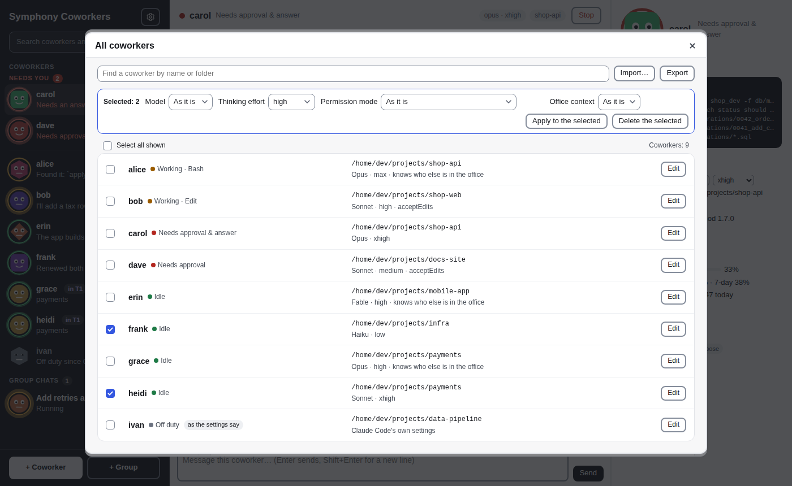

# symphony

[English](README.md) | [简体中文](README.zh-CN.md) | [繁體中文](README.zh-TW.md) | **日本語** | [한국어](README.ko.md) | [Español](README.es.md) | [Français](README.fr.md) | [Deutsch](README.de.md) | [Português (Brasil)](README.pt-BR.md) | [Русский](README.ru.md)

symphony は独立したプロジェクトです。Anthropic とは提携しておらず、Anthropic による承認や後援も受けていません。Claude および Claude Code は Anthropic, PBC の商標です。

Claude Code のセッションをチームにまとめて、メッセージアプリの同僚のように 1 つのページに並べましょう。誰が作業中で誰があなたを待っているのかがひと目でわかり、セッションごとの会話でやり取りでき、権限の承認や AskUserQuestion の質問にもそこからワンクリックで対応できます。


これが**同僚**、symphony が開くページです。左にセッションの一覧（顔が状態を示します）、中央に会話、右にプロフィールとコンピュータがあり、チームはグループチャットになります。全体はアイボリーとクレイ（土の色）の温かみのある配色（ライトでもダークでも）で、見出しはセリフ体です。

## インストール

いちばん手軽な方法：Claude Code を開いて、次のように貼り付けます。

> https://github.com/feynmanzcys-bytes/symphony をインストールして

Claude Code がこの README を読み、次の節の手順を実行します。インストールのあとまで残る変更をする前には、あなたに確認します。手動でインストールする場合も、同じ手順に従ってください。

### AI エージェント向け：インストール手順書

あなたがこれを読んでいるのは、ユーザーに symphony のインストールを頼まれたからです。以下の手順をシェルで順番に実行し、最後にステップ 6 の報告をしてください。よくある選択（アーカイブ、`PATH` 上のフォルダ）は自分で決めてかまいませんが、このインストールのあとまで残る変更をする前には、ユーザーに確認してください。ログインのたびに symphony を起動すること、シェルの rc ファイルの編集、ユーザーの `PATH` の変更がそれにあたります。選んだことはすべて報告に書き出してください。

symphony は 2 つの部分からなり、両方が必要です。

1. **`symphony` プログラム**（bridge）：単一のバイナリで、`http://127.0.0.1:7788/` で動くローカルの Web サーバーです。オフィスのページを配信し、セッションを動かします。`symphony` という名前でユーザーの `PATH` 上に置いてください。動いている bridge がセッションから見つからないとき、mod が `symphony -background` で起動するからです。
2. **`symphony-bridge` プラグイン**（mod）：このリポジトリのマーケットプレイスにある Claude Code のプラグインで、ユーザースコープにインストールします。`SYMPHONY_TOKEN` を付けて起動したセッションでだけ動作し、それ以外のセッションでは何もしません。

#### ステップ 1：マシンを確認する

```bash
uname -sm                 # Linux/macOS：下のアーカイブを選ぶ（x86_64 → amd64、arm64/aarch64 → arm64）
claude --version          # Claude Code 2.1.x が必要（2.1.317 で動作確認済み）
git --version             # 専用の git ブランチを使うグループにだけ必要。なければ報告に書き、止まらない
symphony -version         # インストール済み？ "symphony v1.6.0 (darwin/arm64)" と表示される
curl -s -o /dev/null -w '%{http_code}\n' http://127.0.0.1:7788/api/state   # bridge が動いている？ 401：symphony 1.x、200：それより古いもの、000：なし
claude plugin list --json # mod がインストール済み？ "id": "symphony-bridge@symphony" のエントリーを探す
brew --version            # Homebrew はある？（macOS、Linux）あればステップ 2 でそれを使ってインストールできる
```

Windows では PowerShell を使います。`$env:PROCESSOR_ARCHITECTURE` は `AMD64` か `ARM64` です。`scoop --version` が応答すれば Scoop が入っています。

`claude` がなければ、そこで止めて、先に Claude Code をインストールするようユーザーに伝えてください。プログラムと mod が両方そろっているなら、代わりに下の「更新」へ進んでください。片方だけなら、足りないほうのステップを行います。プログラムにはステップ 2 と 3（`symphony -version` が既に最新のリリースを表示するなら不要）、mod にはステップ 4、そのあとステップ 5 です。既に動いている bridge は、起動したときのプログラムのまま動き続けます。動いていれば、ステップ 5 の前にそれを止めることになります。

#### ステップ 2：プログラムを入手する

**Homebrew か Scoop で。** このリポジトリは Homebrew の tap と Scoop の bucket も兼ねています。ステップ 1 で Homebrew（macOS、Linux）か Scoop（Windows）が見つかったら、このステップの残りとステップ 3 の代わりに、それでインストールできます。最新リリースのアーカイブをダウンロードし、formula か manifest にある SHA-256（リリースが出たときに、その `checksums.txt` から書き込まれたもの）で確認して、`symphony` を `PATH` に置いてくれます。そのあとはステップ 4 に進み、どちらでインストールしたかを報告に書いてください。

```bash
brew tap feynmanzcys-bytes/symphony https://github.com/feynmanzcys-bytes/symphony
brew install symphony
symphony -version          # バージョンとプラットフォームが表示される
```

```powershell
scoop bucket add symphony https://github.com/feynmanzcys-bytes/symphony
scoop install symphony
symphony -version
```

それ以外の場合は、このマシン用のアーカイブとリリースの `checksums.txt` を、新しく作った専用のフォルダにダウンロードし、何かをインストールする前にアーカイブを確認してください。アーカイブは `symphony_<os>_<arch>.tar.gz`（`<os>` は `linux` か `darwin`（macOS）、`<arch>` は `amd64` か `arm64`）と、`symphony_windows_<arch>.zip` です。

Linux と macOS では：

```bash
d=$(mktemp -d)   # 自分だけが読める新しいフォルダ
echo "$d"        # 書き留めておく：ステップ 3 はここからインストールする
cd "$d"
curl -fsSLO https://github.com/feynmanzcys-bytes/symphony/releases/latest/download/symphony_<os>_<arch>.tar.gz
curl -fsSLO https://github.com/feynmanzcys-bytes/symphony/releases/latest/download/checksums.txt
if command -v sha256sum >/dev/null; then sha256sum -c --ignore-missing checksums.txt; else shasum -a 256 -c --ignore-missing checksums.txt; fi   # "symphony_<os>_<arch>.tar.gz: OK" と表示されなければならない
tar xzf symphony_<os>_<arch>.tar.gz              # これでプログラムは "$d/symphony" にある
```

確認で `OK` と表示されなければ、そこで止めてください。プログラムはインストールせず、ユーザーに伝えます。curl の代わりに `gh` を使う場合は、`$d` にダウンロードし（フォルダがまだなければ gh が作ります）、そこで同じ確認と `tar` を実行します。

```bash
gh release download -R feynmanzcys-bytes/symphony -p 'symphony_<os>_<arch>.tar.gz' -p checksums.txt -D "$d"
```

Windows では、PowerShell で：

```powershell
$arch = if ($env:PROCESSOR_ARCHITECTURE -eq 'ARM64') { 'arm64' } else { 'amd64' }
$zip = "symphony_windows_$arch.zip"
$d = Join-Path $env:TEMP ("symphony-" + [guid]::NewGuid())   # 新しいフォルダ
New-Item -ItemType Directory -Path $d | Out-Null
$url = 'https://github.com/feynmanzcys-bytes/symphony/releases/latest/download'
Invoke-WebRequest -UseBasicParsing -Uri "$url/$zip" -OutFile (Join-Path $d $zip)
Invoke-WebRequest -UseBasicParsing -Uri "$url/checksums.txt" -OutFile (Join-Path $d 'checksums.txt')
$want = ((Select-String -SimpleMatch -Path (Join-Path $d 'checksums.txt') -Pattern $zip).Line -split '\s+')[0]
$got = (Get-FileHash -Algorithm SHA256 -LiteralPath (Join-Path $d $zip)).Hash
if ($got -ne $want) { throw "checksum mismatch: $zip" } else { 'checksum OK' }
```

続いて、`gh` がインストールされていてログイン済み（`gh auth status` が成功する）なら、アーカイブがどこでビルドされたかを確認します。リリースのどのアーカイブにも、このリポジトリのリリース workflow がビルドしたことを示す GitHub の構成証明（attestation）が付いています。ターミナルの外では、確認が通っても `gh` は何も表示しないので、終了ステータスで判断してください。

```bash
gh attestation verify "$d/symphony_<os>_<arch>.tar.gz" --repo feynmanzcys-bytes/symphony && echo 'attestation OK'
```

```powershell
gh attestation verify (Join-Path $d $zip) --repo feynmanzcys-bytes/symphony
if ($LASTEXITCODE -eq 0) { 'attestation OK' }
```

v1.2.0 より前のリリースには構成証明がありません（`no attestations found`）。それらは SHA-256 の確認だけで判断します。それ以外の失敗なら、SHA-256 の確認が通らないときと同じく止めてください。`gh` がない、またはログインしていない場合は、この確認を飛ばし、そのことを報告に書いてください。

**ソースから**（Linux か macOS で、ユーザーがそれを望む場合。Go 1.27 以降）。バイナリをビルドしてください。`-autostart` は `go run` のビルドを受け付けないので、`go run` ではだめです。

```bash
d=$(mktemp -d)
git clone https://github.com/feynmanzcys-bytes/symphony.git "$d/src"
cd "$d/src" && go build -o "$d/symphony" ./cmd/bridge   # これでプログラムは "$d/symphony" にある（アーカイブの場合と同じ）
```

| システム | x86-64 | ARM64 |
| --- | --- | --- |
| Linux | [`symphony_linux_amd64.tar.gz`](https://github.com/feynmanzcys-bytes/symphony/releases/latest/download/symphony_linux_amd64.tar.gz) | [`symphony_linux_arm64.tar.gz`](https://github.com/feynmanzcys-bytes/symphony/releases/latest/download/symphony_linux_arm64.tar.gz) |
| macOS | [`symphony_darwin_amd64.tar.gz`](https://github.com/feynmanzcys-bytes/symphony/releases/latest/download/symphony_darwin_amd64.tar.gz)（Intel） | [`symphony_darwin_arm64.tar.gz`](https://github.com/feynmanzcys-bytes/symphony/releases/latest/download/symphony_darwin_arm64.tar.gz)（Apple シリコン） |
| Windows | [`symphony_windows_amd64.zip`](https://github.com/feynmanzcys-bytes/symphony/releases/latest/download/symphony_windows_amd64.zip) | [`symphony_windows_arm64.zip`](https://github.com/feynmanzcys-bytes/symphony/releases/latest/download/symphony_windows_arm64.zip) |

各アーカイブには、プログラム（`symphony`、Windows では `symphony.exe`）、`LICENSE`、`README.md` が入っています。リリースの `checksums.txt` には各アーカイブの SHA-256 が載っています。

#### ステップ 3：PATH に置く

ステップ 2 のプログラム `$d/symphony` をインストールします（シェルがコマンドのあいだで変数を保持しない場合は、ステップ 2 で表示したフォルダを書き出してください）。ユーザーの `PATH` に既に含まれていて、`sudo` なしで書き込めるフォルダを使います。候補は `~/.local/bin`、`/usr/local/bin`、`/opt/homebrew/bin` で、この順に探します。

```bash
install -m 755 "$d/symphony" ~/.local/bin/symphony
xattr -d com.apple.quarantine ~/.local/bin/symphony 2>/dev/null || true   # macOS：バイナリに署名がないため
symphony -version          # "symphony v1.6.0 (linux/amd64)" と表示される：バージョンとプラットフォーム
```

どのフォルダも `PATH` に含まれていなければ、何かを変更する前にユーザーに確認してください。了承されたら、`~/.local/bin` を作ってシェルの rc ファイル（`~/.zshrc` か `~/.bashrc`）に追加し、そのことを報告に書きます。断られたら、ユーザーが指定する場所にプログラムをインストールし、`symphony` が Claude Code セッションの `PATH` 上にないあいだは mod が bridge を自分で起動できないことを伝えてください（ステップ 5 のログイン時の起動は使えます）。

Windows では、専用のフォルダに展開します（`$d` と `$zip` はステップ 2 のものです。新しいシェルなら設定し直してください）。

```powershell
$dest = Join-Path $env:LOCALAPPDATA 'Programs\symphony'
Expand-Archive -LiteralPath (Join-Path $d $zip) -DestinationPath $dest -Force
& (Join-Path $dest 'symphony.exe') -version   # "symphony v1.6.0 (windows/amd64)" と表示される
```

そのフォルダをユーザーの `Path` に追加するのは、あとまで残る変更です。先にユーザーに確認してください。了承されたら下の行を実行して新しいシェルを開き、断られたらフルパスを使います。`Expand-Archive` で展開したプログラムにはダウンロードの印が付かないので、SmartScreen には止められません。エクスプローラーの「すべて展開」で展開してダブルクリックした場合は止められることがあります。「詳細情報」、次に「実行」を選んでください。

```powershell
[Environment]::SetEnvironmentVariable('Path', [Environment]::GetEnvironmentVariable('Path', 'User') + ";$dest", 'User')
```

このあと自分のシェルで `symphony` が見つからない場合は（そのシェルの `PATH` は変更前に読み込まれています）、残りの手順では絶対パスを使ってください。

#### ステップ 4：mod をインストールする

```bash
claude plugin install symphony-bridge --marketplace feynmanzcys-bytes/symphony
```

これでリポジトリがプラグインマーケットプレイス `symphony` として追加され、mod が確認なしでユーザースコープにインストールされます。代わりに、リポジトリのローカルのクローンをマーケットプレイスにすることもできます：`claude plugin install symphony-bridge --marketplace /absolute/path/to/symphony`。その場合、セッションはそのフォルダから mod を読み込み、そこで `git pull` すれば mod も更新されるので、そのクローンは一時フォルダではなく、ずっと残る場所に置いてください。

確認：

```bash
claude plugin list --json   # "id": "symphony-bridge@symphony", "scope": "user", "enabled": true のエントリーが 1 つある
```

- `"scope": "project"` か `"local"`：mod が 1 つのフォルダでしか読み込まれません。`claude plugin uninstall symphony-bridge@symphony` を実行してから、`--scope user` を付けてインストールし直してください。
- `"enabled": false`：`claude plugin enable symphony-bridge@symphony`。

#### ステップ 5：bridge を起動する

ステップ 1 で動いている bridge が見つかった場合は、下の「更新」のとおり、まずそれを止めてください。その bridge は古いプログラムで動いているので、新しいプログラムを起動しても、それが動いているのを見つけて引き下がるだけです。止めるとその bridge が起動したセッションも終了するので、先にユーザーに伝えてください。

symphony をログインのたびに起動するかどうか、ユーザーに確認してください。

起動する場合：

```bash
symphony -autostart on -open=false
```

これで bridge が今すぐ起動し、以後ログインのたびに起動するようになります（Linux では systemd のユーザーサービス、macOS では launchd エージェント、Windows ではレジストリの Run キー）。日付と時刻のあとに、次のように表示されます。

```
symphony now starts when you log in (<where>); it's running at http://127.0.0.1:7788/?key=<key>
```

起動しない場合：

```bash
symphony -background -open=false
```

これで bridge がターミナルから切り離されて起動し（マシンを再起動したあとは起動しません）、標準エラー出力に、日付と時刻のあとに続けて次のように表示されます。

```
the symphony bridge runs in the background at http://127.0.0.1:7788/?key=<key>; its log: <data folder>/bridge.log
```

このバージョンの bridge が既に動いていれば、代わりに同じように `a symphony bridge is already running at http://127.0.0.1:7788/?key=<key>` と表示されます。それで問題ないので、もう 1 つ起動しないでください。`<key>` はページの鍵で、ブラウザはこれでオフィスにログインします。ほかの場所には貼り付けないでください。プログラムが `127.0.0.1:7788 is taken: another program, or a symphony bridge with another data folder, answers there` と答えたら、そこで何が応答しているかをユーザーに伝え（古い symphony の bridge もこれに当たります。「更新」のとおり止めてください）、確認せずに別のアドレスを選ばないでください。

データフォルダにあるページの鍵を示すリクエスト 1 つで、全体のつながりを確認します（鍵は標準入力から渡すので、ほかのユーザーにも見えるコマンドラインには載りません）。

```bash
printf 'X-Symphony-Key: %s\n' "$(cat "${SYMPHONY_DATA:-${XDG_CONFIG_HOME:-$HOME/.config}/symphony}/key")" | curl -s -H @- http://127.0.0.1:7788/api/launch/options      # Linux
printf 'X-Symphony-Key: %s\n' "$(cat "${SYMPHONY_DATA:-$HOME/Library/Application Support/symphony}/key")" | curl -s -H @- http://127.0.0.1:7788/api/launch/options   # macOS
```

```powershell
$data = if ($env:SYMPHONY_DATA) { $env:SYMPHONY_DATA } else { Join-Path $env:APPDATA 'symphony' }
(Invoke-WebRequest -UseBasicParsing -Headers @{ 'X-Symphony-Key' = (Get-Content (Join-Path $data 'key')) } -Uri http://127.0.0.1:7788/api/launch/options).Content
```

データフォルダは、Linux では `~/.config/symphony`（`$XDG_CONFIG_HOME` が設定されていれば `$XDG_CONFIG_HOME/symphony`）、macOS では `~/Library/Application Support/symphony`、Windows では `%AppData%\symphony` です。`SYMPHONY_DATA` が設定されていれば、そこになります。

応答に `"enabled":true` と `"mod":{"ok":true,"id":"symphony-bridge@symphony","version":"1.1.1"}` が含まれていれば、bridge が動いていて、`claude` を見つけ、mod がセッションの読み込む場所にインストールされています。`"enabled":false` なら、`mod.code` が何が問題かを、`mod.fix` がそれを直すコマンドを示します。`mod_not_installed` か `mod_project_scope`（ステップ 4 に戻る）、`mod_disabled`（有効にする）、`mod_check_failed`（`claude plugin list --json` が失敗したので、Claude Code が古すぎる可能性が高い）です。`"mod":null` は、bridge が自分の `PATH` 上に `claude` をまったく見つけられなかったという意味です（ログにそう出ます）。そこへ置くか、`-claude /path/to/claude` を付けて bridge を起動してください。`"code":"page_key"` を含む応答は、リクエストが鍵を示さなかったか、違う鍵を示したという意味です。`cat` が鍵ファイルを見つけたか確かめてください（データフォルダは上で説明したとおりです）。見つけていたなら、動いている bridge は別のデータフォルダで起動されています。

bridge のログはデータフォルダの `bridge.log` です。ログイン時に起動した場合、ログは Linux では `journalctl --user -u symphony`、macOS では `~/Library/Logs/symphony.log` に出ます。

#### ステップ 6：ユーザーに報告する

`symphony` を実行してオフィスを開きます。bridge が動いていれば、ログイン済みのオフィスを既定のブラウザで開いて終了します。`?key=` 付きのアドレスも表示し、それを開けばこのマシンのどのブラウザでもログインできます。

ユーザーに次のことを伝えてください。

- オフィスを開くには `symphony` を実行します（ダブルクリックでもかまいません）。既にログイン済みのブラウザなら、`http://127.0.0.1:7788/` だけでも開けます。一覧の下の「+ 同僚」をクリックして最初の社員を採用します。名前を付けると、Claude Code のセッションが bridge の中で、新しく作られた専用フォルダ（または「詳細設定」で選んだフォルダ）で起動し、ページ上のその会話がセッションのチャットになります。設定 →「同僚」→「全同僚」ではすべての社員を一覧でき、新しい社員の名簿もインポートできます。
- 新しい社員は、ダイアログで別のものを選ばない限り、ユーザーの Claude Code の設定（モデル、思考の強さ、権限モード）に従います。`bypassPermissions` はすべてのコマンドと編集を確認なしで実行するので、セッションが読んだ内容によって、ユーザーの権限でコマンドを実行させられるおそれがあります。これを選ぶとダイアログが警告します。
- どのセッションも、普通の Claude Code セッションと同じように、ユーザーの Claude のプランか API クレジットを消費します。タスクは 2〜20 個のセッションを同時に動かします。
- オフィスに表示されるのは、ページから起動したセッション（または下の「セッションを起動する」のとおり `SYMPHONY_TOKEN` を付けて手動で起動したもの）だけです。このインストールを行っているセッションも含め、ユーザーのほかの Claude Code セッションは表示されません。
- 何をどこにインストールしたか：プログラムのパス、ユーザースコープの mod、bridge をログイン時に起動するようにしたかバックグラウンドで起動したか、`PATH` や rc ファイルを変更したならその内容、自分で決めた選択、`git` がないならそのこと。
- すべてを元に戻す方法：下の「アンインストール」。

ルール：bridge はこのマシンでだけ待ち受けます（このマシン以外のアドレスは拒否します。ユーザーが別のポートを選ばない限り、既定の `127.0.0.1:7788` のままにしてください）。`sudo` で実行しないこと、同じアドレスや同じデータフォルダで 2 つ目の bridge を起動しないこと（symphony はそれを拒否し、動いている bridge を示します）。

#### 更新

ステップ 2 のとおり新しいリリースをダウンロードします。動いている bridge は再起動するまで古いプログラムのままなので（Windows では、動いているプログラムを置き換えることもできません）、`symphony -stop` で bridge を止め、ステップ 3 のとおりプログラムを置き換えてから、前と同じ方法でもう一度起動します。ログイン時に起動するようにしていたなら `symphony -autostart on -open=false`（これで今すぐにも起動します）、そうでなければ `symphony -background -open=false` です。bridge をデフォルト以外の `-addr` や `-data` で動かしている場合は、これらのコマンドのどれにも同じものを付けてください。`-stop` が止めるのはそのデータフォルダの bridge だけで（`-addr` で、またはそのフォルダの bridge が実際に動いている場所で）、何も応答しなければ `nothing to stop` と表示します。bridge を止めると bridge が起動したセッションも終了するので、先にユーザーに伝えてください。（`-stop` は v1.1.0 で加わりました。v1.0.0 の bridge を止めるには、そのプロセスを終了させます。Linux と macOS では `pkill -x symphony`、Windows では `Stop-Process -Name symphony` です。）

Homebrew か Scoop でインストールした場合は、ダウンロードとステップ 3 の代わりに `brew update && brew upgrade symphony`（または `scoop update; scoop update symphony`）を使います。その前の `-stop` とあとの起動は同じです。symphony がログイン時に起動する設定でも、起動エントリに記録されるのは Homebrew のリンク（`bin/symphony`）で、アップグレードで新しいバージョンを指すようになります。ここでの `-autostart on` は今すぐ起動し直すためだけです。

mod は `claude plugin update symphony-bridge@symphony` で更新します（クローンをマーケットプレイスにしている場合は、代わりにそこで `git pull`）。

プログラムと mod は同じバージョン番号を使います。各リリースの変更点は [CHANGELOG.md](CHANGELOG.md) にあります。

#### アンインストール

```bash
symphony -stop                                    # どう起動した bridge でも、bridge とそのセッションを止める（デフォルト以外なら、その -addr と -data を付ける）
symphony -autostart off                           # ログイン時に起動しなくする（そう設定されていなければ、そう表示する）
claude plugin uninstall symphony-bridge@symphony  # mod
claude plugin marketplace remove symphony         # マーケットプレイスの登録
rm ~/.local/bin/symphony                          # プログラム（ステップ 3 で置いた場所）
```

ステップ 3 で `~/.local/bin` をシェルの rc ファイルに追加した場合は、その行も削除してください。Windows では、PowerShell で：

```powershell
symphony -stop                                               # bridge とそのセッションを止める（デフォルト以外なら、その -addr と -data を付ける）
symphony -autostart off                                      # ログイン時に起動しなくする
claude plugin uninstall symphony-bridge@symphony
claude plugin marketplace remove symphony
$dest = Join-Path $env:LOCALAPPDATA 'Programs\symphony'
Remove-Item -Recurse -Force $dest                            # プログラム
$p = ([Environment]::GetEnvironmentVariable('Path', 'User') -split ';' | Where-Object { $_ -and $_ -ne $dest }) -join ';'
[Environment]::SetEnvironmentVariable('Path', $p, 'User')    # ステップ 3 で追加した Path の項目
```

Homebrew でインストールした場合は、`rm` の行の代わりに `brew uninstall symphony` と `brew untap feynmanzcys-bytes/symphony` を、Scoop の場合は PowerShell の最後の 4 行の代わりに `scoop uninstall symphony` と `scoop bucket rm symphony` を実行してください。

データフォルダ（token 付きのアカウント、ページの鍵、メッセージ履歴、利用台帳、タスク、それに `lock`、`bridge.addr`、よけておいた `*.corrupt-<time>` などのファイル）は残ります。すべて消すには、このフォルダも削除してください。社員専用のフォルダ（ホームフォルダーの `symphony-bots`、または設定で指定したフォルダー）も、中の成果ごと残ります。削除するとページの鍵も消えるので、次の起動で新しい鍵が作られ、どのブラウザもログインし直す必要があります。Linux で snap か flatpak のブラウザを使っている場合、`open.html` はそのブラウザ専用のフォルダ（`~/snap/<snap>/common` か `~/.var/app/<app id>`）にあるので、これも削除してください。

## できること

- **セッションはチャットとして見える**：一覧の同僚をクリックすると、ページの中央にその会話が開きます。上に社員の情報、下にセッションのチャット：入力したプロンプト、モデルの思考（折りたたみ、進行中はオレンジの「思考中…」）、流れてくる回答、ツール呼び出し、他のセッションからのメッセージ（左側に紫で）、それにエンジンが自分で差し込んだ通知（たとえばバックグラウンドのコマンドが終わった知らせ）は 1 行のお知らせとして表示されます。下の入力欄に書けばそのセッションへのプロンプトになり（画像も送れます。クリップ、貼り付け、ドロップのどれでも。ファイルはセッションのフォルダの `.symphony/inbox/` に置かれ、git には入らず、セッションはそこから読みます）、「停止」ボタンで中断できます。モデルが書いたものは Markdown で表示されます（見出し、リスト、表、コード、リンク）。フェンス付きコードブロックは、よく使う言語（Go, JavaScript/TypeScript, Python, Rust, C, Java, Shell, JSON, YAML, HTML, CSS, SQL, Diff…）についてページ自前のトークナイザで色分けされます。回答と回答の間の思考とツール呼び出しは 1 行にまとまり、作業中は「思考中… 2分38秒」、終わると「2分38秒考えました」と出ます。クリックするとステップが開きます。
- **ブラウザで承認**：権限の承認（コマンドの実行やファイルの編集）と AskUserQuestion の質問は、その同僚の会話の中の、現れた位置にカードとして表示され、入力もそのまま続けられます。あなたの決定は、あなたの吹き出しとして会話に残ります（選んだ回答、許可または拒否したコマンド）。あなたを待っている同僚は赤くなって一覧のいちばん上に並び、タブのタイトルにはカードの数が出ます。権限の承認カードの「このセッション中の…を許可」をクリックすると、セッションが終わるまで、同じ種類の呼び出しは確認なしで通ります。対象は、すべての編集、先頭が同じコマンド（`npm test`）、またはツールです。MCP サーバーのフォームもカードとして表示されます。回答はセッションのターミナルで行い、そのターミナルはカードからウィンドウの中に開けます。bridge が動いていないとき、bridge がアカウントを認識できないとき、bridge を信頼できないときは、いつもどおりターミナルでの操作に戻るので、セッションが止まったままになることはありません。
- **誰でもすぐ見つかる**：一覧の上の検索ボックスで、名前、セッション名、フォルダから同僚を、タスクからグループチャットを探せます（`/` キーでジャンプ）。一覧では、顔を囲む輪がその同僚の状態を示します（緑でゆっくり：待機中、黄色：作業中、赤で速く：あなたを待っている）。名前の下の行は、その会話で最後に言われたことです。
- **コンピュータ**：右のプロフィールには、セッションのターミナルが小さくライブで映ります。画面をクリックすると会話の中でそのまま操作でき、「ターミナルのウィンドウで開く」なら専用のウィンドウで開きます。
- **動いているセッションのモデルを変える**：セッションがオンラインのあいだ、右のプロフィールの「モデル」の下に 2 つのドロップダウンがあります。モデルか思考の強さを選ぶと、セッションは、あなたが打ち込んだのと同じように `/model` か `/effort` を実行し、そのコマンドが会話に表示されます。
- **セッション間のメッセージ**：セッション同士がメッセージを送り合う（SendMessage）と、そのメッセージが両方の会話に紫で表示されます。
- **ページからセッションを起動、ウィンドウは開かない**：「+ 同僚」をクリックして新しい社員を採用し、名前を付け、顔を選んで（形と色。あとから設定 →「全同僚」で変えられます）出勤させます。どこでどう働くかは「詳細設定」にたたまれていて、何を使うかを 1 行で示します。その内容は設定 →「同僚」で決めた新入社員の出勤内容のとおりで、既定のフォルダー（ホームフォルダーの `symphony-bots`）の中に新しく作る専用のフォルダ（git リポジトリにして、次回もそこに戻ります）、別のものを選ばない限りあなたの Claude Code の設定（「デフォルト」）に従うモデル、思考の強さ、権限モード、それにオフィスにほかに誰がいるかを伝えるかどうか（伝えると、会話ごとに一度、オンラインのほかのセッションの名前がそのセッションのシステムプロンプトに入るので、SendMessage で連絡を取れます）です。開けば今回の起動に限ってどれでも変えられ、フォルダも選べます。権限モードが `bypassPermissions` なら、たたんであってもなくても、それで何が許されるかを赤い警告で示します。退勤した社員の会話で「出勤」をクリックすると、前回と同じ選択で（同じ席に）再出勤します。セッションは bridge の中の専用ターミナルで動くので、ウィンドウは開かず、フォーカスも奪われません。会話の横のコンピュータにはそのターミナルがライブで映り、「ターミナルのウィンドウで開く」で専用のウィンドウに開けます。そのウィンドウを閉じても何も変わりません。
- **全社員を 1 つの一覧で**：設定 →「同僚」→「全同僚」には、すべての社員が、状態、フォルダ、出勤時の設定（モデル、思考の強さ、権限モード、オフィスの情報）とともに並びます（ページから一度も出勤していない社員は、それまで設定に従います）。行で 1 人ずつ編集することも、何人か選んでまとめて変えることも、選んだうち退勤している社員を削除することもできます。「インポート…」は、貼り付けた名簿かファイル（1 行に 1 人の名前、または「エクスポート」で出した JSON）を受け取り、何をするかを 1 件ずつ示してから、新しい社員の採用とほかの社員の変更を一度に行います。1 件でも問題があるうちは何も行いません。変更は社員の次の出勤から有効になり、名前は変えられません。
- **グループチャットでチームを組む**：「+ グループ」をクリックして名前を付け、タスクの内容を書き（チームチャットで伝えることにして、空のままでもかまいません）、2〜20 人のメンバーを選びます。メンバーは社員（それぞれグループ専用の 2 つ目のセッションを持ちます）か、その場限りのアドバイザーです。デフォルトでは最初のメンバーがリーダーになり、SendMessage で担当を割り振ります。グループが動いているあいだに、メンバーは加わったり離れたりできます。デフォルトでは全員が自分のフォルダでそのまま作業します。ボックスにチェックを入れると、代わりに各メンバーが自分の git worktree とブランチを持ちます。
- **設定と問題の報告**：一覧の上の歯車には、ときどきしか変えないものがまとまっています。言語、ライトかダークか、文字の大きさ（ページ全体が 4 段階で大きくなります）と書体（システムのもの：明朝、丸ゴシック、等幅）、動きの一時停止、ステップを開いて表示、新入社員の出勤時の設定（フォルダ、モデル、思考の強さ、権限モード、オフィスの情報。新しいチームのアドバイザーと権限モードも、ここの内容で始まります）。問題が起きると（起動やタスクの失敗、セッションの API エラー、ページ内のエラー）自動でエラーログに書き込まれます。報告したいときは設定の「問題を報告する」を押し、受け取ったファイルをメールで送るか GitHub の issue に添付してください。ファイルにはエラー、バージョン、bridge の最近のログが入り、鍵やトークン、会話の内容は入りません。
- **10 言語に対応**：English、简体中文、繁體中文、日本語、한국어、Español、Français、Deutsch、Português (Brasil)、Русский。ページはブラウザの言語で表示され、設定で言語を切り替えられます。bridge のメッセージは `-lang`、なければシステムの言語（`LANG` など）、なければ英語になります。mod のメッセージは `SYMPHONY_LANG`（ページから起動したセッションではページの言語）、なければシステムの言語、なければ英語になります。
- **ローカルで完結**：bridge は Go のプログラム 1 つ（標準ライブラリのみ。エンドツーエンドテストでは chromedp も使います）で、このマシンでだけ待ち受けます。ページは素の JavaScript で、外部のサービスには一切依存しません。




## 必要なもの

- Claude Code 2.1.317（このバージョンで動作確認済み）。mod は Claude Code の function hooks を使っていますが、これはまだアーリーアクセスの API なので、Claude Code をアップグレードしたらエンドツーエンドテストを実行してください。
- bridge は Linux、macOS、Windows 用のビルド済みプログラムとして配布しています。Go 1.27 以降が必要なのは、ソースからビルドする場合だけです。
- `git`。「メンバーごとに git ブランチとワークツリーを作る」にチェックを入れたグループにだけ必要です。そのメンバーは git worktree で作業します。チェックしないグループには git は要りません。
- ほかには何も要りません。ページから起動したセッションは、どのプラットフォームでも bridge の中で動きます。

## bridge を動かす

`symphony` を実行すると bridge が起動し、ログイン済みのオフィスがブラウザで開きます（`-open=false` で無効にできます）。ブラウザは bridge のページの鍵を、データフォルダにあるあなただけが読めるファイル `open.html` を通じて cookie として受け取るので、鍵がコマンドラインに出ることはありません。Linux でブラウザが snap か flatpak の場合、そうしたブラウザはデータフォルダを読めないので、このファイルは代わりにそのブラウザ専用のフォルダに置かれます。ログインしていないブラウザで <http://127.0.0.1:7788/> を開くと、入り方を説明するページが表示されます。`symphony` をもう一度実行するか、bridge がログに出力した `?key=` 付きのアドレスを開いてください。<http://127.0.0.1:7788/approve> は承認だけを行うシンプルなページです。bridge が動いているときにもう一度 `symphony` を起動すると、オフィスを開くだけです。Windows で `symphony.exe` をダブルクリックすると専用のウィンドウで動き、そのウィンドウを閉じると bridge も止まります。

| フラグ | デフォルト | 説明 |
| --- | --- | --- |
| `-addr` | `127.0.0.1:7788` | 待ち受けるアドレス。ホストは `127.0.0.1`、`localhost`、`::1`（`[::1]:7788` のように）のいずれかでなければならず、それ以外は bridge が拒否します |
| `-data` | `$SYMPHONY_DATA`、なければ設定フォルダ内の `symphony` | データフォルダ。token 付きのアカウント（`accounts.json`）、ページの鍵（`key`）と `open.html`、メッセージ履歴（`messages.json`）、利用台帳（`ledger.json`）、タスク（`tasks.json`）、bridge の設定（`settings.json`）、エラーログ（`errors.json`）、`-background` のログ（`bridge.log`）、`lock` と `bridge.addr`（どの bridge がどこで使っているか）、壊れていたためよけておいたメッセージ履歴や利用台帳、設定（`*.corrupt-<time>`）が入ります |
| `-claude` | `claude` | claude の実行ファイル |
| `-lang` | システムの言語、なければ `en` | bridge のメッセージの言語（デフォルトは `SYMPHONY_LANG`、`LC_ALL`、`LC_MESSAGES`、`LANG` で決まります） |
| `-mod` | なし | 開発用：このフォルダの mod を `--plugin-dir` でセッションに渡し、インストール済みのものより優先させる |
| `-web` | なし | 開発用：このフォルダのページを配信し、編集を再読み込みで反映させる |
| `-open` | `true` | bridge の起動後にブラウザでオフィスを開く。このデータフォルダの bridge が `-addr` で既に動いていれば、そのオフィスを開くだけ |
| `-autostart` | — | `on`：ログインのたびに bridge を自動で起動し（ほかに指定したフラグ付き）、今すぐ起動する。`off`：元に戻す |
| `-background` | — | bridge をバックグラウンドで起動する。ターミナルから切り離し、ログはデータフォルダの `bridge.log` に書き、応答するようになったら戻る |
| `-stop` | — | このデータフォルダの bridge を（`-addr` で、そこになければ実際に動いている場所で）、どう起動したかにかかわらず止め（そのセッションは終了します）、止まったら戻る。鍵を示すのは、その鍵を持っていることを証明した bridge に対してだけ |
| `-version` | — | バージョンを表示して終了する |

`-addr` でほかのもの（別のプログラム、別のデータフォルダを使う bridge、または古い symphony の bridge）が応答しているときは、symphony はそう伝えて終了します。ページの鍵を示すのは、その鍵を持っていることを証明した bridge に対してだけです。1 つのデータフォルダを使えるのは一度に 1 つの bridge だけです。指定したデータフォルダの bridge がすでに別のアドレスで動いているときは、symphony はそのアドレスを伝え、そのオフィスを開いて終了します（2 つ目の bridge には専用の `-data` を指定してください）。

**ログイン時に起動**：`symphony -autostart on` を実行すると、以後ログインのたびに bridge が自動で起動し（一緒に指定したフラグ、たとえば `-addr` も引き継ぎます）、今すぐにも起動します。`symphony -autostart off` で元に戻せます。Linux では systemd のユーザーサービス（ログは `journalctl --user -u symphony` で見られます）、macOS では launchd エージェント（ログは `~/Library/Logs/symphony.log`）、Windows ではレジストリの Run キーの値です（bridge はコンソールウィンドウで動き、閉じると次のログインまで止まります）。`symphony -stop` は、どう起動した bridge でも、次に起動されるまで止めます（ログイン時に起動したものなら、次のログインまで）。`go run` ではなく、symphony プログラムそのものが必要です。ログイン時に起動した bridge はシェルから `PATH` しか受け取らないので、`-autostart on` は、セッションが必要としそうな変数も、実行したときのシェルの値のまま保存します。保存するのは `CLAUDE_CONFIG_DIR`、プロキシ（`HTTP_PROXY`、`HTTPS_PROXY`、`NO_PROXY`、`ALL_PROXY`。大文字でも小文字でも）、`NODE_EXTRA_CA_CERTS`、`SSL_CERT_FILE`、`SSL_CERT_DIR` だけで（API キーは保存しません）、保存先はデータフォルダにある、あなただけが読める `autostart-env.json` です。これらを変えたら、もう一度実行してください。起動に失敗する bridge（データフォルダを別の bridge が使っている、`accounts.json` が壊れている、そのアドレスで別のものが動いている）は何度か再起動され、そのあとは放っておかれます。Linux では 1 分間に 5 回まで（理由は `systemctl --user status symphony` でわかります）、macOS では 1 分に 1 回です（理由はログでわかります）。原因を取り除いてから `symphony -autostart on` をもう一度実行するか、ログインし直してください。

**ソースから**（Go 1.27 以降）：`git clone https://github.com/feynmanzcys-bytes/symphony.git && cd symphony && go run ./cmd/bridge`。

## セッションを起動する

**ページから**：「+ 同僚」をクリックし、名前を入力して、必要ならフォルダとオプションを選びます。bridge は自分の中の専用ターミナルで `claude` を実行し、ウィンドウは開きません。社員の会話にセッションがチャットとして表示され、コンピュータの下の「ターミナルのウィンドウで開く」でそのセッションに接続したターミナルウィンドウが開きます（どのターミナルからでも `symphony attach <id>` で同じことができます。bridge がデフォルト以外の設定を使っている場合は `-addr` と `-data` を付けます。ターミナルウィンドウを開けないときは、正確なコマンドがページに表示されます。`Ctrl-]` かウィンドウを閉じると切り離され、セッションは続きます）。セッションは bridge の子プロセスなので、bridge を止めるとセッションも終了します。セッションが終わると（ページから止めたときも、bridge と一緒に止まったときも、自分で終了したときも）、そのセッションがバックグラウンドに残したもの（たとえばツールが `&` でバックグラウンドに回したコマンド）も一緒に終了します。Windows では、セッションのジョブオブジェクト（job object）がそれらをすべて終了させます。Linux と macOS では、bridge は環境変数にある起動 ID でそれらのプロセスを見つけます。ただし macOS では Apple 自身のプログラム（`/bin/sleep`、`bash`、`zsh`、`perl`。システムがその環境変数を `ps -E` から隠します）の環境変数を読めないので、残った `node` や Homebrew で入れたサーバーは終了しますが、ただの `sleep` やシェルスクリプトは終了しません。

**ターミナルから**：ページの鍵を示してアカウントを作り、token を受け取って、その token を付けて `claude` を起動します。

```bash
printf 'X-Symphony-Key: %s\n' "$(cat ~/.config/symphony/key)" | curl -H @- -X POST 127.0.0.1:7788/api/accounts -d '{"name":"frontend-alice"}'   # レスポンスに token が含まれます
SYMPHONY_TOKEN=<token> claude --name frontend-alice --permission-mode manual
```

鍵ファイルは、Linux では `~/.config/symphony/key`、macOS では `~/Library/Application Support/symphony/key`、Windows では `%AppData%\symphony\key`、または `-data` / `SYMPHONY_DATA` で指定したフォルダの `key` です。

権限モードは `manual` がおすすめです。`auto` モードではほとんどの操作で誰にも確認しないので、ページに届く承認がほとんどなくなります。bridge がデフォルトのアドレスにない場合は、`SYMPHONY_BRIDGE` も設定してください。このマシン上の `http://127.0.0.1:<port>`、`http://localhost:<port>`、`http://[::1]:<port>`、または `https://` のアドレスです。それ以外では、mod は bridge に一切接続しません。mod のメッセージの言語は `SYMPHONY_LANG` で選べます（なければシステムの言語、なければ英語）。

セッションが token をどこかへ送る前に、mod はそのアドレスの bridge がその token を知っていることを、token を送らずに確かめます（`POST /api/hello`）。bridge がセッションを受け入れられないときは、セッションに次のいずれかのメッセージが表示され、承認はターミナルに残り、セッションが止まったままになることはありません。

| メッセージ | 意味 |
| --- | --- |
| `bridge（…）に接続できません` / `can't reach the bridge` | bridge のアドレスで何も応答せず、bridge を起動しても解決しなかった（またはアドレスがこのマシン上にない）。 |
| `bridge（…）を起動できませんでした: <reason>` / `couldn't start the bridge ...: <reason>` | 何も応答せず、`symphony -background` も表示された理由で失敗した（たとえば、このデータフォルダの bridge が別のアドレスで動いている。`SYMPHONY_BRIDGE` をそのアドレスにしてください）。 |
| `bridge がこの SYMPHONY_TOKEN を認識しません` / `the bridge doesn't know this SYMPHONY_TOKEN` | bridge にこの token のアカウントがない。アカウントが削除されたか、bridge が別のデータフォルダを使っている。 |
| `このセッションが信頼できる symphony の bridge ではない` / `isn't a symphony bridge this session can trust` | アドレスで何かが応答しているが、token を知っていることを証明できない。別のプログラムか、mod より古い symphony（更新してください）。token は送られません。 |
| `SYMPHONY_BRIDGE（…）はこのマシン上にあるか、https を使う必要があります` / `SYMPHONY_BRIDGE ... must be on this machine or use https` | mod が受け付けないアドレス。bridge には一切接続しません。 |
| `このアカウントには既にオンラインのセッションがあります` / `this account already has a session online` | 1 つのアカウントを同時に使えるセッションは 1 つだけ。このセッション用に別のアカウントを作ってください。 |
| `オフィスの Web ページ（…）での回答を待っています` / `waiting for your answer in the office page` | 権限の承認や質問が、ターミナルではなくオフィスのページで待っている。そこで答えるか、Esc でキャンセルしてください。表示されるのはセッションごとに 1 回だけです。 |

このマシン上の bridge のアドレスが応答しないときは、セッションが `symphony -background -open=false -addr <that address>` で bridge を自分で起動し（`symphony` が PATH にある場合）、そのことを表示します（`bridge（…）をバックグラウンドで起動しました` / `started the bridge ... in the background`）。bridge はセッションが終わっても動き続けます。アカウントが既定のデータフォルダにない場合は `SYMPHONY_DATA` を設定してください。このデータフォルダの bridge がすでに別のアドレスで動いている場合は、そう表示して、セッションはターミナルでの操作に戻ります。`SYMPHONY_BRIDGE` をそのアドレスにしてください。

## チームでのタスク

タスクは、2〜20 人のセッションがチームになって 1 つのことに取り組むものです。同僚のページではグループチャットになります。タスクは、あなたが解散するまで続きます。メンバーは出入りでき、セッションが終わったメンバーはもう一度始められます。

**タスクを始める**：「+ グループ」をクリックします。好みでグループに名前を付け（付けなければ番号が表示されます）、やってほしいことを書きます。空のままにすることもでき、その場合はメンバー同士を紹介するだけで、仕事はあなたがチームチャットで割り振ります。メンバーを好きな順にチェックし（2〜20 人）、それぞれのモデルと思考の強さ、チーム全体の権限モードを選んで（デフォルトは Claude Code 自身の設定。以前に働いたことのある社員は、前回のモデルと思考の強さで始まります。`bypassPermissions` を選ぶと警告が出ます）、「グループを開始」をクリックします。メンバーは次のどちらかです。

- **社員**：タスク専用の 2 つ目のセッションが、その社員のフォルダで動きます。席にいるほうのセッションはそのままです。社員は同時に複数のタスクに参加でき、タスクごとに専用のセッションを持ちます。まだ一度も働いたことのない社員にはフォルダがないので、先に一度「出勤」をクリックするか、設定 →「同僚」→「全同僚」でフォルダを指定してください。
- **アドバイザー**：このタスクのためだけに、いつもの項目（名前、フォルダ、モデル、思考の強さ）で作る一時的なメンバーです。席はなく、タスクが終わるといなくなります。

**リーダー**：デフォルトでは最初のメンバーがリーダーです。タスクを分け、SendMessage で担当を割り振り、成果をレビューし、何をやったかをあなたに報告します。リーダーのチェックを外すと、全員がタスク全体を受け持ち、メンバー同士で分担を決めます。リーダーをタスクから外した場合も、以後はその形になります。どちらの場合も、各メンバーへの最初のプロンプトは bridge が送ります。そこには、チームの顔ぶれ（メンバーは SendMessage で名前を指定して互いに連絡します）、全員の作業場所、ルールが書かれています。

**メンバーの出入り**：タスクのウィンドウの「+ メンバーを追加」で同じダイアログが開き、メンバーを増やせます（ほかのメンバーと同じように起動して最初のプロンプトを受け取り、チームにはチームチャットでも知らされます）。メンバーのカードの × はそのメンバーを外します（セッションは止まり、離れたメンバーとして一覧に残り、同じメンバーとして、ブランチがあればそれごと、あとから戻せます）。セッションが終わったメンバーの「再開」は、働いていた場所でもう一度起動し、最初のプロンプトも改めて送ります。誰もいなくなってもタスクは自分では終わりません。新しく起動した bridge は、見つけたタスクをそのまま実行中として保ち、メンバーは退勤した状態です。解散するか、メンバーを再開してください。

**git まわり**：デフォルトでは、メンバーは自分のフォルダ、つまり席のセッションと同じフォルダでそのまま作業します。したことはすぐフォルダに反映され、あとでマージする必要はありません（フォルダを共有するメンバーには、誰がどのファイルを編集するかを相談して決め、互いの足元でフォルダをチェックアウト、stash、reset しないように伝えます）。ダイアログの「メンバーごとに git ブランチとワークツリーを作る」にチェックを入れると、代わりにメンバーはそれぞれ、自分のフォルダの専用の git worktree で、自分のブランチ `symphony/<task id>/<member>`（たとえば `symphony/T1/bob`。同じ名前のメンバーが 2 人目なら `-2` が付きます）の上で作業します。互いのファイルを踏み荒らすことはなく、あなた自身のチェックアウトもそのままです。長いタスクでは worktree とフォルダの内容が次第にずれていきます。ダイアログのボックスの横にもそう書いてあります。worktree はフォルダの中の `.symphony/worktrees/` に置かれ、`.git/info/exclude` で git から見えないようにします（あなたの `.gitignore` には触れません）。タスクが終わると、メンバーがコミットしていなかった変更はそのメンバーのブランチにコミットされ、その worktree で git が無視しているファイル（ビルドの成果物、`.env`、`node_modules` など）はフォルダの `.symphony/kept/<member>-<task id>/` に移され、worktree は削除されます。symphony が `.symphony/kept/` を削除することはありません。中身が要らなくなったら削除してください。

- あなた自身のリポジトリでは何もマージしません。ブランチはそのまま残るので、あなたがマージします。リーダーがいれば、全員の成果はリーダーのブランチに集まっています。
- git リポジトリではないフォルダは、タスクのためにリポジトリになり、その後もリポジトリのままです。`git init` して、中身をすべてコミットします。ただし、秘密情報を含むことが多いファイルやかさばるファイル（`.env`、`.env.*`、`*.pem`、`*.key`、`*.p12`、`*.pfx`、`id_rsa*`、`id_ecdsa*`、`id_ed25519*`、`.npmrc`、`.netrc`、`.pypirc`、`node_modules/`、`.DS_Store`）は除き、`.git/info/exclude` に書き込みます。これらのファイルはフォルダに残りますが、メンバーの worktree には入らないので、必要なメンバーは自分でインストールするか作ります。タスクが終わるとメンバーのブランチがフォルダのブランチにマージされ、フォルダには結果が入ります。`.git` もブランチも残ります。タスクの開始に失敗した場合は、フォルダは普通のフォルダに戻ります。
- マージに失敗したときはそのマージを取り消すので、ベースはマージ前のままです。ブランチは作業ごと残り、どのブランチが衝突したかをタスクのウィンドウに表示します。タスクの終了中にほかに失敗したことは、そのままの状態で残り、何が失敗したかをタスクのウィンドウに表示します。

**同僚のページでは**：タスクは一覧の同僚の下にあるグループチャットで、名前か番号で表示されます。クリックすると中央にタスクのウィンドウが開き、メンバーとそれぞれのフォルダ（とブランチ）、メンバーを追加・削除するボタン、チームチャット、「グループを解散」が表示され、右にはタスクの内容と、メンバーの顔と状態が並びます。メンバーをクリックするとその会話が開き、そこからグループに戻れます。メンバーがあなたを待っていると、グループが赤くなります。

**チームチャット**：タスクのウィンドウには、メンバー同士が送り合ったメッセージが並びます。どれも送り主の顔と名前つきで、本文は `@` と宛先から始まります。誰が加わり誰が離れたかを伝える bridge 自身のメモも並びます。その下の入力欄から、あなたもチームに書き込めます。`@bob-T1 …` はそのメンバーだけに届きます（`@names` を複数書けば、その全員に届きます。`@` を打つとメンバーの一覧が出るので、矢印キーと Enter かクリックで選べます）。`@` のないメッセージはタスクの全員に届きます。Enter で送信、Shift+Enter で改行です。

タスクは、タスクのウィンドウで解散したときに終わります。bridge はメンバーのセッションを止め、上のとおり git まわりを片づけて、アドバイザーを削除します。bridge を止めたときに終了の途中だったタスクは、次に bridge を起動したときに同じように終了されます。

## アカウントと席

- symphony では、名前・token・固定の席の 3 つがそろって 1 つのアカウントになります。1 つのアカウントを同時に使えるセッションは 1 つだけです（参加中のタスク用に、もう 1 つ持てます）。それ以外のセッションは拒否され、その承認はターミナルで行うことになります。
- 設定 →「同僚」→「全同僚」には、すべての社員（アドバイザーはそのタスクに属するので含まれません）と、ページから出勤するときの設定が並びます。1 人ずつでも複数まとめてでも変えられ、名簿からインポートし、エクスポートできます。token は決して表示しません（token は `POST /api/accounts` が一度だけ返します）。
- Claude へのログインは symphony では管理しません。すべてのセッションで 1 つの Claude ログインを共有してかまいません。
- データは `~/.config/symphony`（Linux）、`~/Library/Application Support/symphony`（macOS）、`%AppData%\symphony`（Windows）、または `-data` / `SYMPHONY_DATA` で指定した場所に保存されます。`accounts.json` には token が、`key` にはページの鍵が入っていて、どちらも所有者だけが読めるようになっています（0600）。Windows ではユーザーフォルダのアクセス権で保護されます。

## コストと権限

- symphony が起動するセッションはどれも Claude Code のセッションで、ほかのセッションと同じように、あなたの Claude のプランか API クレジットを消費します。Opus を最大の思考の強さで使うとすぐに使い切りますし、タスクは 2〜20 個のセッションを同時に動かします。
- `bypassPermissions` はすべてのコマンドと編集を確認なしで実行します。そのため、セッションが読んだ内容（ファイル、Web ページ、ツールの出力）によって、あなたの権限でコマンドを実行させられるおそれがあります。起動ダイアログとタスクのダイアログは、これを選ぶと赤い警告を出します。デフォルトでは、どちらもあなたの Claude Code の設定に従います。
- ページから起動したセッションでは、Claude Code の「このフォルダを信頼する」という質問に bridge が代わりに答えます。セッションは信頼できるフォルダでだけ起動してください。
- 「このセッション中の…を許可」が効くのはセッションが終わるまでで、通すのは Claude Code が本来確認を求めるものだけ、それもあなたの権限設定の範囲内です。ほかのコマンドとつないだコマンド（`;`、`&&`、`|`、リダイレクト）は決して通さず、拒否ルールやあなたの組織の設定を越えることもありません。コマンドのルールは、先頭が同じコマンドすべてに当てはまります（`npm test` なら `npm test -- --watch` も）。

## セキュリティ

ページからセッションを起動できる、つまりこのマシンでコマンドを実行できるので、bridge は、誰がアクセスできるかを制限しています。

- **ページの鍵**：オフィスとその API にはページの鍵が必要です。これは、`symphony` が開くリンクを通じてブラウザが受け取る cookie です。鍵はデータフォルダの `key` ファイルで、あなただけが読めます。プログラムは `X-Symphony-Key` ヘッダーで鍵を示します。
- **このマシンだけ**：bridge はこのマシンでだけ待ち受け、このマシンからの接続だけを受け付けます。ほかのホスト宛てのリクエスト（DNS リバインディング）や、ほかの Web サイトがあなたのブラウザ経由で送ってくる書き込みは拒否します。また API は、ほかのサイトやほかのポートから来たとブラウザが示すリクエストには、リンクであっても応答しません。ほかのサイトがそのページをフレームに埋め込むこともできません。ページは bridge 自身のファイルだけを読み込みます（Content Security Policy）。
- **mod は bridge を確かめてから** token を送り、`symphony` プログラムも bridge を確かめてからページの鍵を示すので、bridge のアドレスで待ち受けているほかの何かが token やページの鍵を受け取ることはありません。
- **防げないもの**：あなた自身のユーザーとして動くプログラムは、ほかのファイルと同じように、データフォルダにあるページの鍵や token を読めます。また、ブラウザはサイトの cookie をそのサイトのどのポートにも送ります。このマシンのほかのユーザーが `127.0.0.1` で動かしているサーバーは、あなたのブラウザがそれを開いたとき、または bridge が止まっていてオフィスがまだタブで開いているあいだにそのサーバーが bridge のポートを使ったときに、ページの鍵の cookie を受け取ります。共用のマシンでは、bridge を止める前にオフィスを閉じてください。鍵が漏れたおそれがあるときは、データフォルダの `key` ファイルを削除してください（次の起動で新しい鍵が作られます）。
- プログラムには署名がありません。ブラウザでダウンロードした場合、macOS は開発元を検証できないとして実行を拒むことがあります。「システム設定 → プライバシーとセキュリティ」で「このまま開く」をクリックするか、`xattr -d com.apple.quarantine symphony` を一度実行してください。Windows では、エクスプローラーの「すべて展開」で展開したコピーをダブルクリックすると SmartScreen に止められることがあります。「詳細情報」をクリックしてから「実行」を選んでください（インストール手順の `Expand-Archive` はダウンロードの印を残しません）。リリースの `checksums.txt` には各アーカイブの SHA-256 が載っていて、各アーカイブには、どこでビルドされたかを示す GitHub の構成証明（attestation）が付いています。インストールのステップ 2 で、その両方を確認します。

脆弱性の報告については [SECURITY.md](SECURITY.md) を見てください。

## 対応プラットフォーム

| OS | ページから起動したセッション | 「ターミナルを開く」 | テスト状況 |
| --- | --- | --- | --- |
| Linux | bridge の中の疑似ターミナル | グラフィカルなターミナル（x-terminal-emulator、gnome-terminal、konsole、xterm）で `symphony attach` を実行 | エンドツーエンドテストまで実施 |
| macOS | bridge の中の疑似ターミナル | Terminal.app で `symphony attach` を実行 | エンドツーエンドテストまで実施 |
| Windows | bridge の中の疑似コンソール（ConPTY） | 新しいコンソールウィンドウで `symphony attach` を実行 | 単体テストと tmux を使わないエンドツーエンドテスト。実際のセッションを Windows 11 で確認済み |

「このフォルダを信頼する」には、どのプラットフォームでも bridge があなたの代わりに答えます。

## 開発

```bash
go test -race ./...                         # bridge と翻訳の単体テスト
claude plugin test mods/symphony-bridge     # mod の単体テスト
claude plugin validate .                    # マーケットプレイスをチェック
claude plugin validate mods/symphony-bridge  # mod をチェック
SYMPHONY_E2E=1 go test -tags e2e -v -count=1 -timeout 20m ./e2e/   # エンドツーエンド：本物のセッションを起動し、token を消費します
```

- コントリビュート：[CONTRIBUTING.md](CONTRIBUTING.md) に、セットアップ、プルリクエストの前に実行するチェック、ルールがあります。[CLAUDE.md](CLAUDE.md) はコードの詳しい地図です。
- mod を開発するとき：`go run ./cmd/bridge -mod mods/symphony-bridge` で起動すると、ページから起動したセッションには手元の mod が `--plugin-dir` で渡されます。手動で起動するセッションには、自分で `--plugin-dir mods/symphony-bridge` を付けてください。
- ページを開発するとき：`go run ./cmd/bridge -web web` で起動すると、再読み込みするだけで編集が反映されます。
- 本物のセッションなしでオフィスを見るとき：専用のデータフォルダを持つ 2 つ目の bridge を起動して、架空のアクティビティを流し込みます。`D=$(mktemp -d)`、`go run ./cmd/bridge -addr 127.0.0.1:7799 -data "$D"` を実行してから、別のターミナルで（同じ `D` を設定して）`go run ./cmd/demo -base http://127.0.0.1:7799 -data "$D"` を実行してください（demo はそのデータフォルダから bridge のページの鍵を読みます）。
- この README のスクリーンショット：`SYMPHONY_E2E=1 SYMPHONY_E2E_DOCS=1 go test -tags e2e -run TestDocsScreens ./e2e/` で、架空のアクティビティを使って撮り直せます（token は消費しません）。
- 翻訳：1 言語につき 1 ファイルで、ページ用は `web/locales/<lang>.json`、bridge 用は `internal/i18n/locales/<lang>.json` です。キーは `en.json` と同じです。mod のわずかなメッセージは `mods/symphony-bridge/hooks/messages.ts` にあります。単体テストでは、すべての言語にすべてのキーがそろっていて、`{placeholders}` も一致していることを確認します。エンドツーエンドテストの `TestI18n` は、すべての言語でページを開いて確かめます。
- エンドツーエンドテストには claude、tmux（テストが自分で動かすセッション用）、Chromium か Chrome が必要なので、Linux と macOS で実行できます。`TestOffice` と `TestModStartsBridge` は本物のセッションを起動して token を消費しますが、ほかのテストは消費しません。デフォルトではこのリポジトリの mod を使います。インストール済みの mod を使うには `SYMPHONY_E2E_MOD=installed` を設定してください。スクリーンショットは `e2e/artifacts/` に保存されます。
- リリース：`mods/symphony-bridge/.claude-plugin/plugin.json` のバージョンを上げ、`CHANGELOG.md` に `## vX.Y.Z (date)` の節を追加し、dev を main に取り込んでから、main 上のそのコミットにタグを付けて push します（`git tag -a v1.0.0 -m v1.0.0 && git push origin v1.0.0`）。GitHub Actions は、タグが `plugin.json` のバージョンと一致していることとその節があることを確認し、全プラットフォーム向けにプログラムをビルドし、アーカイブがどこでビルドされたかの構成証明を付けて、ノートがその節で始まるリリースを公開します（`.github/workflows/release.yml`。`-rc.1` のようなサフィックスを付けるとプレリリースになります）。プレリリースでなければ、続けて Homebrew の formula と Scoop の manifest を main に（dev が fast-forward できるなら dev にも）コミットするので、あとで両方を pull してください。`.github/release.sh v1.0.0 dist` で同じアーカイブを手元で作れます（Linux ではバイト単位まで同じになります）。

| フォルダ | 内容 |
| --- | --- |
| `mods/symphony-bridge/` | Claude Code の mod（TypeScript） |
| `.claude-plugin/marketplace.json` | `claude plugin install` が読み込むプラグインマーケットプレイス |
| `cmd/bridge/`、`internal/bridge/` | bridge |
| `internal/i18n/` | 言語の判定と bridge の翻訳 |
| `web/` | オフィスと承認ページ、およびその翻訳（bridge に組み込まれます） |
| `cmd/demo/` | オフィス用の架空のアクティビティ |
| `e2e/` | エンドツーエンドテスト |
| `docs/` | bridge とページのあいだのプロトコルと、スクリーンショット |

## ライセンス

[MIT](LICENSE)

symphony は独立したプロジェクトです。Anthropic とは提携しておらず、Anthropic による承認や後援も受けていません。Claude および Claude Code は Anthropic, PBC の商標です。
